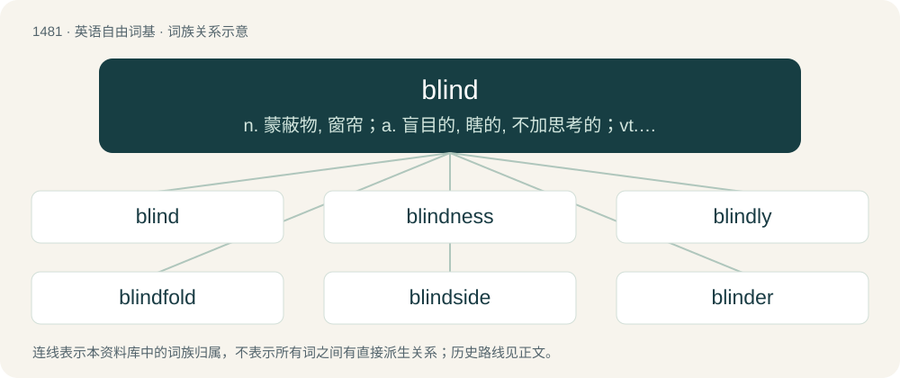

# 1572 · blind — n. 蒙蔽物, 窗帘；a. 盲目的, 瞎的, 不加思考的；vt. 使失明, 蒙蔽, 遮暗

[总目录](../00_总目录_按常用程度.md)

**类型**：英语自由词基　｜　**来源语言**：见词源记录

## 核心含义与来源

- 核心含义：n. 蒙蔽物, 窗帘；a. 盲目的, 瞎的, 不加思考的；vt. 使失明, 蒙蔽, 遮暗
- 英文含义：Unable to see, or only partially able to see.
- 词形：blind

**来源记录 1**（形容词；Unable to see, or only partially able to see.）

From Middle English blynd, from Old English blind, from Proto-West Germanic \*blind, from Proto-Germanic \*blindaz. Cognate with Danish, Dutch, German, Norwegian Bokmål, Norwegian Nynorsk, and Swedish blind, Faroese and Icelandic blindur.

## 词族图

## 单词速览（常用到不常用）

| 单词 | 音标 | 释义 |
|---|---|---|
| [blind](#w-1) | /ˈblaɪ̯nd/ | n. 蒙蔽物, 窗帘；a. 盲目的, 瞎的, 不加思考的；vt. 使失明, 蒙蔽, 遮暗 |
| [blindness](#w-2) | /ˈblaɪndnəs/ | n. 盲目, 失明, 愚昧；\[医\] 盲, 视觉缺失 |
| [blindly](#w-3) | /ˈblaɪndli/ | adv. 轻率地, 盲目地 |
| [blindfold](#w-4) | 英 /ˈblaɪndfəʊld/；美 /ˈblaɪ̯ndfɔʊ̯ld/ | n. 眼罩, 障眼物；vt. 遮眼, 蒙骗；a. 看不清的, 盲目的 |
| [blindside](#w-5) | /ˈblaɪndˌsaɪd/ | vt. 攻其不备, 出其不意地袭击; 使遭受意外打击 |
| [blinder](#w-6) | 英 /ˈblaɪndə/；美 /ˈblaɪndɚ/ | n. 眼罩 |

## 逐词详解

### 1. blind

**词性**：形容词　｜　**音标**：/ˈblaɪ̯nd/

**中文释义**：n. 蒙蔽物, 窗帘；a. 盲目的, 瞎的, 不加思考的；vt. 使失明, 蒙蔽, 遮暗

**英文义项**：Unable to see, or only partially able to see. / Failing to recognize, acknowledge or perceive.

**词源与演化**：

From Middle English blynd, from Old English blind, from Proto-West Germanic \*blind, from Proto-Germanic \*blindaz. Cognate with Danish, Dutch, German, Norwegian Bokmål, Norwegian Nynorsk, and Swedish blind, Faroese and Icelandic blindur.

**例句**：

> I went into the meeting totally blind, so I really didn’t have a clue what I was talking about.

该用例对应义项：Without any prior knowledge.

### 2. blindness

**词性**：名词　｜　**音标**：/ˈblaɪndnəs/

**中文释义**：n. 盲目, 失明, 愚昧；\[医\] 盲, 视觉缺失

**英文义项**：The condition of being blind; unable to see. / Want of intellectual or moral discernment; mental darkness; ignorance, heedlessness.

**构词拆分**：blind + -ness

**词源与演化**：

From Middle English blyndnes, blyndnesse, from Old English blindnes (“blindness”), equivalent to blind + -ness.

**例句**：

> He made up his mind to jog in spite of his blindness.

### 3. blindly

**词性**：副词　｜　**音标**：/ˈblaɪndli/

**中文释义**：adv. 轻率地, 盲目地

**英文义项**：In a blind manner; without sight. / Without consideration or question.

**构词拆分**：blind + -ly

**词源与演化**：

From Middle English blindly, blyndly, from Old English blindlīċe (“in a blind manner; blindly; rashly”), equivalent to blind + -ly. Cognate with Swedish blindligt (“blindly”), Icelandic blindlega (“blindly”). Compare also West Frisian blindich (“blindly”), Dutch blindelings (“blindly”), German blindlings (“blindly”).

**例句**：

> I stumbled blindly through the forest, branches whipping at my face.

该用例对应义项：In a blind manner; without sight.

### 4. blindfold

**词性**：名词　｜　**音标**：英 /ˈblaɪndfəʊld/；美 /ˈblaɪ̯ndfɔʊ̯ld/

**中文释义**：n. 眼罩, 障眼物；vt. 遮眼, 蒙骗；a. 看不清的, 盲目的

**英文义项**：A covering, usually a bandage, for the eyes, blocking light to the eyes. / Anything that obscures the vision.

**构词拆分**：blind + felled

**词源与演化**：

From Middle English blyndefolde, blyndfuld, blynfold, blindfeld, blindfelt, yblynfeld, variants of y-blyndfalled, blyndfelled, etc. ("stricken blind, blindfolded"), past participle of Middle English blindfellen (“to strike blind”), from blind (“to blind”) and fellen (“to fell”), equivalent to blind + felled. Later influenced by the unrelated verb fold.

**例句**：

> I put a blindfold over my boyfriend's eyes and told him I had a surprise for him.

该用例对应义项：A covering, usually a bandage, for the eyes, blocking light to the eyes.

### 5. blindside

**词性**：名词　｜　**音标**：/ˈblaɪndˌsaɪd/

**中文释义**：vt. 攻其不备, 出其不意地袭击; 使遭受意外打击

**英文义项**：A driver's field of blindness around an automobile; the side areas behind the driver. / A tram/train driver's field of blindness around a tram (trolley/streetcar) or a train; the side areas behind the tram/train driver.

**构词拆分**：blind + side

**词源与演化**：

From blind + side.

**例句**：

> The blindside packs down at the scrum on the blindside.

该用例对应义项：The blindside flanker, a position in rugby union, usually number 6.

### 6. blinder

**词性**：名词　｜　**音标**：英 /ˈblaɪndə/；美 /ˈblaɪndɚ/

**中文释义**：n. 眼罩

**英文义项**：A bag or cloth put over the head of a difficult horse while it is being handled or mounted. / A screen attached to a horse's bridle preventing it from being able to see things to its side.

**构词拆分**：From blind + -er.

**词源与演化**：

From blind + -er.

**例句**：

> He played a blinder this afternoon on the cricket ground.

该用例对应义项：An exceptional performance.
