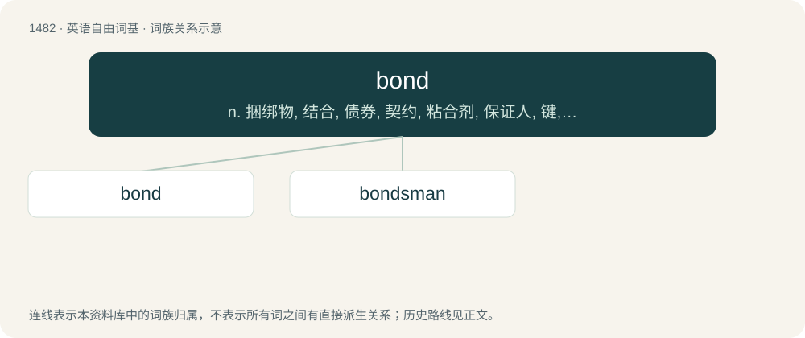

# 1573 · bond — n. 捆绑物, 结合, 债券, 契约, 粘合剂, 保证人, 键, 关栈保留；vt. 存入关栈, 使黏合；vi. 结合

[总目录](../00_总目录_按常用程度.md)

**类型**：英语自由词基　｜　**来源语言**：见词源记录

## 核心含义与来源

- 核心含义：n. 捆绑物, 结合, 债券, 契约, 粘合剂, 保证人, 键, 关栈保留；vt. 存入关栈, 使黏合；vi. 结合
- 英文含义：A document constituting evidence of a long-term debt, by which the bond issuer (the borrower) is obliged to pay interest when due, and repay the principal at maturity, as specified on the face of the bond certificate. The rights of the holder are specified in the bond indenture, which contains the legal terms and conditions under which the bond was issued. Bonds are available in two forms: registered bonds, and bearer bonds.
- 词形：bond

**多个词源／构词路径**：同一拼写可能有不同来源；以下按词性和含义分别列出。

**来源记录 1**（名词；A document constituting evidence of a long-term debt, by which the bond issuer (the borrower) is obliged to pay interest when due, and repay the principal at maturity, as specified on the face of the bond certificate. The rights of the holder are specified in the bond indenture, which contains the legal terms and conditions under which the bond was issued. Bonds are available in two forms: registered bonds, and bearer bonds.）

From Middle English bond, a variant of band, from Old English beand, bænd, bend (“bond, chain, fetter, band, ribbon, ornament, chaplet, crown”), from Proto-Germanic \*bandaz, \*bandiz (“band, fetter”)، from Proto-Indo-European \*bʰendʰ- (“to tie; bond, band”). Cognate with Dutch band, German Band, Swedish band. Doublet of Bund. Related to bind.

**来源记录 2**（动词；To connect, secure or tie with a bond; to bind.）

Inherited from Middle English bonden.

**来源记录 3**（名词；A peasant; churl.）

From Middle English bonde (“peasant, servant, bondman”), from Old English bōnda, būnda (“householder, freeman, plebeian, husband”), perhaps from Old Norse bóndi (“husbandman, householder”, literally “dweller”), or a contraction of Old English būend (“dweller, inhabitant”), both from Proto-Germanic \*būwandz (“dweller”), from Proto-Indo-European \*bʰuH- (“to become, grow, appear”). See also bower, boor.

## 词族图

## 单词速览（常用到不常用）

| 单词 | 音标 | 释义 |
|---|---|---|
| [bond](#w-1) | 英 /bɒnd/；美 /bɑnd/ | n. 捆绑物, 结合, 债券, 契约, 粘合剂, 保证人, 键, 关栈保留；vt. 存入关栈, 使黏合；vi. 结合 |
| [bondsman](#w-2) | 英 /ˈbɒndzmən/；美 /ˈbɑndzmən/ | n. 奴隶；\[经\] 保证人 |

## 逐词详解

### 1. bond

**词性**：名词　｜　**音标**：英 /bɒnd/；美 /bɑnd/

**中文释义**：n. 捆绑物, 结合, 债券, 契约, 粘合剂, 保证人, 键, 关栈保留；vt. 存入关栈, 使黏合；vi. 结合

**英文义项**：A document constituting evidence of a long-term debt, by which the bond issuer (the borrower) is obliged to pay interest when due, and repay the principal at maturity, as specified on the face of the bond certificate. The rights of the holder are specified in the bond indenture, which contains the legal terms and conditions under which the bond was issued. Bonds are available in two forms: registered bonds, and bearer bonds. / A documentary obligation to pay a sum or to perform a contract; a debenture.

**词源与演化**：

From Middle English bond, a variant of band, from Old English beand, bænd, bend (“bond, chain, fetter, band, ribbon, ornament, chaplet, crown”), from Proto-Germanic \*bandaz, \*bandiz (“band, fetter”)، from Proto-Indo-European \*bʰendʰ- (“to tie; bond, band”). Cognate with Dutch band, German Band, Swedish band. Doublet of Bund. Related to bind.

**例句**：

> Organic chemistry primarily consists of the study of carbon bonds, in their many variations.

该用例对应义项：A link or force between neighbouring atoms in a molecule.

### 2. bondsman

**词性**：名词　｜　**音标**：英 /ˈbɒndzmən/；美 /ˈbɑndzmən/

**中文释义**：n. 奴隶；\[经\] 保证人

**英文义项**：A male slave. / A male indentured servant.

**构词拆分**：bond + -s- + -man

**词源与演化**：

From bond + -s- + -man.
