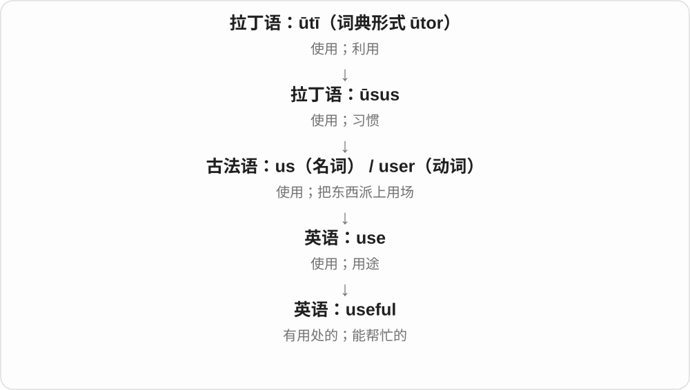
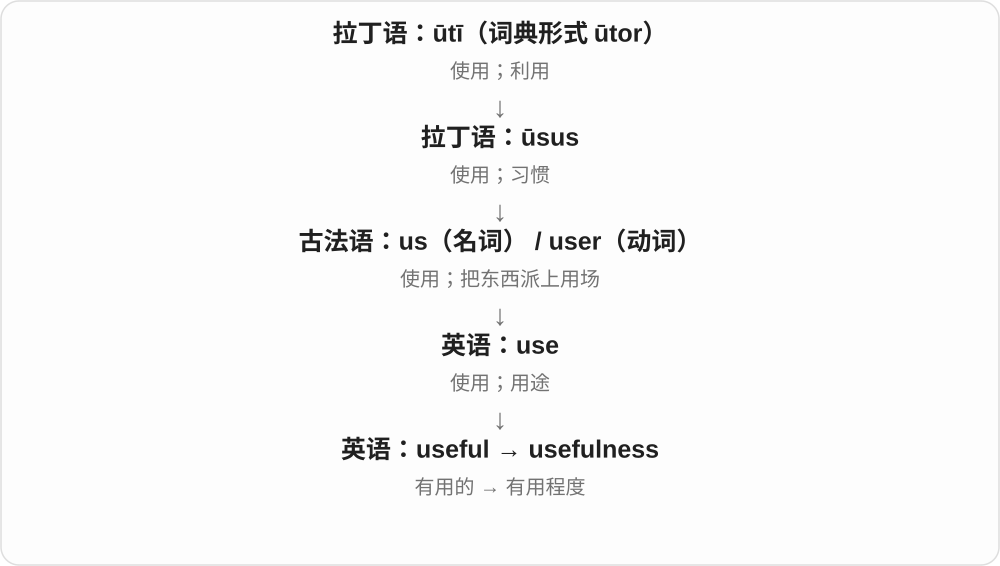

# 1573 · useful — 派上用场与有益的行动

[逐词精讲目录](../00_逐词精讲目录.md) · [总目录](../00_总目录_按常用程度.md)

## 核心词根与来源

不只是放在一边也不坏，而是实际能帮忙。忙着做事和忙得有益要分清。

**USEFUL：能帮你把事情往前推，时间也可以用得有价值**

useful → usefully、usefulness，分别说性质、方式和性质名词。

- **性质、方式与有用性**：useful · usefully · usefulness

## 词形与演化规律

use + -ful → useful；useful + -ly/-ness；usefully 接成 ll。

## 单词速览（按词族由简到繁）

同一基础词的相关扩展放在一起，先读基础形式，再读扩展；各组之间优先读常用的。具体词源关系见各词讲解。

| 单词 | 音标 | 核心意思 |
|---|---|---|
| [useful](#w-1) | /ˈjuːsfəl/ | 有用的；能帮上忙的 |
| [usefulness](#w-2) | /ˈjuːsfəlnəs/ | 用处；有用程度 |
| [usefully](#w-3) | /ˈjuːsfəli/ | 有用地、有效益地；派得上用场地 |

## 逐词讲解

### 1. useful — 有用的；能帮上忙的

**音标**：/ˈjuːsfəl/

**先抓住这个画面**

useful 的重点是“对眼前这件事有帮助”。一张简单的纸条，只要能让你少走弯路，就很 useful。

**怎么拆**

use + -ful。-ful 在这里形成“有这种作用或性质”的形容词，不是说东西被“使用”装满了。

**怎么变成今天的意思**

use 作为名词有“用处”的意思，useful 就是有用处。它评价的是对象与需要之间的关系：对修车有用，不表示对做饭也有用。

**常见搭配与例句**

useful for doing something；useful to someone；a useful tip；come in useful（派上用场）。

> This map is useful for finding the smaller streets.

这张地图对寻找小街巷很有帮助。

> Your notes came in useful when I missed the class.

我缺课时，你的笔记帮了大忙。

**别混淆**

useful 是能帮忙；usable 是还能用。一个 usable 的旧工具能正常操作，却未必对当前任务 useful。

### 2. usefulness — 用处；有用程度

**音标**：/ˈjuːsfəlnəs/

**先抓住这个画面**

usefulness 问的是：它到底帮上了多大忙？注意力从“这个东西”转到“这个东西的用处”。

**怎么拆**

useful + -ness；-ness 把形容词变成表示性质的名词。

**怎么变成今天的意思**

一份报告可能写得很漂亮，但如果不能帮人判断或行动，usefulness 就有限。这个词让我们直接讨论实际帮助。

**常见搭配与例句**

the usefulness of…；question its usefulness；limited usefulness；outlive its usefulness（已不再有用）。

> The usefulness of the guide depends on how often it is updated.

这份指南有没有用，取决于它更新得是否及时。

> The team questioned the usefulness of another long meeting.

团队怀疑再开一次长会能有多大帮助。

**别混淆**

usefulness 不等于使用次数。一个很少用到的急救工具，仍可能在需要时极有用处。

### 3. usefully — 有用地、有效益地；派得上用场地

**音标**：/ˈjuːsfəli/

**先抓住这个画面**

时间、信息没有白白放着，而是真帮上了忙。usefully occupied 就是忙的事情有价值。

**怎么拆**

useful + -ly，useful 末尾一个 l，与后缀相接成为 usefully 的 ll。副词强调行动、安排有用。

**怎么变成今天的意思**

**use + -ful → useful**  
能派上用场的

↓

**useful + -ly → usefully**  
以有用、有帮助的方式

usefully employed 有效利用，usefully occupied 忙于有益事情，usefully compare 作有帮助的比较。

**常见搭配与例句**

usefully employed；usefully occupied；usefully compare。

> The waiting time was usefully spent reviewing notes.

等待时间被有效利用来复习笔记。

> The report usefully compares the two methods.

报告对两种方法作了很有帮助的比较。

**别混淆**

useful 形容词、usefully 副词、usefulness 有用性名词；busy 忙不保证 usefully occupied 忙得有价值。

## 这一组要分清什么

useful 形容物、usefully 修饰做法、usefulness 讨论有用程度；useful 一个 l、usefully 接后缀后两个。

## 串起来练习

The useful notes helped us spend the time usefully.

这些有用的笔记帮助我们把时间用得有价值。
