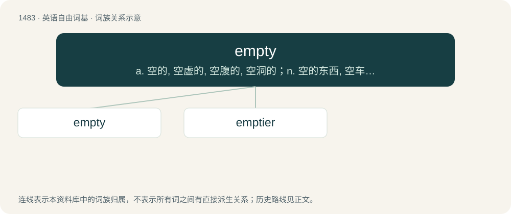

# 1574 · empty — a. 空的, 空虚的, 空腹的, 空洞的；n. 空的东西, 空车；vt. 倒空, 使变空, 使排出

[总目录](../00_总目录_按常用程度.md)

**类型**：英语自由词基　｜　**来源语言**：见词源记录

## 核心含义与来源

- 核心含义：a. 空的, 空虚的, 空腹的, 空洞的；n. 空的东西, 空车；vt. 倒空, 使变空, 使排出
- 英文含义：Devoid of content; containing nothing or nobody; vacant.
- 词形：empty

**来源记录 1**（形容词；Devoid of content; containing nothing or nobody; vacant.）

From Middle English emty, amty, from Old English ǣmtiġ, ǣmettiġ (“vacant, empty, free, idle, unmarried”, literally “without must or obligation, leisurely”), from Proto-Germanic \*uz- (“out”) + Proto-Germanic \*mōtijô, \*mōtô (“must, obligation, need”), \*mōtiþô (“ability, accommodation”), from Proto-Indo-European \*med- (“measure; to acquire, possess, be in command”). Related to Old English ġeǣmtigian (“to empty”), ǣmetta (“leisure”), mōtan (“can, to be allowed”). More at mote, meet. The interconsonantal excrescent p is a euphonic insertion dating from Middle English.

## 词族图

## 单词速览（常用到不常用）

| 单词 | 音标 | 释义 |
|---|---|---|
| [empty](#w-1) | 英 /ˈɛm(p).ti/；/ˈɪm(p).ti/ | a. 空的, 空虚的, 空腹的, 空洞的；n. 空的东西, 空车；vt. 倒空, 使变空, 使排出 |
| [emptier](#w-2) | /ˈemptaiə/ | n. 卸载器；排空装置 |

## 逐词详解

### 1. empty

**词性**：形容词　｜　**音标**：英 /ˈɛm(p).ti/；/ˈɪm(p).ti/

**中文释义**：a. 空的, 空虚的, 空腹的, 空洞的；n. 空的东西, 空车；vt. 倒空, 使变空, 使排出

**英文义项**：Devoid of content; containing nothing or nobody; vacant. / Containing no elements (as of a string, array, or set), opposed to being null (having no valid value).

**词源与演化**：

From Middle English emty, amty, from Old English ǣmtiġ, ǣmettiġ (“vacant, empty, free, idle, unmarried”, literally “without must or obligation, leisurely”), from Proto-Germanic \*uz- (“out”) + Proto-Germanic \*mōtijô, \*mōtô (“must, obligation, need”), \*mōtiþô (“ability, accommodation”), from Proto-Indo-European \*med- (“measure; to acquire, possess, be in command”). Related to Old English ġeǣmtigian (“to empty”), ǣmetta (“leisure”), mōtan (“can, to be allowed”). More at mote, meet. The interconsonantal excrescent p is a euphonic insertion dating from Middle English.

**例句**：

> Empty cow rates have increased in recent years.

该用例对应义项：Not pregnant; not producing offspring when expected to do so during the breeding season.

### 2. emptier

**词性**：名词　｜　**音标**：/ˈemptaiə/

**中文释义**：n. 卸载器；排空装置

**英文义项**：A person who, or device which empties.

**构词拆分**：empty + -er

**词源与演化**：

From empty (verb) + -er.

**例句**：

> Shopping trolleys used to be small, making them appear more full; today they are massive, making them appear emptier.
