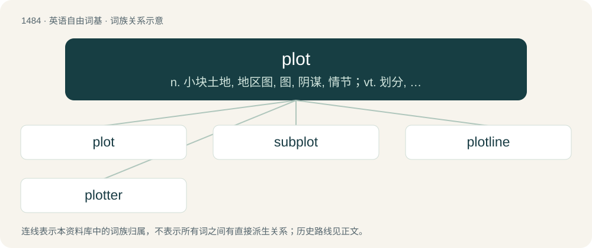

# 1575 · plot — n. 小块土地, 地区图, 图, 阴谋, 情节；vt. 划分, 绘图, 密谋；vi. 密谋, 策划

[总目录](../00_总目录_按常用程度.md)

**类型**：英语自由词基　｜　**来源语言**：见词源记录

## 核心含义与来源

- 核心含义：n. 小块土地, 地区图, 图, 阴谋, 情节；vt. 划分, 绘图, 密谋；vi. 密谋, 策划
- 英文含义：The course of a story, comprising a series of incidents which are gradually unfolded, sometimes by unexpected means.
- 词形：plot

**来源记录 1**（名词；The course of a story, comprising a series of incidents which are gradually unfolded, sometimes by unexpected means.）

From Middle English plot, plotte, from late Old English plot (“a plot of ground”), of uncertain origin. Perhaps from Proto-Germanic \*plataz, \*platjaz (“a patch”); or alternatively, perhaps from a rebracketing of Old English land-splott (“small portion, or plot, of ground”) taken as landes-plot (“plot of land”). Compare Middle Low German plet (“patch, strip of cloth, rags”), German Bletz (“rags, bits, strip of land”), and possibly Gothic 𐍀𐌻𐌰𐍄 (plat, “a patch, rags”). See also plat. See also complot for an influence and reinforcement of noun sense 8. Noun sense 12 is a back-formation from for the plot.

## 词族图

## 单词速览（常用到不常用）

| 单词 | 音标 | 释义 |
|---|---|---|
| [plot](#w-1) | 英 /plɒt/；美 /plɑt/ | n. 小块土地, 地区图, 图, 阴谋, 情节；vt. 划分, 绘图, 密谋；vi. 密谋, 策划 |
| [subplot](#w-2) | 英 /ˈsʌb.plɒt/；美 /ˈsʌb.plɑt/ | n. 陪衬情节, 次要情节 |
| [plotline](#w-3) | /ˈplɔtlain/ | n. (戏剧、小说等的)情节主线,主要情节 |
| [plotter](#w-4) | /ˈplɒtə/ | n. 密谋者, 策划者, 绘图员, 绘图仪；\[计\] 绘图仪 |

## 逐词详解

### 1. plot

**词性**：名词　｜　**音标**：英 /plɒt/；美 /plɑt/

**中文释义**：n. 小块土地, 地区图, 图, 阴谋, 情节；vt. 划分, 绘图, 密谋；vi. 密谋, 策划

**英文义项**：The course of a story, comprising a series of incidents which are gradually unfolded, sometimes by unexpected means. / An area or land used for building on or planting on.

**词源与演化**：

From Middle English plot, plotte, from late Old English plot (“a plot of ground”), of uncertain origin. Perhaps from Proto-Germanic \*plataz, \*platjaz (“a patch”); or alternatively, perhaps from a rebracketing of Old English land-splott (“small portion, or plot, of ground”) taken as landes-plot (“plot of land”). Compare Middle Low German plet (“patch, strip of cloth, rags”), German Bletz (“rags, bits, strip of land”), and possibly Gothic 𐍀𐌻𐌰𐍄 (plat, “a patch, rags”). See also plat. See also complot for an influence and reinforcement of noun sense 8. Noun sense 12 is a back-formation from for the plot.

**例句**：

> The plot would have enabled them to get a majority on the board.

该用例对应义项：A secret plan to achieve an end, the end or means usually being illegal or otherwise questionable.

### 2. subplot

**词性**：名词　｜　**音标**：英 /ˈsʌb.plɒt/；美 /ˈsʌb.plɑt/

**中文释义**：n. 陪衬情节, 次要情节

**英文义项**：A plot within a story, subsidiary to the main plot. / A subdivision of a plot of land, especially one used for an agricultural experiment.

**构词拆分**：sub- + plot

**词源与演化**：

From sub- + plot.

**例句**：

> Chapter five focused on the romantic subplot of the novel.

### 3. plotline

**词性**：名词　｜　**音标**：/ˈplɔtlain/

**中文释义**：n. (戏剧、小说等的)情节主线,主要情节

**英文义项**：The basic plot of a story or group of stories. / A group of stories sharing a plot.

**构词拆分**：plot + line

**词源与演化**：

From plot + line.

**例句**：

> Once the plotline of a movie franchise can't possibly be continued any longer, that's when they start making prequels.

### 4. plotter

**词性**：名词　｜　**音标**：/ˈplɒtə/

**中文释义**：n. 密谋者, 策划者, 绘图员, 绘图仪；\[计\] 绘图仪

**英文义项**：A person who plots. / An output device that draws graphs and other pictorial images on paper, sometimes using attached pens.

**构词拆分**：plot + -er

**词源与演化**：

From plot + -er.

**例句**：

> This plotter draws much faster than the old one did.
