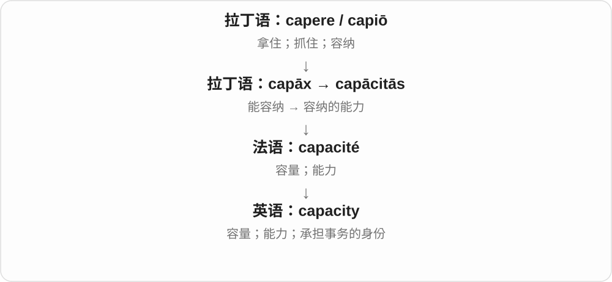

# 1576 · capacity — 容纳、能力、产能与电学储电能力

[逐词精讲目录](../00_逐词精讲目录.md) · [总目录](../00_总目录_按常用程度.md)

## 核心词根与来源

capacity 的能力义和体积义不同。电容器是物件，电容量是量；产能过剩也不等于机器超负荷。

**CAPACITY：能装、能做多少，再分器件、物理量与是否过剩**

capacity 为基础，incapacity、overcapacity 分缺少能力与多余产能；capacitor、capacitance、capacitive 集中讲电学分支。

- **一般能力和数量**：capacity · incapacity · overcapacity
- **电学器件、量与性质**：capacitor · capacitance · capacitive

## 词形与演化规律

capax、capācitās 经法语 → capacity；in-/over- + capacity；capacit- + -or/-ance/-ive。

## 单词速览（按词族由简到繁）

同一基础词的相关扩展放在一起，先读基础形式，再读扩展；各组之间优先读常用的。具体词源关系见各词讲解。

| 单词 | 音标 | 核心意思 |
|---|---|---|
| [capacity](#w-1) | /kəˈpæsəti/ | 容量；处理能力；身份 |
| [capacitor](#w-2) | 英 /kəˈpæsɪtə/；美 /kəˈpæsɪtər/ | 电容器 |
| [capacitance](#w-3) | /kəˈpæsɪtəns/ | 电容、电容量〔物理量〕 |
| [capacitive](#w-5) | /kəˈpæsɪtɪv/ | 电容性的、与电容作用有关的 |
| [incapacity](#w-4) | /ˌɪnkəˈpæsɪti/ | 无能力、缺乏能力；不能履行职责的状态 |
| [overcapacity](#w-6) | 英 /ˌəʊvəkəˈpæsɪti/；美 /ˌoʊvərkəˈpæsɪti/ | 产能过剩、容量过剩 |

## 逐词讲解

### 1. capacity — 容量；处理能力；身份

**音标**：/kəˈpæsəti/

**先抓住这个画面**

先想一个容器最多装多少，再想一个人或系统最多能承担多少。capacity 常在说这种“能装、能处理的量”。

**怎么拆**

来自拉丁语 capāx“能容纳的”及名词 capācitās，经法语进入英语。cap- 仍与 capere 有关。

**怎么变成今天的意思**

杯子的容积、工厂的产能、人的学习能力，都能从“装得下或应付得了多少”理解。in my capacity as manager 则指“以经理这个身份”，是另一个固定用法。

**常见搭配与例句**

at full capacity（满负荷）；a capacity for…；in one’s capacity as…。

> The theater has a capacity of five hundred people.

这家剧院可容纳五百人。

> I am writing in my capacity as team leader.

我以团队负责人的身份写这封信。

**别混淆**

capacity 与 capability 都谈能力，但 capacity 更常涉及数量、潜力或承受上限。capacity 不能一律译成容积。

### 2. capacitor — 电容器

**音标**：英 /kəˈpæsɪtə/；美 /kəˈpæsɪtər/

**先抓住这个画面**

电路里能把正负电荷分开储存、在电场中存能量的器件。可以借能暂存的“小容器”联想，但它不是一只装满电流的水桶。

**怎么拆**

从 capacity 容量词族的 capacit- + -or 构成器件名，名字强调储电能力。与 capacitance 同族，不表示 capacitor 是一个会装东西的人。

**怎么变成今天的意思**

**拉丁 capax〔词干 capac-〕、capācitās → 法语 capacité → capacity**  
能容纳 → 容量、能力

↓

**现代 capacit- 技术词干**  
接器件、性质后缀，命名储电能力和器件

↓

**capacit- + -or → capacitor**  
具有储电能力的器件

a capacitor in a circuit 电路中的电容器，a capacitor’s value 电容器标称电容量，a variable capacitor 可变电容器。

**常见搭配与例句**

a capacitor；a variable capacitor；a capacitor in a circuit。

> The diagram shows a capacitor beside the resistor.

图中电阻旁边画着一个电容器。

> The technician identified the capacitor on the board.

技术人员认出了电路板上的电容器。

**别混淆**

capacitor 是器件，capacitance 是电容量；电池和电容器都可与储能有关，但机制不等同。

### 3. capacitance — 电容、电容量〔物理量〕

**音标**：/kəˈpæsɪtəns/

**先抓住这个画面**

比较在相同电压下能分开储存多少电荷；这项能力的量就是 capacitance，不是器件本身的尺寸名称。

**怎么拆**

由 capacity 相关词干 capacit- + -ance，专化为电学储电能力。-ance 形成性质名词，不说 capacity 原样加 ance。

**怎么变成今天的意思**

**拉丁 capax〔词干 capac-〕、capācitās → 法语 capacité → capacity**  
能容纳 → 容量、能力

↓

**现代 capacit- 技术词干**  
接器件、性质后缀，命名储电能力和器件

↓

**capacit- + -ance → capacitance**  
储电能力对应的电学量

measure capacitance 测电容量，a capacitance value 电容值，capacitance in farads 以法拉计的电容量。

**常见搭配与例句**

measure capacitance；a capacitance value；capacitance in farads。

> The instrument measures capacitance.

这台仪器测量电容量。

> The textbook gives capacitance in farads.

教材用法拉表示电容量。

**别混淆**

capacitance 是量，capacitor 是物件；电容量不等于此刻电荷量，测量与使用条件也要区分。

### 4. capacitive — 电容性的、与电容作用有关的

**音标**：/kəˈpæsɪtɪv/

**先抓住这个画面**

某个元件、系统利用电容效应工作，或表现出这种电学性质；不是笼统说容量特别大。

**怎么拆**

capacity 词族的 capacit- + -ive，形成电容性质相关的形容词。

**怎么变成今天的意思**

**拉丁 capax〔词干 capac-〕、capācitās → 法语 capacité → capacity**  
能容纳 → 容量、能力

↓

**现代 capacit- 技术词干**  
接器件、性质后缀，命名储电能力和器件

↓

**capacit- + -ive → capacitive**  
电容性的、利用电容效应的

a capacitive sensor 电容式传感器，a capacitive touchscreen 电容式触摸屏，capacitive coupling 电容耦合。

**常见搭配与例句**

a capacitive sensor；a capacitive touchscreen；capacitive coupling。

> The device uses a capacitive sensor.

这个装置使用电容式传感器。

> The manual identifies the screen as capacitive.

手册注明屏幕采用电容式技术。

**别混淆**

capacitive 是电学性质，不等于 capable 有能力的；capacitive screen 并不在说屏幕像仓库一样能装很多东西。

### 5. incapacity — 无能力、缺乏能力；不能履行职责的状态

**音标**：/ˌɪnkəˈpæsɪti/

**先抓住这个画面**

本来要求能理解、工作或完成某项任务，这方面能力却缺失或不足。不是只说这只杯子容量小。

**怎么拆**

in- 否定 + capacity 能力；与拉丁、法语的对应否定名词有历史联系，现代直接看没有相应能力。

**怎么变成今天的意思**

**拉丁 capax〔词干 capac-〕、capācitās → 法语 capacité → capacity**  
能容纳 → 容量、能力

↓

**in- + capacity → incapacity**  
缺少相应能力、不能履职的状态

incapacity to act 无力行动，incapacity for work 无法工作的状态，temporary incapacity 暂时丧失能力。法律、医疗语境有具体定义。

**常见搭配与例句**

incapacity to；incapacity for work；temporary incapacity。

> The report described his temporary incapacity for work.

报告描述了他暂时无法工作的状态。

> The novel portrays a leader’s incapacity to make decisions.

小说描绘了一位领导者无力作决定的处境。

**别混淆**

incapacity 较正式，说能力缺失、无法履行；unwillingness 不愿意是态度，不能因为不想做就判为做不到。

### 6. overcapacity — 产能过剩、容量过剩

**音标**：英 /ˌəʊvəkəˈpæsɪti/；美 /ˌoʊvərkəˈpæsɪti/

**先抓住这个画面**

能造、能装的量比实际需要多：厂房和机器都备着，却没有那么多订单把它们用满。

**怎么拆**

over- 过多 + capacity 能力、产能，名词说可供能力超出需求。

**怎么变成今天的意思**

**拉丁 capax〔词干 capac-〕、capācitās → 法语 capacité → capacity**  
能容纳 → 容量、能力

↓

**over- + capacity → overcapacity**  
供应、生产能力相对需求过多

industrial overcapacity 工业产能过剩，excess capacity and overcapacity 过剩能力，overcapacity in the industry 行业产能过剩。

**常见搭配与例句**

industrial overcapacity；overcapacity in；reduce overcapacity。

> The industry faced overcapacity after demand fell.

需求下降后，行业面临产能过剩。

> The report links idle factories to overcapacity.

报告把闲置工厂与产能过剩联系起来。

**别混淆**

overcapacity 常过剩产能，overload 常实际负荷超出能承受的限度；有多余工厂与把一台机器压得太满方向不同。

## 这一组要分清什么

capacitor/量capacitance/形容capacitive；incapacity 非不愿意；overcapacity 过剩产能非 overload 超负荷。

## 串起来练习

The textbook explains a capacitor and its capacitance.

教材解释了电容器及其电容量。
