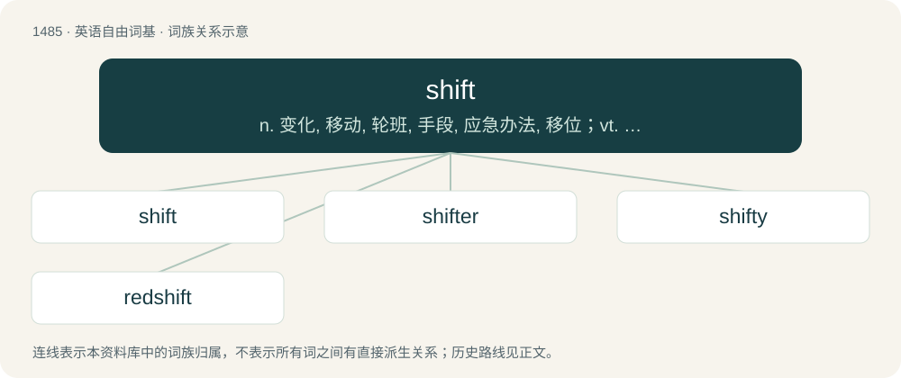

# 1576 · shift — n. 变化, 移动, 轮班, 手段, 应急办法, 移位；vt. 替换, 转移, 改变, 推卸, 变速；vi. 转换, 移动, 转变, 推托, 变速

[总目录](../00_总目录_按常用程度.md)

**类型**：英语自由词基　｜　**来源语言**：见词源记录

## 核心含义与来源

- 核心含义：n. 变化, 移动, 轮班, 手段, 应急办法, 移位；vt. 替换, 转移, 改变, 推卸, 变速；vi. 转换, 移动, 转变, 推托, 变速
- 英文含义：A movement to do something, a beginning.
- 词形：shift

**来源记录 1**（名词；A movement to do something, a beginning.）

The verb is from Middle English schiften, from Old English sċiftan (“to divide, separate into shares; appoint, ordain; arrange, organise”), from Proto-West Germanic \*skiftijan, from Proto-Germanic \*skiftijaną, \*skiptijaną, from earlier \*skipatjaną (“to organise, put in order”), from Proto-Indo-European \*skeyb- (“to separate, divide, part”), from Proto-Indo-European \*skey- (“to cut, divide, separate, part”). Cognate with Scots schift, skift (“to shift”), West Frisian skifte, skiftsje (“to sort”), Dutch schiften (“to sort, screen, winnow, part”), Low German schichten (“to stack, layer”), German schichten (“to stack, layer”), Swedish skifta (“to shift, change, exchange, vary”), Norwegian skifte (“to shift”), Icelandic skipta (“to switch”). See ship. The noun is from Middle English schyft, shyffte. Cognate with Dutch schift (“split, fissure”), German Schicht (“layer, shift”).

## 词族图

## 单词速览（常用到不常用）

| 单词 | 音标 | 释义 |
|---|---|---|
| [shift](#w-1) | /ˈʃɪft/ | n. 变化, 移动, 轮班, 手段, 应急办法, 移位；vt. 替换, 转移, 改变, 推卸, 变速；vi. 转换, 移动, 转变, 推托, 变速 |
| [shifter](#w-2) | /ˈʃiftə/ | n. 搬移东西者, 回避论点者, 领班, 辅助工, 移动装置, 开关；\[计\] 移头器; 移位器; 移带器 |
| [shifty](#w-3) | /ˈʃɪfti/ | a. 变化的；\[法\] 善于应变的, 多策略的, 诡诈的 |
| [redshift](#w-4) | /ˈɹɛdˌʃɪft/ | n. （天体）红移, 红向移动 |

## 逐词详解

### 1. shift

**词性**：名词　｜　**音标**：/ˈʃɪft/

**中文释义**：n. 变化, 移动, 轮班, 手段, 应急办法, 移位；vt. 替换, 转移, 改变, 推卸, 变速；vi. 转换, 移动, 转变, 推托, 变速

**英文义项**：A movement to do something, a beginning. / An act of shifting; a slight movement or change.

**词源与演化**：

The verb is from Middle English schiften, from Old English sċiftan (“to divide, separate into shares; appoint, ordain; arrange, organise”), from Proto-West Germanic \*skiftijan, from Proto-Germanic \*skiftijaną, \*skiptijaną, from earlier \*skipatjaną (“to organise, put in order”), from Proto-Indo-European \*skeyb- (“to separate, divide, part”), from Proto-Indo-European \*skey- (“to cut, divide, separate, part”). Cognate with Scots schift, skift (“to shift”), West Frisian skifte, skiftsje (“to sort”), Dutch schiften (“to sort, screen, winnow, part”), Low German schichten (“to stack, layer”), German schichten (“to stack, layer”), Swedish skifta (“to shift, change, exchange, vary”), Norwegian skifte (“to shift”), Icelandic skipta (“to switch”). See ship. The noun is from Middle English schyft, shyffte. Cognate with Dutch schift (“split, fissure”), German Schicht (“layer, shift”).

**例句**：

> We'll work three shifts a day till the job's done.

该用例对应义项：A change of workers, now specifically a set group of workers or period of working time.

### 2. shifter

**词性**：名词　｜　**音标**：/ˈʃiftə/

**中文释义**：n. 搬移东西者, 回避论点者, 领班, 辅助工, 移动装置, 开关；\[计\] 移头器; 移位器; 移带器

**英文义项**：One who, or that which, shifts or changes. / A word whose meaning changes depending on the situation, as by deixis.

**构词拆分**：From shift + -er.

**词源与演化**：

From shift + -er.

### 3. shifty

**词性**：形容词　｜　**音标**：/ˈʃɪfti/

**中文释义**：a. 变化的；\[法\] 善于应变的, 多策略的, 诡诈的

**英文义项**：Subject to frequent changes in direction. / Moving from one object to another; not looking directly and steadily at the person with whom one is speaking.

**构词拆分**：shift + -y

**词源与演化**：

From shift + -y. Cognate with Dutch schiftig (“loose-fitting, open-textured”).

**例句**：

> He was a shifty character in a seedy bar, and I checked my wallet was still there after talking to him.

该用例对应义项：Having the appearance of being dishonest, criminal, or unreliable.

### 4. redshift

**词性**：名词　｜　**音标**：/ˈɹɛdˌʃɪft/

**中文释义**：n. （天体）红移, 红向移动

**英文义项**：An increase in the wavelength of a photon or of light while in transit, corresponding to a lower frequency and a shift toward the red end of the electromagnetic spectrum.

**构词拆分**：red + shift

**词源与演化**：

From red + shift.
