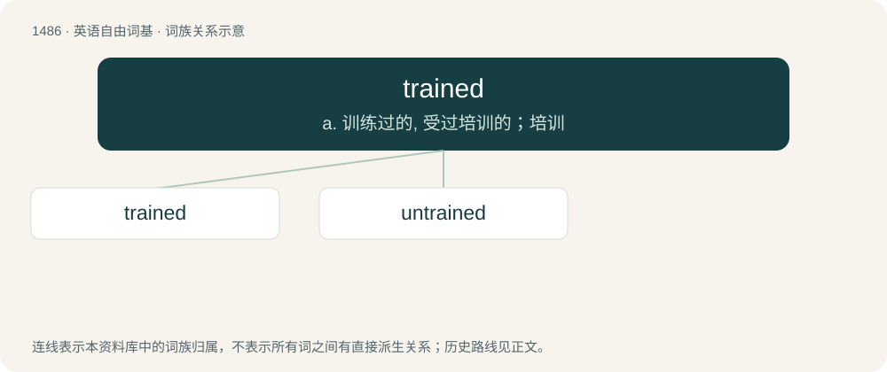

# 1577 · trained — a. 训练过的, 受过培训的；培训

[总目录](../00_总目录_按常用程度.md)

**类型**：英语自由词基　｜　**来源语言**：见词源记录

## 核心含义与来源

- 核心含义：a. 训练过的, 受过培训的；培训
- 英文含义：Having undergone a course of training (sometimes in combination).
- 词形：trained

**来源记录 1**（形容词；Having undergone a course of training (sometimes in combination).）

From train + -ed.

## 词族图

## 单词速览（常用到不常用）

| 单词 | 音标 | 释义 |
|---|---|---|
| [trained](#w-1) | /tɹeɪnd/ | a. 训练过的, 受过培训的；培训 |
| [untrained](#w-2) | /.ʌnˈtreind/ | a. 未经训练的 |

## 逐词详解

### 1. trained

**词性**：形容词　｜　**音标**：/tɹeɪnd/

**中文释义**：a. 训练过的, 受过培训的；培训

**英文义项**：Having undergone a course of training (sometimes in combination). / Manipulated in shape or habit.

**构词拆分**：train + -ed

**词源与演化**：

From train + -ed.

**用法示例／搭配（非完整句）**：

> fully trained troops

该用例对应义项：Having undergone a course of training (sometimes in combination).

### 2. untrained

**词性**：形容词　｜　**音标**：/.ʌnˈtreind/

**中文释义**：a. 未经训练的

**英文义项**：Lacking training, not having been instructed in something.

**构词拆分**：un- + trained

**词源与演化**：

From un- + trained.

**例句**：

> Young minds untrained in the habit of concentration.

该用例对应义项：not disciplined or conditioned or made adept by training
