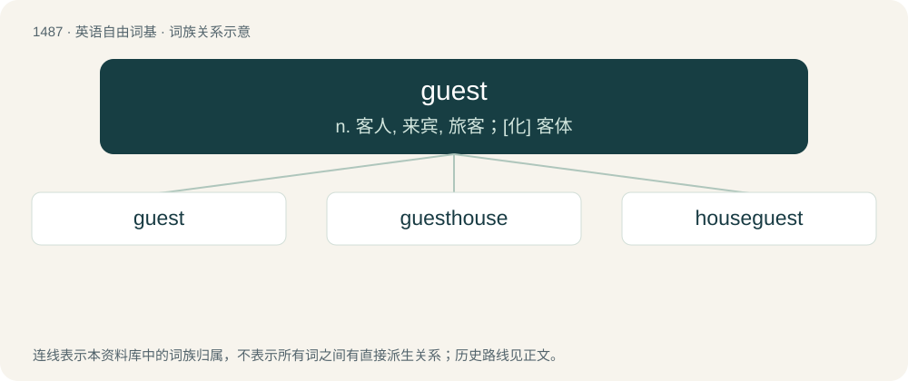

# 1578 · guest — n. 客人, 来宾, 旅客；\[化\] 客体

[总目录](../00_总目录_按常用程度.md)

**类型**：英语自由词基　｜　**来源语言**：见词源记录

## 核心含义与来源

- 核心含义：n. 客人, 来宾, 旅客；\[化\] 客体
- 英文含义：A recipient of hospitality, especially someone staying by invitation at the house of another.
- 词形：guest

**来源记录 1**（名词；A recipient of hospitality, especially someone staying by invitation at the house of another.）

From Middle English gest, from Old Norse gestr, which replaced or was merged with Old English ġiest, both from Proto-Germanic \*gastiz, from Proto-Indo-European \*gʰóstis (“stranger, guest, host, someone with whom one has reciprocal duties of hospitality”). Doublet of host, from Latin. Cognates West-Germanic: :\* Bavarian Gåst (“guest”) :\* Dutch gast (“guest”) :\* German Gast (“guest”) :\* Luxembourgish Gaascht (“guest”) :\* Vilamovian gost (“guest”) :\* Yiddish גאַסט (gast, “guest”) North-Germanic: :\* Danish gæst (“guest, visitor”) :\* Faroese and Icelandic gestur (“guest”) :\* Norwegian Bokmål and Norwegian Nynorsk gjest (“guest”) :\* Swedish gäst (“guest”) East-Germanic: :\* Gothic 𐌲𐌰𐍃𐍄𐍃 (gasts, “guest”)

## 词族图

## 单词速览（常用到不常用）

| 单词 | 音标 | 释义 |
|---|---|---|
| [guest](#w-1) | /ɡɛst/ | n. 客人, 来宾, 旅客；\[化\] 客体 |
| [guesthouse](#w-2) | /ˈɡɛsthaʊs/ | n. 宾馆, 高级寄宿舍, 招待所 |
| [houseguest](#w-3) | 美 /ˈhaʊsˌɡɛst/ | n. 在家过夜或暂住的来客 |

## 逐词详解

### 1. guest

**词性**：名词　｜　**音标**：/ɡɛst/

**中文释义**：n. 客人, 来宾, 旅客；\[化\] 客体

**英文义项**：A recipient of hospitality, especially someone staying by invitation at the house of another. / A patron or customer in a hotel etc.

**词源与演化**：

From Middle English gest, from Old Norse gestr, which replaced or was merged with Old English ġiest, both from Proto-Germanic \*gastiz, from Proto-Indo-European \*gʰóstis (“stranger, guest, host, someone with whom one has reciprocal duties of hospitality”). Doublet of host, from Latin. Cognates West-Germanic: :\* Bavarian Gåst (“guest”) :\* Dutch gast (“guest”) :\* German Gast (“guest”) :\* Luxembourgish Gaascht (“guest”) :\* Vilamovian gost (“guest”) :\* Yiddish גאַסט (gast, “guest”) North-Germanic: :\* Danish gæst (“guest, visitor”) :\* Faroese and Icelandic gestur (“guest”) :\* Norwegian Bokmål and Norwegian Nynorsk gjest (“guest”) :\* Swedish gäst (“guest”) East-Germanic: :\* Gothic 𐌲𐌰𐍃𐍄𐍃 (gasts, “guest”)

**例句**：

> Guests must vacate their rooms by 10 o'clock on their day of departure.

该用例对应义项：A patron or customer in a hotel etc.

### 2. guesthouse

**词性**：名词　｜　**音标**：/ˈɡɛsthaʊs/

**中文释义**：n. 宾馆, 高级寄宿舍, 招待所

**英文义项**：A small house near a main house, for lodging visitors. / A private house offering accommodation to paying guests; a boarding house; a bed and breakfast.

**构词拆分**：guest + house

**词源与演化**：

From Middle English gest hous, gistenehus, gystehuse, gesthus, partly from Old English gæsthūs, ġesthūs (“guesthouse, hostel; guest-chamber”), from Proto-West Germanic \*gastihūs; and partly from Old Norse gesthús (“guesthouse; guest-chamber”); both from Proto-Germanic \*gastihūsą, corresponding to guest + house.

**例句**：

> I too am staying at the guesthouse.

### 3. houseguest

**词性**：名词　｜　**音标**：美 /ˈhaʊsˌɡɛst/

**中文释义**：n. 在家过夜或暂住的来客

**英文义项**：A person who visits and stays at someone else's house, usually for one or more nights.

**构词拆分**：house + guest

**词源与演化**：

From house + guest.

**例句**：

> We had houseguests for weeks after the wedding.

该用例对应义项：A person who visits and stays at someone else's house, usually for one or more nights.
