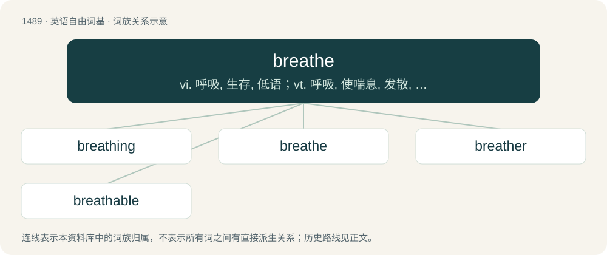

# 1580 · breathe — vi. 呼吸, 生存, 低语；vt. 呼吸, 使喘息, 发散, 低声说

[总目录](../00_总目录_按常用程度.md)

**类型**：英语自由词基　｜　**来源语言**：见词源记录

## 核心含义与来源

- 核心含义：vi. 呼吸, 生存, 低语；vt. 呼吸, 使喘息, 发散, 低声说
- 英文含义：To draw air into (inhale), and expel air from (exhale), the lungs in order to extract oxygen and excrete waste gases.
- 词形：breathe

**来源记录 1**（动词；To draw air into (inhale), and expel air from (exhale), the lungs in order to extract oxygen and excrete waste gases.）

From Middle English brethen (“to breathe, blow, exhale, odour”), derived from Middle English breth (“breath”). Eclipsed Middle English ethien and orðiæn, from Old English ēþian and orþian (“to breathe”); as well as Middle English anden, onden, from Old Norse anda (“to breathe”). More at breath.

## 词族图

## 单词速览（常用到不常用）

| 单词 | 音标 | 释义 |
|---|---|---|
| [breathing](#w-1) | 英 /ˈbɹiːðɪŋ/；美 /ˈbɹiðɪŋ/ | n. 呼吸, 瞬间, 微风；a. 呼吸的, 逼真的 |
| [breathe](#w-2) | 英 /bɹiːð/；美 /bɹið/ | vi. 呼吸, 生存, 低语；vt. 呼吸, 使喘息, 发散, 低声说 |
| [breather](#w-3) | 英 /ˈbɹiː.ðə(ɹ)/ | n. 呼吸者, 使人喘气的事, 剧烈的运动；\[机\] 通气器 |
| [breathable](#w-4) | /ˈbɹiːðəbəl/ | a. 可以吸入的, 适宜于吸入的 |

## 逐词详解

### 1. breathing

**词性**：名词　｜　**音标**：英 /ˈbɹiːðɪŋ/；美 /ˈbɹiðɪŋ/

**中文释义**：n. 呼吸, 瞬间, 微风；a. 呼吸的, 逼真的

**英文义项**：A diacritical mark indicating aspiration or lack thereof. / Any gentle influence or operation; inspiration.

**构词拆分**：breathe + -ing

**词源与演化**：

From breathe + -ing.

**例句**：

> His placid face and regular breathing showed that he was fast asleep.

### 2. breathe

**词性**：动词　｜　**音标**：英 /bɹiːð/；美 /bɹið/

**中文释义**：vi. 呼吸, 生存, 低语；vt. 呼吸, 使喘息, 发散, 低声说

**英文义项**：To draw air into (inhale), and expel air from (exhale), the lungs in order to extract oxygen and excrete waste gases. / To take in needed gases and expel waste gases in a similar way.

**词源与演化**：

From Middle English brethen (“to breathe, blow, exhale, odour”), derived from Middle English breth (“breath”). Eclipsed Middle English ethien and orðiæn, from Old English ēþian and orþian (“to breathe”); as well as Middle English anden, onden, from Old Norse anda (“to breathe”). More at breath.

**例句**：

> Uncork the wine and leave it on the table for a few minutes to allow it to breathe.

该用例对应义项：To exchange gases with the environment.

### 3. breather

**词性**：名词　｜　**音标**：英 /ˈbɹiː.ðə(ɹ)/

**中文释义**：n. 呼吸者, 使人喘气的事, 剧烈的运动；\[机\] 通气器

**英文义项**：Something or someone that breathes. / A heavy breather.

**构词拆分**：breathe + -er (agent noun suffix)

**词源与演化**：

From breathe + -er (agent noun suffix) or + -er (relational noun suffix).

**例句**：

> After a short breather she was ready to continue up the hill.

该用例对应义项：A short break; a rest or respite.

### 4. breathable

**词性**：形容词　｜　**音标**：/ˈbɹiːðəbəl/

**中文释义**：a. 可以吸入的, 适宜于吸入的

**英文义项**：suitable for breathing / Letting air seep through.

**构词拆分**：breathe + -able

**词源与演化**：

From breathe + -able.

**用法示例／搭配（非完整句）**：

> breathable paint

该用例对应义项：Letting air seep through.
