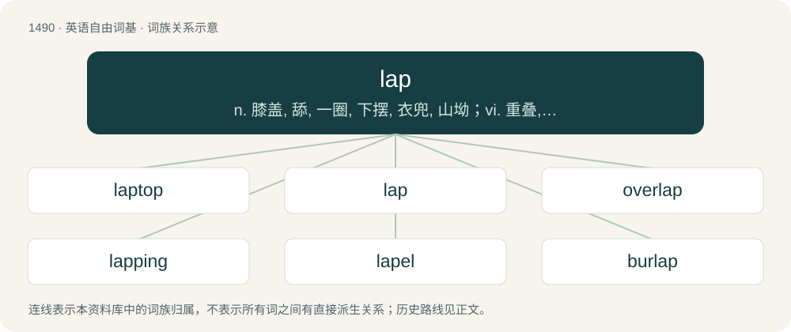

# 1581 · lap — n. 膝盖, 舔, 一圈, 下摆, 衣兜, 山坳；vi. 重叠, 围住, 轻拍, 舔；vt. 包围, 抱...在膝上, 使重叠, 舔, 拍打, 泼溅

[总目录](../00_总目录_按常用程度.md)

**类型**：英语自由词基　｜　**来源语言**：见词源记录

## 核心含义与来源

- 核心含义：n. 膝盖, 舔, 一圈, 下摆, 衣兜, 山坳；vi. 重叠, 围住, 轻拍, 舔；vt. 包围, 抱...在膝上, 使重叠, 舔, 拍打, 泼溅
- 英文含义：The loose part of a coat; the lower part of a garment that plays loosely; a skirt; an apron.
- 词形：lap

**多个词源／构词路径**：同一拼写可能有不同来源；以下按词性和含义分别列出。

**来源记录 1**（名词；The loose part of a coat; the lower part of a garment that plays loosely; a skirt; an apron.）

From Middle English lappe, from Old English læppa (“skirt or flap of a garment”), from Proto-West Germanic \*lappō, from Proto-Germanic \*lappô (“cloth; rag”), of uncertain origin, possibly Proto-Indo-European \*leb- (“to hang loosely”). Cognate with Dutch lap (“cloth; rag”), German Lappen (“cloth; lobe; flap”), Icelandic leppur (“rag; patch”).

**来源记录 2**（动词；To fold; to bend and lay over or on something.）

From Middle English lappen (“to fold, wrap”) from earlier wlappen (“to fold, wrap”), from Old English \*wlappan, \*wlæppan, \*wlappian (“to wrap”), from Proto-Germanic \*wlapp-, \*wrapp- (“to wrap, fold, roll up, turn”), from Proto-Indo-European \*werb- (“to bend, turn”). Cognate with Middle Dutch lappen (“to wrap up, embrace”), dialectal Danish vravle (“to wind”), Old Italian goluppare (“to wrap, fold up”) (from Germanic). Doublet of wrap. Also related to envelop, develop. The sense of "to get a lap ahead (of someone) on a track" is from 1847, on notion of "overlapping." The noun meaning "a turn around a track" (1861) is from this sense.

**来源记录 3**（动词；To take (liquid) into the mouth with the tongue; to lick up with a quick motion of the tongue.）

From Middle English lappen, from Old English lapian, from Proto-West Germanic \*lapōn, from Proto-Germanic \*lapōną, \*lapjaną (“to lick; lap”), from imitative Proto-Indo-European \*leh₂b- (“to lap, lick”); akin to Old High German laffen (“to lick”), Old Norse lepja, Danish labe, Old Saxon lepil, German Löffel (“spoon”). Cognate with Latin lambere (“lick”). French lamper is a loanword from German. Compare Danish leffe, dialect German läffeln.

## 词族图

## 单词速览（常用到不常用）

| 单词 | 音标 | 释义 |
|---|---|---|
| [laptop](#w-1) | 英 /ˈlæp.tɒp/；美 /ˈlæp.tɑp/ | \[计\] 膝上型的 |
| [lap](#w-2) | 英 /læp/ | n. 膝盖, 舔, 一圈, 下摆, 衣兜, 山坳；vi. 重叠, 围住, 轻拍, 舔；vt. 包围, 抱...在膝上, 使重叠, 舔, 拍打, 泼溅 |
| [overlap](#w-3) | /ˌəʊvəˈlæp/ | n. 重叠, 重复, 部分的同时发生；vt. 重叠, 重复, 与...同时发生；vi. 迭盖, 部分的同时发生 |
| [lapping](#w-4) | /ˈlæpɪŋ/ | \[计\] 研磨, 抛光；\[化\] 研磨 |
| [lapel](#w-5) | 英 /ləˈpɛl/ | n. 翻领 |
| [burlap](#w-6) | 英 /ˈbɜːlæp/；美 /ˈbɝlæp/ | n. 粗麻布；\[机\] 粗麻布 |

## 逐词详解

### 1. laptop

**词性**：名词　｜　**音标**：英 /ˈlæp.tɒp/；美 /ˈlæp.tɑp/

**中文释义**：\[计\] 膝上型的

**英文义项**：A laptop computer.

**构词拆分**：lap (“upper legs of a seated person”) + top

**词源与演化**：

From lap (“upper legs of a seated person”) + top, modeled after desktop.

**例句**：

> He was playing a video game on his laptop.

该用例对应义项：A laptop computer.

### 2. lap

**词性**：名词　｜　**音标**：英 /læp/

**中文释义**：n. 膝盖, 舔, 一圈, 下摆, 衣兜, 山坳；vi. 重叠, 围住, 轻拍, 舔；vt. 包围, 抱...在膝上, 使重叠, 舔, 拍打, 泼溅

**英文义项**：The loose part of a coat; the lower part of a garment that plays loosely; a skirt; an apron. / An edge; a border; a hem, as of cloth.

**词源与演化**：

From Middle English lappe, from Old English læppa (“skirt or flap of a garment”), from Proto-West Germanic \*lappō, from Proto-Germanic \*lappô (“cloth; rag”), of uncertain origin, possibly Proto-Indo-European \*leb- (“to hang loosely”). Cognate with Dutch lap (“cloth; rag”), German Lappen (“cloth; lobe; flap”), Icelandic leppur (“rag; patch”).

**例句**：

> The boy was sitting on his mother's lap.

该用例对应义项：The upper legs of a seated person.

### 3. overlap

**词性**：动词　｜　**音标**：/ˌəʊvəˈlæp/

**中文释义**：n. 重叠, 重复, 部分的同时发生；vt. 重叠, 重复, 与...同时发生；vi. 迭盖, 部分的同时发生

**英文义项**：To extend over and partly cover something. / To co-occur, to happen at the same time.

**构词拆分**：over- + lap

**词源与演化**：

From over- + lap. Cognate with Dutch overlap.

**例句**：

> The set (all men) overlaps the set (vegetarians).

该用例对应义项：Of sets: to have some elements in common.

### 4. lapping

**词性**：名词　｜　**音标**：/ˈlæpɪŋ/

**中文释义**：\[计\] 研磨, 抛光；\[化\] 研磨

**英文义项**：A kind of machine blanket or wrapping material used by calico printers. / The process of forming a lap or fleece of fibrous material for the carding-machine.

**构词拆分**：lap + -ing

**词源与演化**：

From Middle English lapping, lappyng, lappinge, equivalent to lap + -ing.

**例句**：

> She sat listening to the water lapping rhythmically against the moored rowing boats.

### 5. lapel

**词性**：名词　｜　**音标**：英 /ləˈpɛl/

**中文释义**：n. 翻领

**英文义项**：Each of the two triangular pieces of cloth on the front of a jacket or coat that are folded back below the throat, leaving a triangular opening between.

**构词拆分**：From lap + -el (“diminutive suffix”).

**词源与演化**：

From lap + -el (“diminutive suffix”).

**例句**：

> She fastened the medal on the lapel with a pin.

### 6. burlap

**词性**：名词　｜　**音标**：英 /ˈbɜːlæp/；美 /ˈbɝlæp/

**中文释义**：n. 粗麻布；\[机\] 粗麻布

**英文义项**：A very strong, coarse cloth, made from jute, flax, or hemp, and used to make sacks, etc.

**构词拆分**：burel (“a coarse woollen cloth”) + lap (“flap of a garment”)

**词源与演化**：

Uncertain. Attested since about 1695 in the spelling bore-lap, borelapp. Likely from burel (“a coarse woollen cloth”) + lap (“flap of a garment”), where the first element is from Middle English burel, borel. Others feel that "its character and time of appearance makes a Dutch origin very likely" (and the earliest references as to its importation from the Netherlands); the NED suggests derivation from Dutch boenlap (“coarse, rubbing linen or cloth”) with the first element perhaps confused with boer (“farmer, peasant”). Bense similarly suggests derivation from an unattested Dutch \*boerenlap, where boeren would be used in the sense of “coarse” as in boerenkost (“coarse, heavy food as is eaten by farmers”) or boerenpraat (“coarse, rural speech”).

**例句**：

> The indie coffee brand sells its roasted beans in small burlap sacks.
