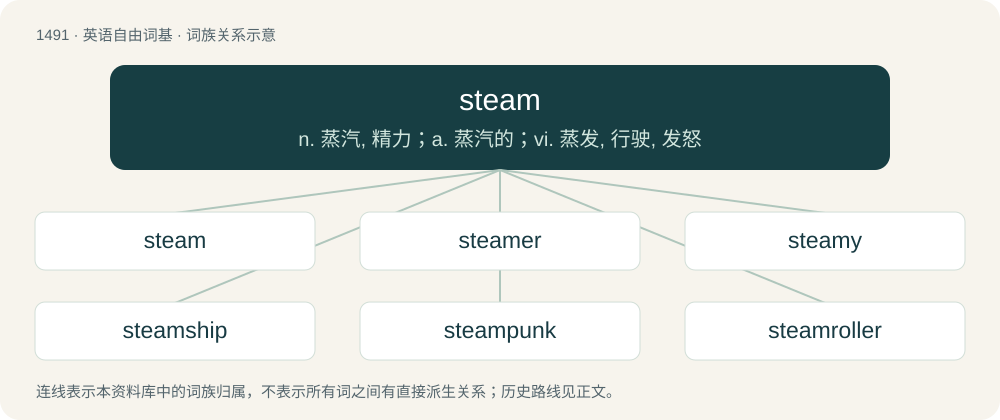

# 1582 · steam — n. 蒸汽, 精力；a. 蒸汽的；vi. 蒸发, 行驶, 发怒

[总目录](../00_总目录_按常用程度.md)

**类型**：英语自由词基　｜　**来源语言**：见词源记录

## 核心含义与来源

- 核心含义：n. 蒸汽, 精力；a. 蒸汽的；vi. 蒸发, 行驶, 发怒
- 英文含义：The hot gaseous form of water, formed when water changes from the liquid phase to the gas phase (at or above its boiling point temperature).
- 词形：steam

**来源记录 1**（名词；The hot gaseous form of water, formed when water changes from the liquid phase to the gas phase (at or above its boiling point temperature).）

From Middle English steem, stem, from Old English stēam (“steam, hot exhalation, hot breath; that which emits vapour; blood”), from Proto-Germanic \*staumaz (“steam, vapour, breath”), from Proto-Indo-European \*dʰewh₂- (“to whirl, waft, stink, shake; steam, haze, smoke”). Cognate with Scots stem, steam (“steam”), West Frisian steam (“steam, vapour”), Dutch stoom (“steam, vapour”), Low German stom (“steam”), Swedish dialectal stimma (“steam, fog”), Latin fūmus (“smoke, steam”).

## 词族图

## 单词速览（常用到不常用）

| 单词 | 音标 | 释义 |
|---|---|---|
| [steam](#w-1) | 英 /stiːm/；美 /stiːm/ | n. 蒸汽, 精力；a. 蒸汽的；vi. 蒸发, 行驶, 发怒 |
| [steamer](#w-2) | 英 /ˈstiːmə/；美 /ˈstimɚ/ | n. 汽船, 蒸汽机；\[化\] 蒸汽发生器; 蒸汽机 |
| [steamy](#w-3) | /ˈstiː.mi/ | a. 蒸汽的, 充满蒸汽的 |
| [steamship](#w-4) | 美 /ˈstimˌʃɪp/ | n. 汽船, 轮船 |
| [steampunk](#w-5) | 英 /ˈstiːm.pʌŋk/ | 【英文】A subgenre of science fiction that depicts advanced technology combined with Victorian style and aesthetics, such as steam-powered machines and vehicles, visible gears and screws and people dressed in 19th-century at |
| [steamroller](#w-6) | 美 /ˈstimˌroʊlɚ/ | vt.vi. 压垮, 压服；n. 蒸汽压路机, 高压力量, 高压手段 |

## 逐词详解

### 1. steam

**词性**：名词　｜　**音标**：英 /stiːm/；美 /stiːm/

**中文释义**：n. 蒸汽, 精力；a. 蒸汽的；vi. 蒸发, 行驶, 发怒

**英文义项**：The hot gaseous form of water, formed when water changes from the liquid phase to the gas phase (at or above its boiling point temperature). / Mist, fog.

**词源与演化**：

From Middle English steem, stem, from Old English stēam (“steam, hot exhalation, hot breath; that which emits vapour; blood”), from Proto-Germanic \*staumaz (“steam, vapour, breath”), from Proto-Indo-European \*dʰewh₂- (“to whirl, waft, stink, shake; steam, haze, smoke”). Cognate with Scots stem, steam (“steam”), West Frisian steam (“steam, vapour”), Dutch stoom (“steam, vapour”), Low German stom (“steam”), Swedish dialectal stimma (“steam, fog”), Latin fūmus (“smoke, steam”).

**例句**：

> After three weeks in bed he was finally able to sit up under his own steam.

该用例对应义项：Internal energy for progress or motive power.

### 2. steamer

**词性**：名词　｜　**音标**：英 /ˈstiːmə/；美 /ˈstimɚ/

**中文释义**：n. 汽船, 蒸汽机；\[化\] 蒸汽发生器; 蒸汽机

**英文义项**：A vessel in which articles are subjected to the action of steam, as in washing and in various processes of manufacture. / A cooking appliance that cooks by steaming.

**构词拆分**：steam + -er

**词源与演化**：

From steam + -er. The steamer duck or steamer (sense 6.2) is apparently named for its resemblance to a paddle steamer when swimming rapidly. The feces sense comically evokes the idea of steaming hot food and probably reflects that fresh feces sometimes give off visible water vapor in cold outdoor conditions such as those encountered by hunters, campers, and soldiers.

**例句**：

> As luck would have it, a steamer passed by and they were saved.

### 3. steamy

**词性**：形容词　｜　**音标**：/ˈstiː.mi/

**中文释义**：a. 蒸汽的, 充满蒸汽的

**英文义项**：Warm and humid; full of steam. / Resembling or characteristic of steam.

**构词拆分**：From steam + -y.

**词源与演化**：

From steam + -y.

**例句**：

> Her latest novel was very steamy, but still managed to top the charts.

该用例对应义项：Erotic.

### 4. steamship

**词性**：名词　｜　**音标**：美 /ˈstimˌʃɪp/

**中文释义**：n. 汽船, 轮船

**英文义项**：A ship or vessel propelled by steam power.

**构词拆分**：steam + ship

**词源与演化**：

From steam + ship.

**例句**：

> A steamship is, without a doubt, a city in itself.

### 5. steampunk

**词性**：名词　｜　**音标**：英 /ˈstiːm.pʌŋk/

**英文义项**：A subgenre of science fiction that depicts advanced technology combined with Victorian style and aesthetics, such as steam-powered machines and vehicles, visible gears and screws and people dressed in 19th-century attires. / A writer of steampunk fiction.

**构词拆分**：steam + -punk

**词源与演化**：

From steam + -punk, by analogy with cyberpunk, coined by science-fiction writer Kevin Wayne Jeter (born 1950) in a 1987 letter to the magazine Locus in response to a review of his book Infernal Devices published the same year (see the quotation below).

**例句**：

> One can consider Esperanto as a Steampunk language, whilst Interlingua as a Dieselpunk language.

### 6. steamroller

**词性**：名词　｜　**音标**：美 /ˈstimˌroʊlɚ/

**中文释义**：vt.vi. 压垮, 压服；n. 蒸汽压路机, 高压力量, 高压手段

**英文义项**：Any heavy road roller. / Any seemingly irresistible force.

**构词拆分**：steam + roller

**词源与演化**：

From steam + roller.

**例句**：

> Horses used to pull road-rollers, but the steamroller arrived with the invention of the steam engine.
