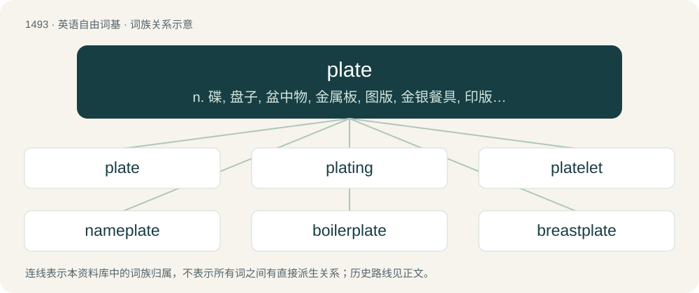

# 1583 · plate — n. 碟, 盘子, 盆中物, 金属板, 图版, 金银餐具, 印版, 金属牌(照)；vt. 镀金, 电镀, 用金属板固定, 给...装钢板, 为...制印版

[总目录](../00_总目录_按常用程度.md)

**类型**：英语自由词基　｜　**来源语言**：见词源记录

## 核心含义与来源

- 核心含义：n. 碟, 盘子, 盆中物, 金属板, 图版, 金银餐具, 印版, 金属牌(照)；vt. 镀金, 电镀, 用金属板固定, 给...装钢板, 为...制印版
- 英文含义：A slightly curved but almost flat dish from which food is served or eaten.
- 词形：plate

**多个词源／构词路径**：同一拼写可能有不同来源；以下按词性和含义分别列出。

**来源记录 1**（名词；A slightly curved but almost flat dish from which food is served or eaten.）

From Middle English plate, from Old French plate, from Medieval Latin plata, from Vulgar Latin \*plat(t)us, from Ancient Greek πλατύς (platús, “broad, flat, wide”). Compare Spanish plato. (foot): Cockney rhyming slang, from "plates of meat" for "feet".

**来源记录 2**（动词；To cover the surface material of an object with a thin coat of another material, usually a metal.）

From Middle English platen, from Old English platian and Old French plater, both ultimately from Latin plata (see above).

**来源记录 3**（名词；Precious metal, especially silver.）

From Middle English, partly from Anglo-Norman plate (“plate, bullion”) and partly from Latin plata (“silver”), from Vulgar Latin \*platta (“metal plate”), from feminine of Latin \*plattus (“flat”).

**来源记录 4**（名词；A roundel of silver or argent.）

From Spanish plata (“silver”).

## 词族图

## 单词速览（常用到不常用）

| 单词 | 音标 | 释义 |
|---|---|---|
| [plate](#w-1) | 英 /ˈpleɪ̯t/ | n. 碟, 盘子, 盆中物, 金属板, 图版, 金银餐具, 印版, 金属牌(照)；vt. 镀金, 电镀, 用金属板固定, 给...装钢板, 为...制印版 |
| [plating](#w-2) | /ˈpleɪtɪŋ/ | n. 电镀, 镀层, 金属外表的镀层, 装甲；\[化\] 喷镀 |
| [platelet](#w-3) | /ˈpleɪt.lət/ | n. 血小板, 小盘, 小板 |
| [nameplate](#w-4) | /ˈneimpleit/ | n. 名牌, 标示牌 |
| [boilerplate](#w-5) | 英 /ˈbɔɪ.ləˌpleɪt/；美 /ˈbɔɪ.ləɹˌpleɪt/ | n. 样板文件 |
| [breastplate](#w-6) | 美 /ˈbɹɛstˌpleɪt/ | n. 护胸甲, 腹甲, 胸革带 |
| [plater](#w-7) | /ˈpleitə/ | n. 电镀工, 镀匠, 金属板工, 铁甲工；\[化\] 镀层装置 |

## 逐词详解

### 1. plate

**词性**：名词　｜　**音标**：英 /ˈpleɪ̯t/

**中文释义**：n. 碟, 盘子, 盆中物, 金属板, 图版, 金银餐具, 印版, 金属牌(照)；vt. 镀金, 电镀, 用金属板固定, 给...装钢板, 为...制印版

**英文义项**：A slightly curved but almost flat dish from which food is served or eaten. / Such dishes collectively.

**词源与演化**：

From Middle English plate, from Old French plate, from Medieval Latin plata, from Vulgar Latin \*plat(t)us, from Ancient Greek πλατύς (platús, “broad, flat, wide”). Compare Spanish plato. (foot): Cockney rhyming slang, from "plates of meat" for "feet".

**例句**：

> If you're not careful, someone will sell you silverware that's really only silver plate.

该用例对应义项：A material covered with such a layer.

### 2. plating

**词性**：名词　｜　**音标**：/ˈpleɪtɪŋ/

**中文释义**：n. 电镀, 镀层, 金属外表的镀层, 装甲；\[化\] 喷镀

**英文义项**：An act of determining where a postage stamp is positioned on a sheet. / A thin coating of metal laid upon another metal.

**构词拆分**：plate + -ing

**词源与演化**：

From Middle English \*platynge, from Old English platung (“plate, thin piece of metal”), equivalent to plate + -ing.

**例句**：

> The police vehicle's armor plating saved the lives of its occupants.

### 3. platelet

**词性**：名词　｜　**音标**：/ˈpleɪt.lət/

**中文释义**：n. 血小板, 小盘, 小板

**英文义项**：A small colorless disk-shaped particle found in the blood of mammals, which plays an important role in the formation of blood clots.

**构词拆分**：plate + -let

**词源与演化**：

From plate + -let.

### 4. nameplate

**词性**：名词　｜　**音标**：/ˈneimpleit/

**中文释义**：n. 名牌, 标示牌

**英文义项**：A plate or plaque inscribed with a name. / The masthead of a newspaper.

**构词拆分**：name + plate

**词源与演化**：

From name + plate.

**用法示例／搭配（非完整句）**：

> the brass nameplate on the doctor's front door

该用例对应义项：A plate or plaque inscribed with a name.

### 5. boilerplate

**词性**：名词　｜　**音标**：英 /ˈbɔɪ.ləˌpleɪt/；美 /ˈbɔɪ.ləɹˌpleɪt/

**中文释义**：n. 样板文件

**英文义项**：A sheet of copper or steel used in the construction of a boiler. / Any metal taking the form of sheets used in the construction of a boiler.

**构词拆分**：boiler + plate

**词源与演化**：

From boiler + plate.

**例句**：

> They put that boilerplate on all the warning labels.

该用例对应义项：Standard text of a legal or official nature added to documents or labels.

### 6. breastplate

**词性**：名词　｜　**音标**：美 /ˈbɹɛstˌpleɪt/

**中文释义**：n. 护胸甲, 腹甲, 胸革带

**英文义项**：A piece of armor that covers the chest. / A piece of armor that covers the torso; a cuirass, the breast- (front) and back-plate, taken together as a unit.

**构词拆分**：breast + plate

**词源与演化**：

From Middle English brestplate, equivalent to breast + plate. Displaced Old English brēostbeorg.

### 7. plater

**词性**：名词　｜　**音标**：/ˈpleitə/

**中文释义**：n. 电镀工, 镀匠, 金属板工, 铁甲工；\[化\] 镀层装置

**英文义项**：Someone who plates metal. / Someone who installs sheet metal and armour plating, particularly on trains, ships, tanks, and similar items.

**构词拆分**：plate + -er

**词源与演化**：

From plate + -er.
