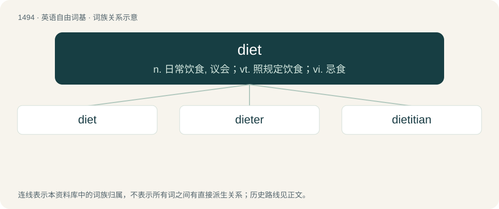

# 1584 · diet — n. 日常饮食, 议会；vt. 照规定饮食；vi. 忌食

[总目录](../00_总目录_按常用程度.md)

**类型**：英语自由词基　｜　**来源语言**：见词源记录

## 核心含义与来源

- 核心含义：n. 日常饮食, 议会；vt. 照规定饮食；vi. 忌食
- 英文含义：The food and beverage a person or animal consumes.
- 词形：diet

**多个词源／构词路径**：同一拼写可能有不同来源；以下按词性和含义分别列出。

**来源记录 1**（名词；The food and beverage a person or animal consumes.）

From Middle English diet, dyet, diete, from Old French diete, from Medieval Latin dieta (“regimen, regulation; assembly”), from Latin diaeta, from Ancient Greek δίαιτα (díaita).

**来源记录 2**（动词；To modify one's food and beverage intake so as to decrease or increase body weight or influence health.）

From Middle English dieten, dyeten, diȝeten, from Old French dïeter and Medieval Latin diētāre.

**来源记录 3**（名词；A council or assembly of leaders; a formal deliberative assembly.）

From Middle English diet, dyet, from Old French diete, from Medieval Latin diēta, diaeta (“a public assembly; set day of trial; a day's journey”), from Ancient Greek δῐ́αιτα (dĭ́aita, “way of living, living space; decision, judgement”), influenced by Latin diēs (“day”).

## 词族图

## 单词速览（常用到不常用）

| 单词 | 音标 | 释义 |
|---|---|---|
| [diet](#w-1) | /ˈdaɪət/ | n. 日常饮食, 议会；vt. 照规定饮食；vi. 忌食 |
| [dieter](#w-2) | /ˈdaiətə/ | n. 节食者 |
| [dietitian](#w-3) | /daɪəˈtɪʃən/ | n. 饮食学家, 营养学家；\[医\] 饮食学家 |

## 逐词详解

### 1. diet

**词性**：名词　｜　**音标**：/ˈdaɪət/

**中文释义**：n. 日常饮食, 议会；vt. 照规定饮食；vi. 忌食

**英文义项**：The food and beverage a person or animal consumes. / A controlled regimen of food and drink choices, as to gain or lose weight or otherwise influence health.

**词源与演化**：

From Middle English diet, dyet, diete, from Old French diete, from Medieval Latin dieta (“regimen, regulation; assembly”), from Latin diaeta, from Ancient Greek δίαιτα (díaita).

**例句**：

> He's been on a diet since he found out that he has coronary atherosclerosis.

该用例对应义项：A controlled regimen of food and drink choices, as to gain or lose weight or otherwise influence health.

### 2. dieter

**词性**：名词　｜　**音标**：/ˈdaiətə/

**中文释义**：n. 节食者

**英文义项**：A person who diets, usually in an effort to lose weight.

**构词拆分**：diet + -er

**词源与演化**：

From diet + -er.

**例句**：

> Heike was pleasantly surprised when Dieter responded favorably to her advances.

### 3. dietitian

**词性**：名词　｜　**音标**：/daɪəˈtɪʃən/

**中文释义**：n. 饮食学家, 营养学家；\[医\] 饮食学家

**英文义项**：A person who studies or practices dietetics.

**构词拆分**：diet + -ician

**词源与演化**：

Irregular spelling of diet + -ician, probably influenced by dietetic.

**例句**：

> The dietitian told me that I eat too much starch.
