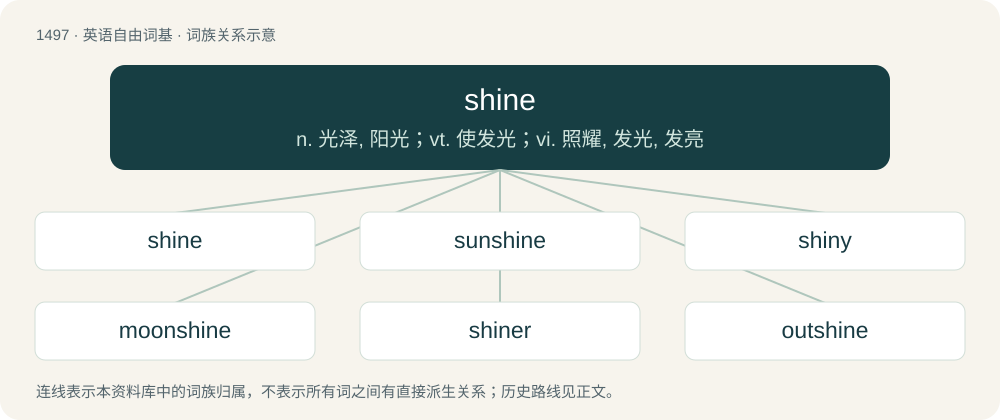

# 1586 · shine — n. 光泽, 阳光；vt. 使发光；vi. 照耀, 发光, 发亮

[总目录](../00_总目录_按常用程度.md)

**类型**：英语自由词基　｜　**来源语言**：见词源记录

## 核心含义与来源

- 核心含义：n. 光泽, 阳光；vt. 使发光；vi. 照耀, 发光, 发亮
- 英文含义：To emit or reflect light so as to glow.
- 词形：shine

**多个词源／构词路径**：同一拼写可能有不同来源；以下按词性和含义分别列出。

**来源记录 1**（动词；To emit or reflect light so as to glow.）

From Middle English shinen, schinen (preterite schon, past participle schinen), from Old English sċīnan (“to shine, flash; be resplendent”; preterite sċān, past participle sċinen), from Proto-West Germanic \*skīnan (“to shine”), from Proto-Germanic \*skīnaną (“to shine”). Cognate with Dutch schijnen, German scheinen, Danish and Norwegian Bokmål skinne, Norwegian Nynorsk and Swedish skina, Faroese and Icelandic skína.

**来源记录 2**（动词；To cause (something) to be smooth and shiny by rubbing; put a shine on (something); polish (something).）

From the noun shine, or perhaps continuing Middle English schinen in its causative uses, from Old English scīn (“brightness, shine”), and also Middle English schenen, from Old English scǣnan (“to render brilliant, make shine”), from Proto-Germanic \*skainijaną, causative of \*skīnaną (“to shine”).

## 词族图

## 单词速览（常用到不常用）

| 单词 | 音标 | 释义 |
|---|---|---|
| [shine](#w-1) | 英 /ʃaɪn/ | n. 光泽, 阳光；vt. 使发光；vi. 照耀, 发光, 发亮 |
| [sunshine](#w-2) | /ˈsʌnʃaɪn/ | n. 阳光, 光明, 晴天 |
| [shiny](#w-3) | /ˈʃaɪ.ni/ | a. 有光泽的, 发光的, 辉煌的, 磨光的, 磨损的 |
| [moonshine](#w-4) | /ˈmuːnʃaɪn/ | n. 月光, 大话, 非法酿制的酒 |
| [shiner](#w-5) | /ˈʃaɪnə(ɹ)/ | n. 出色的人, 发亮物, 发光体, (英)(非正式)钱币, (英)(非正式)金钱 |
| [outshine](#w-6) | /aʊtˈʃaɪn/ | vt. 光亮强过..., 使相形见绌, 使失色；vi. 发光 |
| [shoeshine](#w-7) | 美 /ˈʃuˌʃaɪn/ | n. 擦亮的皮鞋面, 擦皮鞋 |

## 逐词详解

### 1. shine

**词性**：动词　｜　**音标**：英 /ʃaɪn/

**中文释义**：n. 光泽, 阳光；vt. 使发光；vi. 照耀, 发光, 发亮

**英文义项**：To emit or reflect light so as to glow. / To reflect light.

**词源与演化**：

From Middle English shinen, schinen (preterite schon, past participle schinen), from Old English sċīnan (“to shine, flash; be resplendent”; preterite sċān, past participle sċinen), from Proto-West Germanic \*skīnan (“to shine”), from Proto-Germanic \*skīnaną (“to shine”). Cognate with Dutch schijnen, German scheinen, Danish and Norwegian Bokmål skinne, Norwegian Nynorsk and Swedish skina, Faroese and Icelandic skína.

**用法示例／搭配（非完整句）**：

> in hunting, to shine the eyes of a deer at night by throwing a light on them

该用例对应义项：To cause to shine, as a light or by reflected light.

### 2. sunshine

**词性**：名词　｜　**音标**：/ˈsʌnʃaɪn/

**中文释义**：n. 阳光, 光明, 晴天

**英文义项**：The direct rays, light or warmth of the sun. / A location on which the sun's rays fall.

**构词拆分**：sun + shine

**词源与演化**：

In the Coverdale Bible in 1535, in Genesis and Exodus about 1250 as Middle English sunnesine; synchronically sun + shine. Compare isolated Old English sunsċīn (“mirror”).

**例句**：

> OK, sunshine, listen up and listen good. There's five vandalised telephone boxes out there and I know you're responsible.

该用例对应义项：An ironic form of address directed toward someone perceived as inferior or troublesome.

### 3. shiny

**词性**：形容词　｜　**音标**：/ˈʃaɪ.ni/

**中文释义**：a. 有光泽的, 发光的, 辉煌的, 磨光的, 磨损的

**英文义项**：Reflecting light. / Emitting light.

**构词拆分**：shine + -y

**词源与演化**：

From shine + -y (adjectival suffix).

**例句**：

> Saw the moon like a shiny dime on a deep blue velvet carpet.

该用例对应义项：reflecting light

### 4. moonshine

**词性**：名词　｜　**音标**：/ˈmuːnʃaɪn/

**中文释义**：n. 月光, 大话, 非法酿制的酒

**英文义项**：The light of the moon. / The light reflected off Earth's Moon.

**构词拆分**：moon + shine

**词源与演化**：

From Middle English mone schyne, mone-schyne, moone shone; equivalent to moon + shine. Illegally distilled liquor is so named because its manufacture may be conducted without artificial light at night. The verb sense is a back-formation from moonshiner.

**例句**：

> They watered down the moonshine.

该用例对应义项：High-proof alcohol (especially whiskey) that is often, but not always, produced illegally.

### 5. shiner

**词性**：名词　｜　**音标**：/ˈʃaɪnə(ɹ)/

**中文释义**：n. 出色的人, 发亮物, 发光体, (英)(非正式)钱币, (英)(非正式)金钱

**英文义项**：One who shines; a luminary. / One who causes things to shine; a polisher.

**构词拆分**：shine + -er

**词源与演化**：

From Middle English schyner, equivalent to shine + -er. Compare Old English sċīnere (“one who produces deceptive appearances, magician”).

### 6. outshine

**词性**：动词　｜　**音标**：/aʊtˈʃaɪn/

**中文释义**：vt. 光亮强过..., 使相形见绌, 使失色；vi. 发光

**英文义项**：To shine brighter than something else / To exceed something or someone else, especially in an obvious or flamboyant manner

**构词拆分**：out- + shine

**词源与演化**：

From out- + shine.

**例句**：

> Sami hoped to outshine his siblings by doing well at school.

### 7. shoeshine

**词性**：名词　｜　**音标**：美 /ˈʃuˌʃaɪn/

**中文释义**：n. 擦亮的皮鞋面, 擦皮鞋

**英文义项**：The act of polishing shoes. / One who polishes shoes.

**构词拆分**：shoe + shine

**词源与演化**：

From shoe + shine.

**例句**：

> His trousers had a sharp crease and you could see your reflection in his shoeshine.

该用例对应义项：a shiny finish put on shoes with polish and buffing
