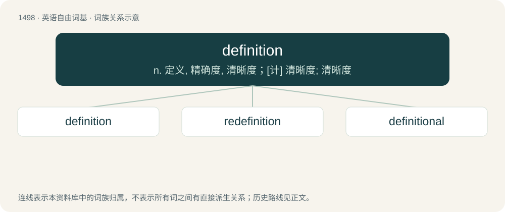

# 1587 · definition — n. 定义, 精确度, 清晰度；\[计\] 清晰度; 清晰度

[总目录](../00_总目录_按常用程度.md)

**类型**：英语自由词基　｜　**来源语言**：见词源记录

## 核心含义与来源

- 核心含义：n. 定义, 精确度, 清晰度；\[计\] 清晰度; 清晰度
- 英文含义：A statement of the meaning of a word, word group, sign, or symbol; especially, a dictionary definition.
- 词形：definition

**来源记录 1**（名词；A statement of the meaning of a word, word group, sign, or symbol; especially, a dictionary definition.）

From Middle English diffinicioun, from Middle French definition, from Latin dēfīnītiō, from dēfīniō. Equivalent to define + -ition.

## 词族图

## 单词速览（常用到不常用）

| 单词 | 音标 | 释义 |
|---|---|---|
| [definition](#w-1) | /ˌdɛf.ɪˈnɪʃ.ən/ | n. 定义, 精确度, 清晰度；\[计\] 清晰度; 清晰度 |
| [redefinition](#w-2) | /.riːdefiˈniʃən/ | n. 重新定义 |
| [definitional](#w-3) |  | \[计\] 定义的 |

## 逐词详解

### 1. definition

**词性**：名词　｜　**音标**：/ˌdɛf.ɪˈnɪʃ.ən/

**中文释义**：n. 定义, 精确度, 清晰度；\[计\] 清晰度; 清晰度

**英文义项**：A statement of the meaning of a word, word group, sign, or symbol; especially, a dictionary definition. / A clear instance conforming to the dictionary or textbook definition.

**构词拆分**：define + -ition

**词源与演化**：

From Middle English diffinicioun, from Middle French definition, from Latin dēfīnītiō, from dēfīniō. Equivalent to define + -ition.

**例句**：

> Your definition of "elephant" needs to be more precise than "a big animal with large ears".

该用例对应义项：A statement of the meaning of a word, word group, sign, or symbol; especially, a dictionary definition.

### 2. redefinition

**词性**：名词　｜　**音标**：/.riːdefiˈniʃən/

**中文释义**：n. 重新定义

**英文义项**：The act or event of redefining.

**构词拆分**：re- + definition

**词源与演化**：

From re- + definition.

**例句**：

> George Orwell's novel 1984 proposed that people's thoughts could be constrained by the redefinition of words in their language.

该用例对应义项：The act or event of redefining.

### 3. definitional

**词性**：形容词

**中文释义**：\[计\] 定义的

**英文义项**：Of or relating to a definition. / Used to define something.

**构词拆分**：From definition + -al.

**词源与演化**：

From definition + -al.
