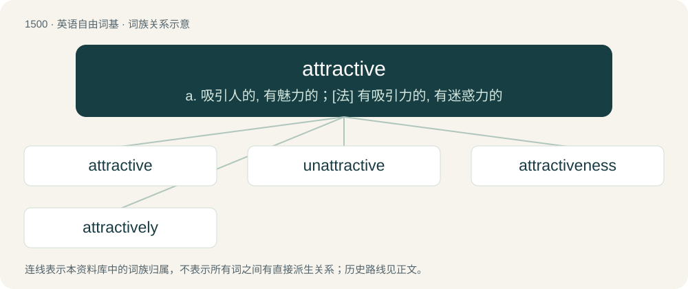

# 1588 · attractive — a. 吸引人的, 有魅力的；\[法\] 有吸引力的, 有迷惑力的

[总目录](../00_总目录_按常用程度.md)

**类型**：英语自由词基　｜　**来源语言**：见词源记录

## 核心含义与来源

- 核心含义：a. 吸引人的, 有魅力的；\[法\] 有吸引力的, 有迷惑力的
- 英文含义：Causing attraction; having the quality of attracting by inherent force.
- 词形：attractive

**来源记录 1**（形容词；Causing attraction; having the quality of attracting by inherent force.）

From Middle French attractif, from Late Latin attractīvus, equivalent to attract + -ive.

## 词族图

## 单词速览（常用到不常用）

| 单词 | 音标 | 释义 |
|---|---|---|
| [attractive](#w-1) | /əˈtɹæktɪv/ | a. 吸引人的, 有魅力的；\[法\] 有吸引力的, 有迷惑力的 |
| [unattractive](#w-2) | 美 /ənəˈt͡ʃɹæktɪv/ | a. 无吸引力的, 无魅力的, 乏味的, 不美的 |
| [attractiveness](#w-3) |  | \[经\] 吸引性, 有利可图 |
| [attractively](#w-4) | /əˈtɹæk.tɪv.li/ | adv. 动人地, 迷人地 |

## 逐词详解

### 1. attractive

**词性**：形容词　｜　**音标**：/əˈtɹæktɪv/

**中文释义**：a. 吸引人的, 有魅力的；\[法\] 有吸引力的, 有迷惑力的

**英文义项**：Causing attraction; having the quality of attracting by inherent force. / Having the power of charming or alluring by agreeable qualities; enticing.

**构词拆分**：attract + -ive

**词源与演化**：

From Middle French attractif, from Late Latin attractīvus, equivalent to attract + -ive.

**例句**：

> He is an attractive fellow with a trim figure.

该用例对应义项：Pleasing or appealing to the senses, especially of a potential romantic partner.

### 2. unattractive

**词性**：形容词　｜　**音标**：美 /ənəˈt͡ʃɹæktɪv/

**中文释义**：a. 无吸引力的, 无魅力的, 乏味的, 不美的

**英文义项**：Not handsome or beautiful or appealing. / Lacking the power to attract interest.

**构词拆分**：un- + attractive

**词源与演化**：

From un- + attractive.

**例句**：

> Being unemployed is a most unattractive prospect.

该用例对应义项：lacking power to arouse interest

### 3. attractiveness

**词性**：名词

**中文释义**：\[经\] 吸引性, 有利可图

**英文义项**：The state of being attractive or engaging. / The result of being attractive.

**构词拆分**：attractive + -ness

**词源与演化**：

From attractive + -ness.

**例句**：

> The thought of rating people by attractiveness does not seem fair to me.

### 4. attractively

**词性**：副词　｜　**音标**：/əˈtɹæk.tɪv.li/

**中文释义**：adv. 动人地, 迷人地

**英文义项**：In an attractive manner; with the power of attracting or drawing to.

**构词拆分**：attractive + -ly

**词源与演化**：

From attractive + -ly.

**例句**：

> Most customers who throng to Jaipur’s iconic markets are unaware that many of these attractively priced, glittering bangles are the product of child labor.
