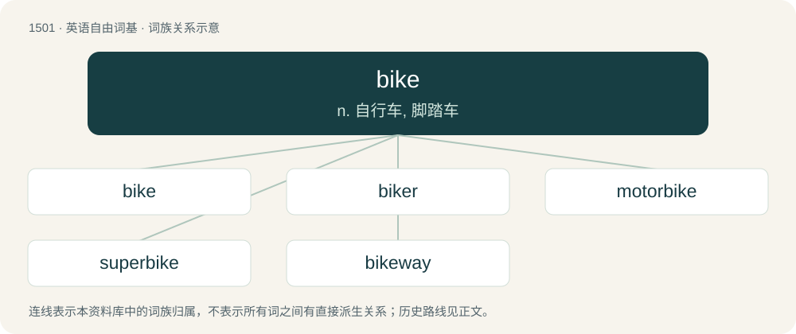

# 1589 · bike — n. 自行车, 脚踏车

[总目录](../00_总目录_按常用程度.md)

**类型**：英语自由词基　｜　**来源语言**：见词源记录

## 核心含义与来源

- 核心含义：n. 自行车, 脚踏车
- 英文含义：Any vehicle sharing some characteristics with a bicycle or motorbike, such as pedal power, a handlebar, or a saddle.
- 词形：bike

**多个词源／构词路径**：同一拼写可能有不同来源；以下按词性和含义分别列出。

**来源记录 1**（名词；Any vehicle sharing some characteristics with a bicycle or motorbike, such as pedal power, a handlebar, or a saddle.）

Clipping of bicycle. First attested in 1882. One explanation for the form with /k/ is that bicycle was parsed to bi(cy)c(le). An alternative explanation is that it was parsed to bic(ycle) but since speakers are aware of a general /k/~/s/ alternation (as in electric ~ electricity etc.), the softened /s/ was restored to a default /k/ when the “ending” -ycle was dropped. Similar cases are merc /mɜɹk/, spec /spɛk/ for mercenary, specify. It seems unlikely, however, that this process is purely phonological and not at least partially based on the spelling ⟨c⟩.

**来源记录 2**（名词；A hive of bees, or a nest of wasps, hornets, or ants.）

From Middle English bike, byke (“a nest of wild bees or wasps; also, honeycomb”), of unknown origin. Perhaps a back-formation of Middle English \*bykere (“beekeeper”), from Old English bēocere (“beekeeper”); or from Old English \*bȳc, a byform of Old English būc (“belly; vessel; container”). Compare also Scots byke (“beehive, anthill; home, dwelling”), Old Norse bý (“bee”).

## 词族图

## 单词速览（常用到不常用）

| 单词 | 音标 | 释义 |
|---|---|---|
| [bike](#w-1) | /baɪk/ | n. 自行车, 脚踏车 |
| [biker](#w-2) | 英 /ˈbaɪ̯kə/；美 /ˈbaɪ̯kɚ/ | n. 骑自行车/摩托车的人 |
| [motorbike](#w-3) | 英 /ˈməʊtə(ɹ)ˌbaɪk/；美 /ˈmoʊtɚˌbaɪk/ | n. 机动脚踏两用车, 摩托车 |
| [superbike](#w-4) | /ˈsjuːpəbaik/ | n. (其发动机额定容量为750立方厘米以上的) 超级摩托车 |
| [bikeway](#w-5) | /ˈbaikwei/ | n. 自行车车道 |

## 逐词详解

### 1. bike

**词性**：动词　｜　**音标**：/baɪk/

**中文释义**：n. 自行车, 脚踏车

**英文义项**：To ride a bike. / To travel by bike.

**词源与演化**：

Clipping of bicycle. First attested in 1882. One explanation for the form with /k/ is that bicycle was parsed to bi(cy)c(le). An alternative explanation is that it was parsed to bic(ycle) but since speakers are aware of a general /k/~/s/ alternation (as in electric ~ electricity etc.), the softened /s/ was restored to a default /k/ when the “ending” -ycle was dropped. Similar cases are merc /mɜɹk/, spec /spɛk/ for mercenary, specify. It seems unlikely, however, that this process is purely phonological and not at least partially based on the spelling ⟨c⟩.

**例句**：

> It was such a nice day I decided to bike to the store, though it's far enough I usually take my car.

该用例对应义项：To travel by bike.

### 2. biker

**词性**：名词　｜　**音标**：英 /ˈbaɪ̯kə/；美 /ˈbaɪ̯kɚ/

**中文释义**：n. 骑自行车/摩托车的人

**英文义项**：A person whose lifestyle is centered on motorcycles, sometimes a member of a motorcycle club. / A cyclist.

**构词拆分**：bike + -er

**词源与演化**：

From bike + -er.

**例句**：

> An innocent biker was shot by an arrogant soldier on that street.

### 3. motorbike

**词性**：动词　｜　**音标**：英 /ˈməʊtə(ɹ)ˌbaɪk/；美 /ˈmoʊtɚˌbaɪk/

**中文释义**：n. 机动脚踏两用车, 摩托车

**英文义项**：To ride a motorbike; to travel by motorbike.

**构词拆分**：motor + bike

**词源与演化**：

From motor + bike.

**例句**：

> Every time my daughter goes out with the motorbike, I am nervous.

### 4. superbike

**词性**：名词　｜　**音标**：/ˈsjuːpəbaik/

**中文释义**：n. (其发动机额定容量为750立方厘米以上的) 超级摩托车

**英文义项**：A super sport bike with a large engine, usually between 800 and 1200 cc

**构词拆分**：super- + bike

**词源与演化**：

From super- + bike.

### 5. bikeway

**词性**：名词　｜　**音标**：/ˈbaikwei/

**中文释义**：n. 自行车车道

**英文义项**：A bicycle lane or path.

**构词拆分**：bike + way

**词源与演化**：

From bike + way.
