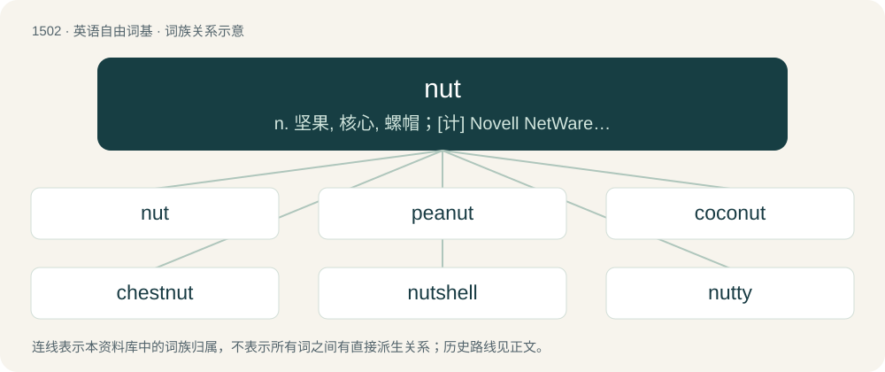

# 1590 · nut — n. 坚果, 核心, 螺帽；\[计\] Novell NetWare服务器实用程序

[总目录](../00_总目录_按常用程度.md)

**类型**：英语自由词基　｜　**来源语言**：见词源记录

## 核心含义与来源

- 核心含义：n. 坚果, 核心, 螺帽；\[计\] Novell NetWare服务器实用程序
- 英文含义：Any of various hard-shelled seeds or hard, dry fruits from various families of plants.
- 词形：nut

**多个词源／构词路径**：同一拼写可能有不同来源；以下按词性和含义分别列出。

**来源记录 1**（名词；Any of various hard-shelled seeds or hard, dry fruits from various families of plants.）

From Middle English note, nute, from Old English hnutu, from Proto-West Germanic \*hnut, from Proto-Germanic \*hnuts (“nut”), from a root \*knu- possibly shared with Proto-Celtic \*knūs and Latin nux (“nut”). Based on the form of the nouns and the restriction of the root to Germanic, Celtic and Italic, it has been argued to be of non-Indo-European (substrate) origin. See also West Frisian nút, Dutch noot, German Nuss, Danish nød, Swedish nöt, Norwegian nøtt.

**来源记录 2**（感叹词；No.）

Variant of not.

## 词族图

## 单词速览（常用到不常用）

| 单词 | 音标 | 释义 |
|---|---|---|
| [nut](#w-1) | 英 /nʌt/ | n. 坚果, 核心, 螺帽；\[计\] Novell NetWare服务器实用程序 |
| [peanut](#w-2) | 英 /ˈpiːnʌt/；美 /ˈpiˌnʌt/ | n. 花生, 小人物, 极小的数额；a. 渺小的, 微不足道的 |
| [coconut](#w-3) | 英 /ˈkəʊ.kə.nʌt/；美 /ˈkoʊ.kəˌnʌt/ | n. 椰子；\[医\] 椰子(实) |
| [chestnut](#w-4) | 英 /ˈt͡ʃɛs(t)nʌt/；美 /ˈt͡ʃɛs(t)ˌnʌt/ | n. 栗子, 栗树, 栗色；a. 栗色的 |
| [nutshell](#w-5) | /ˈnʌt.ʃɛl/ | n. 坚果壳, 极小的东西 |
| [nutty](#w-6) | 英 /ˈnʌti/；美 /ˈnʌti/ | a. 产坚果的 |
| [doughnut](#w-7) | 英 /ˈdəʊnʌt/；美 /ˈdoʊ(ˌ)nʌt/ | n. 油炸圈饼, 环状物；\[计\] 圆环图 |
| [nutcracker](#w-8) | 美 /ˈnʌtˌkɹækɚ/ | n. 轧碎坚果的钳子, 星鸦 |
| [nutter](#w-9) | 英 /ˈnʌtə/ | n. 疯子；拾坚果的人 |
| [hazelnut](#w-10) | 英 /ˈheɪzəlnʌt/；美 /ˈheɪzəlˌnʌt/ | n. 榛实；\[医\] 榛实 |
| [butternut](#w-11) | /ˈbʌtənʌt/ | n. 灰胡桃；\[化\] 灰胡桃(Juglans cenerea) |
| [nutcase](#w-12) | 英 /ˈnʌtkeɪs/ | n. 疯子 |
| [groundnut](#w-13) | /ˈgraundnʌt/ | n. 野豆, 落花生 |
| [wingnut](#w-14) | /ˈwɪŋˌnʌt/ | 枫杨 |
| [nuthatch](#w-15) | /ˈnʌtˌhæt͡ʃ/ | n. \[鸟\]五子雀 |

## 逐词详解

### 1. nut

**词性**：名词　｜　**音标**：英 /nʌt/

**中文释义**：n. 坚果, 核心, 螺帽；\[计\] Novell NetWare服务器实用程序

**英文义项**：Any of various hard-shelled seeds or hard, dry fruits from various families of plants. / Such a fruit that is indehiscent.

**词源与演化**：

From Middle English note, nute, from Old English hnutu, from Proto-West Germanic \*hnut, from Proto-Germanic \*hnuts (“nut”), from a root \*knu- possibly shared with Proto-Celtic \*knūs and Latin nux (“nut”). Based on the form of the nouns and the restriction of the root to Germanic, Celtic and Italic, it has been argued to be of non-Indo-European (substrate) origin. See also West Frisian nút, Dutch noot, German Nuss, Danish nød, Swedish nöt, Norwegian nøtt.

**例句**：

> There are many sorts of nuts: peanuts, cashews, pistachios, Brazil nuts and more.

该用例对应义项：Any of various hard-shelled seeds or hard, dry fruits from various families of plants.

### 2. peanut

**词性**：名词　｜　**音标**：英 /ˈpiːnʌt/；美 /ˈpiˌnʌt/

**中文释义**：n. 花生, 小人物, 极小的数额；a. 渺小的, 微不足道的

**英文义项**：A legume resembling a nut, the fruit of the plant Arachis hypogaea, native to South America. / Synonym of countneck (“very small hard clam”).

**构词拆分**：pea + nut

**词源与演化**：

From pea + nut, perhaps a folk etymology of pinda, pinder (still found in Southern US dialects).

**例句**：

> He always liked eating peanuts along with tea before biscuits came into his life.

该用例对应义项：A legume resembling a nut, the fruit of the plant Arachis hypogaea, native to South America.

### 3. coconut

**词性**：名词　｜　**音标**：英 /ˈkəʊ.kə.nʌt/；美 /ˈkoʊ.kəˌnʌt/

**中文释义**：n. 椰子；\[医\] 椰子(实)

**英文义项**：A fruit of the coconut palm (not a true nut), Cocos nucifera, having a fibrous husk surrounding a large seed. / A hard-shelled seed of this fruit, having white flesh and a fluid-filled central cavity.

**构词拆分**：coco + nut

**词源与演化**：

From coco + nut. In reference to assimilated Hispanic or black people, derived from the fruit's exotic origins. The slur originates from the idea that one is "brown on the outside, white on the inside". In reference to Polynesians, from the ubiquity of coconut palms in the area.

**例句**：

> I think phosphoric acid has the same color and consistency as coconut oil.

### 4. chestnut

**词性**：形容词　｜　**音标**：英 /ˈt͡ʃɛs(t)nʌt/；美 /ˈt͡ʃɛs(t)ˌnʌt/

**中文释义**：n. 栗子, 栗树, 栗色；a. 栗色的

**英文义项**：Of a deep reddish-brown colour, like that of a chestnut fruit (noun sense 1).

**构词拆分**：chesten + nut

**词源与演化**：

The noun is a contraction of chest(en) (“(obsolete) chestnut tree; fruit of this tree, chestnut”) + nut. Chesten is a late variant of chesteine (obsolete), from Middle English chesten, chesteine, chasteine, chesteyne (“chestnut tree (Castanea sativa); fruit of this tree; wood of this tree”), from Old French chastaigne, chastaine (French châtaigne), from Latin castanea (“chestnut tree; fruit of this tree”) (whence Old English ċisten), from Ancient Greek κᾰστᾰ́νειᾰ (kăstắneiă), a variant of κᾰ́στᾰνᾰ (kắstănă, “sweet chestnut”); for further etymology, see that entry. Doublet of castanet. Noun sense 4 (“joke, phrase, etc., which has been repeated so often as to have grown ineffective or tiresome”) may refer to an 1816 play, The Broken Sword, by William Dimond (1781 – c. 1837), in which one character begins to relate a story in which a boy slips down from a cork tree, and another interrupts him to say that he had previously repeated the story many times, and always mentioned a chestnut tree. The adjective is probably from an attributive use of the noun; compare French (of hair) châtain (“chestnut”) (from châtaigne (“a chestnut”)) and marron (“brown”) (from marron (“a horse chestnut or chestnut”)).

**用法示例／搭配（非完整句）**：

> chestnut hair

该用例对应义项：Of a deep reddish-brown colour, like that of a chestnut fruit (noun sense 1).

### 5. nutshell

**词性**：名词　｜　**音标**：/ˈnʌt.ʃɛl/

**中文释义**：n. 坚果壳, 极小的东西

**英文义项**：The shell that surrounds the kernel of a nut. / A short book summarizing an area of law.

**构词拆分**：nut + shell

**词源与演化**：

From Middle English notschelle, from Old English hnutsċiell, from Proto-West Germanic \*hnutskallju, equivalent to nut + shell. Cognate with Saterland Frisian Nuteskele, Nuteskil (“nutshell”), Dutch notenschaal (“nutshell”), German Nussschale (“nutshell”).

**例句**：

> Toki Pona is an attempt to interpret the meaning of life in a nutshell.

### 6. nutty

**词性**：形容词　｜　**音标**：英 /ˈnʌti/；美 /ˈnʌti/

**中文释义**：a. 产坚果的

**英文义项**：Containing nuts. / Resembling or characteristic of nuts.

**构词拆分**：nut + -y

**词源与演化**：

From nut + -y.

**例句**：

> That student's parents seem to be nutty as a fruitcake.

该用例对应义项：Barmy: eccentric, odd; crazy, mad, insane.

### 7. doughnut

**词性**：名词　｜　**音标**：英 /ˈdəʊnʌt/；美 /ˈdoʊ(ˌ)nʌt/

**中文释义**：n. 油炸圈饼, 环状物；\[计\] 圆环图

**英文义项**：A deep-fried piece of dough or batter, usually mixed with various sweeteners and flavors, often made in a toroidal or ellipsoidal shape flattened sphere shape filled with jelly/jam, custard, or cream. / A circular life raft.

**构词拆分**：dough + nut

**词源与演化**：

From dough + nut, 1809 because originally small, nut-sized balls of fried dough, or, more likely, from nut in the earlier sense of "small rounded cake or cookie", with the toroidal shape becoming common in the twentieth century. First attested in Knickerbocker’s History of New York, by Washington Irving, 1809.

**例句**：

> Nice going, you doughnut!

该用例对应义项：A foolish or stupid person; an idiot.

### 8. nutcracker

**词性**：名词　｜　**音标**：美 /ˈnʌtˌkɹækɚ/

**中文释义**：n. 轧碎坚果的钳子, 星鸦

**英文义项**：An implement for cracking nuts. / Any bird of the genus Nucifraga in the crow family.

**构词拆分**：nut + cracker

**词源与演化**：

From nut + cracker.

**例句**：

> Sami had a huge nutcracker sitting by the front door.

### 9. nutter

**词性**：名词　｜　**音标**：英 /ˈnʌtə/

**中文释义**：n. 疯子；拾坚果的人

**英文义项**：A person who gathers nuts. / An eccentric, insane, crazy or reckless person.

**构词拆分**：nut + -er

**词源与演化**：

From Middle English nutter, notere, equivalent to nut + -er.

**例句**：

> Warning, the guy in front of you is a certified nutter!

### 10. hazelnut

**词性**：名词　｜　**音标**：英 /ˈheɪzəlnʌt/；美 /ˈheɪzəlˌnʌt/

**中文释义**：n. 榛实；\[医\] 榛实

**英文义项**：The fruit of the hazel, especially of species Corylus avellana, which is grown commercially. / A light tan color inspired by the color of hazelnut.

**构词拆分**：hazel + nut

**词源与演化**：

Equivalent to hazel + nut; from Middle English haselnote, from Old English hæselhnutu (“hazelnut”). Cognate with West Frisian hazzenút (“hazelnut”), Saterland Frisian Hoaselnuute (“hazelnut”), Dutch hazelnoot, German Haselnuss.

**例句**：

> The walnut, hazelnut and chestnut are wrapped in a husk and a shell.

### 11. butternut

**词性**：名词　｜　**音标**：/ˈbʌtənʌt/

**中文释义**：n. 灰胡桃；\[化\] 灰胡桃(Juglans cenerea)

**英文义项**：A North American walnut tree, Juglans cinerea. / The wood or bark of this walnut tree.

**构词拆分**：butter + nut

**词源与演化**：

From butter + nut.

**例句**：

> He made a delicious butternut soup.

该用例对应义项：Butternut squash.

### 12. nutcase

**词性**：名词　｜　**音标**：英 /ˈnʌtkeɪs/

**中文释义**：n. 疯子

**英文义项**：An eccentric or odd person. / Someone who is insane.

**构词拆分**：nut + case

**词源与演化**：

From nut + case. Compare headcase, mental case etc.

**例句**：

> I would not be here if I had not been a nutcase.

### 13. groundnut

**词性**：名词　｜　**音标**：/ˈgraundnʌt/

**中文释义**：n. 野豆, 落花生

**英文义项**：A climbing vine, Apios americana, of eastern North America, having fragrant brownish flowers and small edible tubers. / Any similar plant having underground tubers.

**构词拆分**：ground + nut

**词源与演化**：

From ground + nut. Compare Icelandic jarðhneta, German Erdnuss (both cognate with earthnut) and Hungarian földimogyoró.

### 14. wingnut

**词性**：名词　｜　**音标**：/ˈwɪŋˌnʌt/

**中文释义**：枫杨

**英文义项**：A deciduous tree of the genus Pterocarya native to Asia. / A person who is or seems odd, eccentric, or crazy; especially, someone with bizarre or extreme political views.

**构词拆分**：wing + nut

**词源与演化**：

From wing + nut. The political sense is a shortening of "right-wing nut".

### 15. nuthatch

**词性**：名词　｜　**音标**：/ˈnʌtˌhæt͡ʃ/

**中文释义**：n. \[鸟\]五子雀

**英文义项**：Any of various small passerine birds from the genus Sitta, found throughout the northern hemisphere and noted for their unusual proclivity for climbing down trees head first.

**构词拆分**：nut + hatch

**词源与演化**：

From Middle English nutthache, notehache, nuthake, nuttehake, nothak, equivalent to nut + hatch (akin to hack). Compare English nutcracker. Compare typologically Polish kowalik (akin to kować).

**例句**：

> The nuthatch is a bird that lives in forests and mountains.
