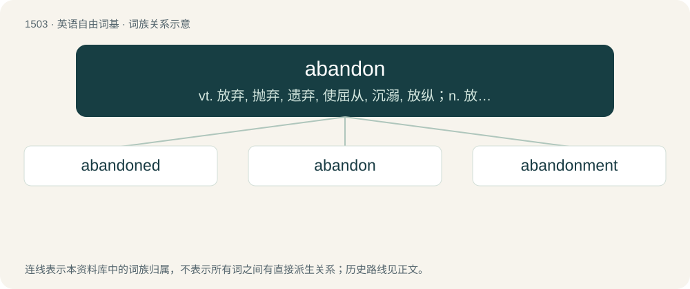

# 1592 · abandon — vt. 放弃, 抛弃, 遗弃, 使屈从, 沉溺, 放纵；n. 放任, 无拘束, 狂热

[总目录](../00_总目录_按常用程度.md)

**类型**：英语自由词基　｜　**来源语言**：见词源记录

## 核心含义与来源

- 核心含义：vt. 放弃, 抛弃, 遗弃, 使屈从, 沉溺, 放纵；n. 放任, 无拘束, 狂热
- 英文含义：To give up or relinquish control of, to surrender or to give oneself over, or to yield to one's emotions.
- 词形：abandon

**多个词源／构词路径**：同一拼写可能有不同来源；以下按词性和含义分别列出。

**来源记录 1**（动词；To give up or relinquish control of, to surrender or to give oneself over, or to yield to one's emotions.）

From Middle English abandounen, from Old French abandoner, formed from a (“at, to”) + bandon (“jurisdiction, control”), from Late Latin bannum (“proclamation”), bannus, bandum, from Frankish \*ban, \*bann, from Proto-Germanic \*bannaną (“to proclaim, command”) (whence English ban), from Proto-Indo-European \*bʰeh₂- (“to speak”). See also ban, banal. Displaced Middle English forleten (“to abandon”), from Old English forlǣtan, anforlǣtan; see forlet; and Middle English forleven (“to leave behind, abandon”), from Old English forlǣfan; see forleave. Compare typologically abdicate, Russian отказа́ться (otkazátʹsja) (akin to приказа́ть (prikazátʹ), сказа́ть (skazátʹ), указа́ть (ukazátʹ)).

**来源记录 2**（名词；A yielding to natural impulses or inhibitions; freedom from artificial constraint, with loss of appreciation of consequences. (Now especially in the phrase with abandon.)）

From Middle English abandoun, from Old French abandon, from Old French abondonner.

## 词族图

## 单词速览（常用到不常用）

| 单词 | 音标 | 释义 |
|---|---|---|
| [abandoned](#w-1) | 英 /əˈbæn.dənd/；/əˈbeə̯n.dənd/ | a. 被抛弃的, 无约束的, 恣意放荡的 |
| [abandon](#w-2) | 英 /əˈbæn.dən/ | vt. 放弃, 抛弃, 遗弃, 使屈从, 沉溺, 放纵；n. 放任, 无拘束, 狂热 |
| [abandonment](#w-3) | /əˈbæn.d(ə)n.m(ə)nt/ | n. 放弃, 抛弃, 放纵；\[经\] 委付, 废弃, 放弃(采矿权) |

## 逐词详解

### 1. abandoned

**词性**：形容词　｜　**音标**：英 /əˈbæn.dənd/；/əˈbeə̯n.dənd/

**中文释义**：a. 被抛弃的, 无约束的, 恣意放荡的

**英文义项**：Having given oneself up to vice; immoral; extremely wicked, or sinning without restraint; irreclaimably wicked. / No longer maintained by its former owners, residents, or caretakers; forsaken, deserted.

**构词拆分**：abandon + -ed

**词源与演化**：

From Middle English abandoned, equivalent to abandon + -ed.

**例句**：

> They explored an abandoned factory on the edge of town.

该用例对应义项：No longer maintained by its former owners, residents, or caretakers; forsaken, deserted.

### 2. abandon

**词性**：动词　｜　**音标**：英 /əˈbæn.dən/

**中文释义**：vt. 放弃, 抛弃, 遗弃, 使屈从, 沉溺, 放纵；n. 放任, 无拘束, 狂热

**英文义项**：To give up or relinquish control of, to surrender or to give oneself over, or to yield to one's emotions. / To desist in doing, practicing, following, holding, or adhering to; to turn away from; to permit to lapse; to renounce; to discontinue.

**词源与演化**：

From Middle English abandounen, from Old French abandoner, formed from a (“at, to”) + bandon (“jurisdiction, control”), from Late Latin bannum (“proclamation”), bannus, bandum, from Frankish \*ban, \*bann, from Proto-Germanic \*bannaną (“to proclaim, command”) (whence English ban), from Proto-Indo-European \*bʰeh₂- (“to speak”). See also ban, banal. Displaced Middle English forleten (“to abandon”), from Old English forlǣtan, anforlǣtan; see forlet; and Middle English forleven (“to leave behind, abandon”), from Old English forlǣfan; see forleave. Compare typologically abdicate, Russian отказа́ться (otkazátʹsja) (akin to приказа́ть (prikazátʹ), сказа́ть (skazátʹ), указа́ть (ukazátʹ)).

**例句**：

> Many baby girls have been abandoned on the streets of Beijing.

该用例对应义项：To leave behind; to desert, as in a ship, a position, or a person, typically in response to overwhelming odds or impending dangers; to forsake, in spite of a duty or responsibility.

### 3. abandonment

**词性**：名词　｜　**音标**：/əˈbæn.d(ə)n.m(ə)nt/

**中文释义**：n. 放弃, 抛弃, 放纵；\[经\] 委付, 废弃, 放弃(采矿权)

**英文义项**：The act of abandoning, or the state of being abandoned; total desertion; relinquishment. / The voluntary leaving of a person to whom one is bound by a special relation, as a wife, husband or child; desertion.

**构词拆分**：abandon + -ment

**词源与演化**：

Borrowed from French abandonnement, from abandonner (“to abandon, relinquish”). abandonner was originally equivalent to mettre à bandon (“to leave to the jurisdiction, i.e. of another”), bandon being from Medieval Latin bandum, bannum (“order, decree, ban”). Equivalent to abandon + -ment. (See also English banns.)

**例句**：

> High-profile abandonments are harder to infiltrate for urban explorers due to their heightened security.

该用例对应义项：An abandoned building or structure.
