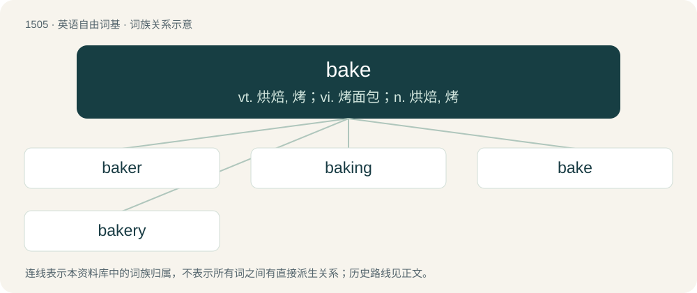

# 1593 · bake — vt. 烘焙, 烤；vi. 烤面包；n. 烘焙, 烤

[总目录](../00_总目录_按常用程度.md)

**类型**：英语自由词基　｜　**来源语言**：见词源记录

## 核心含义与来源

- 核心含义：vt. 烘焙, 烤；vi. 烤面包；n. 烘焙, 烤
- 英文含义：To cook (something) in an oven (for someone).
- 词形：bake

**来源记录 1**（动词；To cook (something) in an oven (for someone).）

From Middle English baken, from Old English bacan (“to bake”), from Proto-West Germanic \*bakan, from Proto-Germanic \*bakaną (“to bake”), from Proto-Indo-European \*bʰeh₃g- (“to roast, bake”). Cognate with West Frisian bakke (“to bake”), Dutch bakken (“to bake”), Low German backen (“to bake”), German backen (“to bake”), Norwegian Bokmål bake (“to bake”), Danish bage (“to bake”), Norwegian Nynorsk and Swedish baka (“to bake”), Ancient Greek φώγω (phṓgō, “roast”, verb).

## 词族图

## 单词速览（常用到不常用）

| 单词 | 音标 | 释义 |
|---|---|---|
| [baker](#w-1) | 英 /ˈbeɪ.kə/；美 /ˈbeɪ.kɚ/ | n. 面包师；\[医\] 烤箱(骨科用) |
| [baking](#w-2) | /ˈbeɪkɪŋ(ɡ)/ | n. 烘焙, 一次烘焙的量；\[机\] 烘, 焙, 烤干 |
| [bake](#w-3) | 英 /beɪk/ | vt. 烘焙, 烤；vi. 烤面包；n. 烘焙, 烤 |
| [bakery](#w-4) | /ˈbeɪ.kə.ɹi/ | n. 面包店 |

## 逐词详解

### 1. baker

**词性**：名词　｜　**音标**：英 /ˈbeɪ.kə/；美 /ˈbeɪ.kɚ/

**中文释义**：n. 面包师；\[医\] 烤箱(骨科用)

**英文义项**：A person who bakes and sells bread, cakes and similar items. / A portable oven for baking.

**构词拆分**：bake + -er

**词源与演化**：

Inherited from Middle English bakere, from Old English bæcere (“baker”), from Proto-Germanic \*bakārijaz (“baker”), equivalent to bake + -er. Cognate with Dutch bakker (“baker”), German Bäcker (“baker”), Norwegian Bokmål baker (“baker”), Swedish bagare (“baker”), Icelandic bakari (“baker”).

**例句**：

> The name’s Sherlock Holmes and the address is 221 B Baker Street.

### 2. baking

**词性**：形容词　｜　**音标**：/ˈbeɪkɪŋ(ɡ)/

**中文释义**：n. 烘焙, 一次烘焙的量；\[机\] 烘, 焙, 烤干

**英文义项**：That bakes. / Of a person, an object, or the weather: very hot; boiling, broiling, roasting.

**构词拆分**：bake + -ing

**词源与演化**：

From Middle English bakynge; equivalent to bake + -ing.

**例句**：

> The car was baking after having been parked in the sun the whole afternoon.

该用例对应义项：Of a person, an object, or the weather: very hot; boiling, broiling, roasting.

### 3. bake

**词性**：动词　｜　**音标**：英 /beɪk/

**中文释义**：vt. 烘焙, 烤；vi. 烤面包；n. 烘焙, 烤

**英文义项**：To cook (something) in an oven (for someone). / To be cooked in an oven.

**词源与演化**：

From Middle English baken, from Old English bacan (“to bake”), from Proto-West Germanic \*bakan, from Proto-Germanic \*bakaną (“to bake”), from Proto-Indo-European \*bʰeh₃g- (“to roast, bake”). Cognate with West Frisian bakke (“to bake”), Dutch bakken (“to bake”), Low German backen (“to bake”), German backen (“to bake”), Norwegian Bokmål bake (“to bake”), Danish bage (“to bake”), Norwegian Nynorsk and Swedish baka (“to bake”), Ancient Greek φώγω (phṓgō, “roast”, verb).

**例句**：

> In some cultures, it is expected that a proper housewife should bake.

该用例对应义项：To regularly prepare baked goods.

### 4. bakery

**词性**：名词　｜　**音标**：/ˈbeɪ.kə.ɹi/

**中文释义**：n. 面包店

**英文义项**：A place in which bread (and often other baked goods such as cakes) is baked and/or sold. / The trade of a baker.

**构词拆分**：bake + -ery (“place of”)

**词源与演化**：

From bake + -ery (“place of”). Replaced earlier bakehouse. Originally "place for making bread"; as "shop where baked goods are sold", it was believed by British travelers by 1832 to be an American-invented term. Sense 4 is by analogy with cake (“buttocks”).

**例句**：

> He's got a whole damn bakery back there!

该用例对应义项：A large pair of buttocks.
