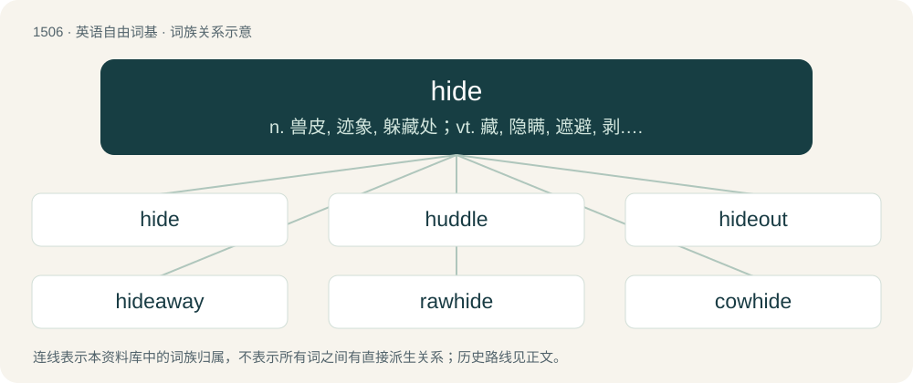

# 1594 · hide — n. 兽皮, 迹象, 躲藏处；vt. 藏, 隐瞒, 遮避, 剥...的皮, 隐藏；vi. 躲藏

[总目录](../00_总目录_按常用程度.md)

**类型**：英语自由词基　｜　**来源语言**：见词源记录

## 核心含义与来源

- 核心含义：n. 兽皮, 迹象, 躲藏处；vt. 藏, 隐瞒, 遮避, 剥...的皮, 隐藏；vi. 躲藏
- 英文含义：To put (something) in a place where it will be out of sight or harder to discover.
- 词形：hide

**多个词源／构词路径**：同一拼写可能有不同来源；以下按词性和含义分别列出。

**来源记录 1**（动词；To put (something) in a place where it will be out of sight or harder to discover.）

From Middle English hiden, huden, from Old English hȳdan (“to hide, conceal, preserve”), from Proto-West Germanic \*huʀdijan (“to conceal”), from Proto-Germanic \*huzdijaną (“to hoard”), from Proto-Indo-European \*(s)kewdʰ- (“to cover, wrap, encase”), from Proto-Indo-European \*(s)kewH- (“to cover”). The verb was originally weak. In the King James Version of the Bible (1611), both hid and hidden are used for the past participle. Cognates Cognate with Dutch huiden, Low German (ver)hüden, (ver)hüen (“to hide, cover, conceal”), Welsh cuddio (“to hide”), Latin custōs, Ancient Greek κεύθω (keúthō, “to conceal”), Sanskrit कुहरम् (kuharam, “cave”). Related to hut and sky.

**来源记录 2**（名词；The skin of an animal.）

From Middle English hyde, from Old English hȳd, from Proto-West Germanic \*hūdi, from Proto-Germanic \*hūdiz, from Proto-Indo-European \*kéw(H)tis (“skin, hide”) (compare Latin cutis (“skin, rind, hide”)), from Proto-Indo-European \*(s)kew(H)- (“to cover”), ultimately the same root as the above etymology. More at sky. Cognates See also West Frisian hûd, Dutch huid, German Haut, Danish hud, Welsh cwd (“scrotum”), Latin cutis (“skin”), Lithuanian kutys (“purse, money-belt”), Ancient Greek κύτος (kútos, “hollow vessel”), σκῦτος (skûtos, “cover, hide”).

## 词族图

## 单词速览（常用到不常用）

| 单词 | 音标 | 释义 |
|---|---|---|
| [hide](#w-1) | /haɪd/ | n. 兽皮, 迹象, 躲藏处；vt. 藏, 隐瞒, 遮避, 剥...的皮, 隐藏；vi. 躲藏 |
| [huddle](#w-2) | /ˈhʌdəl/ | n. 杂乱一团, 混乱, 拥挤；vt. 把...挤在一起, 乱堆, 草率了事, 蜷曲；vi. 挤作一团, 蜷缩 |
| [hideout](#w-3) | /ˈhaɪdˌaʊt/ | n. 隐匿处 |
| [hideaway](#w-4) | 美 /ˈhaɪdəˌweɪ/ | n. 隐匿处, 潜伏处, 退隐处 |
| [rawhide](#w-5) | 英 /ˈɹɔːhaɪd/；美 /ˈɹɔhaɪd/ | n. 生皮, 生皮鞭；vt. (用生皮鞭)抽打 |
| [cowhide](#w-6) | 美 /ˈkaʊˌhaɪd/ | n. 牛皮, 牛皮鞭；vt. 用牛皮鞭打 |
| [hider](#w-7) | 英 /ˈhaɪdə/；美 /ˈhɑɪdɚ/ | \[计\] 封闭多边形 |

## 逐词详解

### 1. hide

**词性**：动词　｜　**音标**：/haɪd/

**中文释义**：n. 兽皮, 迹象, 躲藏处；vt. 藏, 隐瞒, 遮避, 剥...的皮, 隐藏；vi. 躲藏

**英文义项**：To put (something) in a place where it will be out of sight or harder to discover. / To put oneself in a place where one will be out of sight or harder to find.

**词源与演化**：

From Middle English hiden, huden, from Old English hȳdan (“to hide, conceal, preserve”), from Proto-West Germanic \*huʀdijan (“to conceal”), from Proto-Germanic \*huzdijaną (“to hoard”), from Proto-Indo-European \*(s)kewdʰ- (“to cover, wrap, encase”), from Proto-Indo-European \*(s)kewH- (“to cover”). The verb was originally weak. In the King James Version of the Bible (1611), both hid and hidden are used for the past participle. Cognates Cognate with Dutch huiden, Low German (ver)hüden, (ver)hüen (“to hide, cover, conceal”), Welsh cuddio (“to hide”), Latin custōs, Ancient Greek κεύθω (keúthō, “to conceal”), Sanskrit कुहरम् (kuharam, “cave”). Related to hut and sky.

**例句**：

> He hides his magazines under the bed.

该用例对应义项：To put (something) in a place where it will be out of sight or harder to discover.

### 2. huddle

**词性**：动词　｜　**音标**：/ˈhʌdəl/

**中文释义**：n. 杂乱一团, 混乱, 拥挤；vt. 把...挤在一起, 乱堆, 草率了事, 蜷曲；vi. 挤作一团, 蜷缩

**英文义项**：To crowd together. / To curl one's legs up to the chest and keep one's arms close to the torso; to crouch; to assume a position similar to that of an embryo in the womb.

**构词拆分**：hide + -le；hide + -er

**词源与演化**：

From Middle English \*hudelen, alteration (due to hudels, hidels (“hiding place”), see hiddle) of \*huderen, hoderen (“to cover; press together; huddle”), a frequentative form of Middle English huden, hiden (“to hide”), equivalent to hide + -le and/or hide + -er. Compare Low German huderken (“to brood; coddle; nurse; lull children to sleep”).

**例句**：

> Let's huddle together--it's cold!

该用例对应义项：crowd or draw together

### 3. hideout

**词性**：名词　｜　**音标**：/ˈhaɪdˌaʊt/

**中文释义**：n. 隐匿处

**英文义项**：A place to hide. / A hidden headquarters or place to return to.

**构词拆分**：hide + out

**词源与演化**：

From hide + out.

**例句**：

> They'll never find us in this makeshift hideout we've got in the woods.

该用例对应义项：A place to hide.

### 4. hideaway

**词性**：名词　｜　**音标**：美 /ˈhaɪdəˌweɪ/

**中文释义**：n. 隐匿处, 潜伏处, 退隐处

**英文义项**：a hiding place, somewhere one can go to get away from other people

**构词拆分**：hide + away

**词源与演化**：

From hide + away.

**例句**：

> This weekend, let's find some romantic hideaway on the coast.

该用例对应义项：a hiding place, somewhere one can go to get away from other people

### 5. rawhide

**词性**：名词　｜　**音标**：英 /ˈɹɔːhaɪd/；美 /ˈɹɔhaɪd/

**中文释义**：n. 生皮, 生皮鞭；vt. (用生皮鞭)抽打

**英文义项**：Untanned hide. / A whip made from twisted untanned leather.

**构词拆分**：raw + hide

**词源与演化**：

From raw + hide.

### 6. cowhide

**词性**：名词　｜　**音标**：美 /ˈkaʊˌhaɪd/

**中文释义**：n. 牛皮, 牛皮鞭；vt. 用牛皮鞭打

**英文义项**：A hide of a cow. / Any quantity of hides of cows.

**构词拆分**：cow + hide

**词源与演化**：

From cow + hide.

### 7. hider

**词性**：名词　｜　**音标**：英 /ˈhaɪdə/；美 /ˈhɑɪdɚ/

**中文释义**：\[计\] 封闭多边形

**英文义项**：One who hides oneself or a thing.

**构词拆分**：From hide + -er.

**词源与演化**：

From hide + -er.

**例句**：

> Claudio was the seeker and Isabella was the hider.
