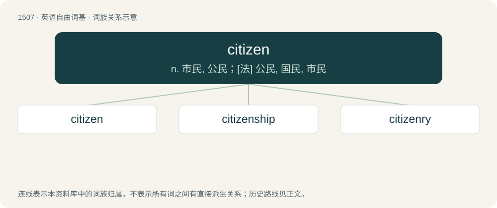

# 1595 · citizen — n. 市民, 公民；\[法\] 公民, 国民, 市民

[总目录](../00_总目录_按常用程度.md)

**类型**：英语自由词基　｜　**来源语言**：见词源记录

## 核心含义与来源

- 核心含义：n. 市民, 公民；\[法\] 公民, 国民, 市民
- 英文含义：A resident of a city or town, especially one with legally recognized rights or duties.
- 词形：citizen

**来源记录 1**（名词；A resident of a city or town, especially one with legally recognized rights or duties.）

From Middle English citeseyn (“inhabitant of a city or town”), citezein, citisein, from Anglo-Norman citesain (“city-dweller, town-dweller”), citesein, citezein, alteration of citeien from cite (“city”) + -ien (“-ain”) (probable variant of cithein perhaps influenced by dainzain (“denizen”), deinzein), from Old French cite (“city”) + -ien (whence French citoyen), from earlier citet, from Latin civitatem, citatem, from civis. See also city. Displaced native Old English burhsittend and Old English ceasterware.

## 词族图

## 单词速览（常用到不常用）

| 单词 | 音标 | 释义 |
|---|---|---|
| [citizen](#w-1) | 英 /ˈsɪtɪzən/；美 /ˈsɪtɪzən/ | n. 市民, 公民；\[法\] 公民, 国民, 市民 |
| [citizenship](#w-2) | 英 /ˈsɪtɪzənʃɪp/ | n. 国籍, 市民权, 市民的身份；\[法\] 公民权, 公民资格, 公民身分 |
| [citizenry](#w-3) | /ˈsitizənri/ | n. 市民；\[法\] 市民 |

## 逐词详解

### 1. citizen

**词性**：名词　｜　**音标**：英 /ˈsɪtɪzən/；美 /ˈsɪtɪzən/

**中文释义**：n. 市民, 公民；\[法\] 公民, 国民, 市民

**英文义项**：A resident of a city or town, especially one with legally recognized rights or duties. / A legally recognized member of a state, with associated rights and obligations; a person considered in terms of this role.

**词源与演化**：

From Middle English citeseyn (“inhabitant of a city or town”), citezein, citisein, from Anglo-Norman citesain (“city-dweller, town-dweller”), citesein, citezein, alteration of citeien from cite (“city”) + -ien (“-ain”) (probable variant of cithein perhaps influenced by dainzain (“denizen”), deinzein), from Old French cite (“city”) + -ien (whence French citoyen), from earlier citet, from Latin civitatem, citatem, from civis. See also city. Displaced native Old English burhsittend and Old English ceasterware.

**例句**：

> Diogenes reckoned himself a citizen of the world.

该用例对应义项：An inhabitant or occupant: a member of any place.

### 2. citizenship

**词性**：名词　｜　**音标**：英 /ˈsɪtɪzənʃɪp/

**中文释义**：n. 国籍, 市民权, 市民的身份；\[法\] 公民权, 公民资格, 公民身分

**英文义项**：The state of being a citizen; the status of a citizen.

**构词拆分**：citizen + -ship

**词源与演化**：

From citizen + -ship. Displaced native Old English burgrǣden, equivalent to borough + -red.

**例句**：

> Award for good citizenship.

该用例对应义项：conduct as a citizen

### 3. citizenry

**词性**：名词　｜　**音标**：/ˈsitizənri/

**中文释义**：n. 市民；\[法\] 市民

**英文义项**：The group of all citizens; citizens taken collectively.

**构词拆分**：citizen + -ry

**词源与演化**：

From citizen + -ry. Displaced native Old English burgwaru.

**例句**：

> Accountability is in the interest of the Government and the citizenry alike.
