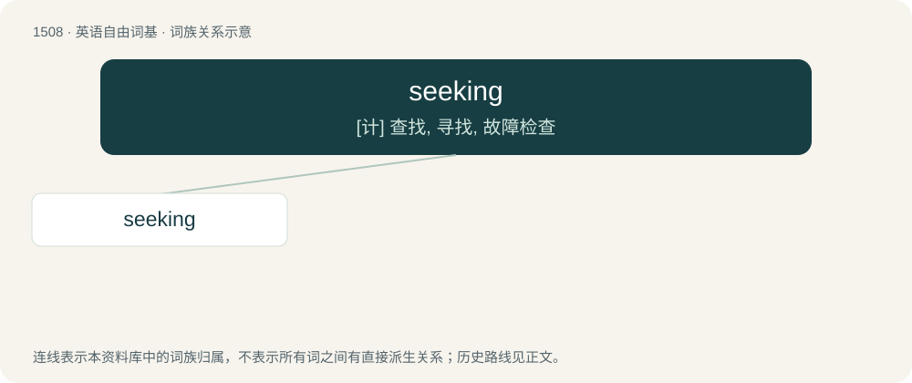

# 1596 · seeking — \[计\] 查找, 寻找, 故障检查

[总目录](../00_总目录_按常用程度.md)

**类型**：英语自由词基　｜　**来源语言**：见词源记录

## 核心含义与来源

- 核心含义：\[计\] 查找, 寻找, 故障检查
- 英文含义：The act of one who seeks; a search or quest to find something.
- 词形：seeking

**来源记录 1**（名词；The act of one who seeks; a search or quest to find something.）

From seek + -ing.

## 词族图

## 单词速览（常用到不常用）

| 单词 | 音标 | 释义 |
|---|---|---|
| [seeking](#w-1) | /ˈsiː.kɪŋ/ | \[计\] 查找, 寻找, 故障检查 |

## 逐词详解

### 1. seeking

**词性**：名词　｜　**音标**：/ˈsiː.kɪŋ/

**中文释义**：\[计\] 查找, 寻找, 故障检查

**英文义项**：The act of one who seeks; a search or quest to find something.

**构词拆分**：From seek + -ing.

**词源与演化**：

From seek + -ing.

**例句**：

> I am seeking a person who can write a personal computer manual.
