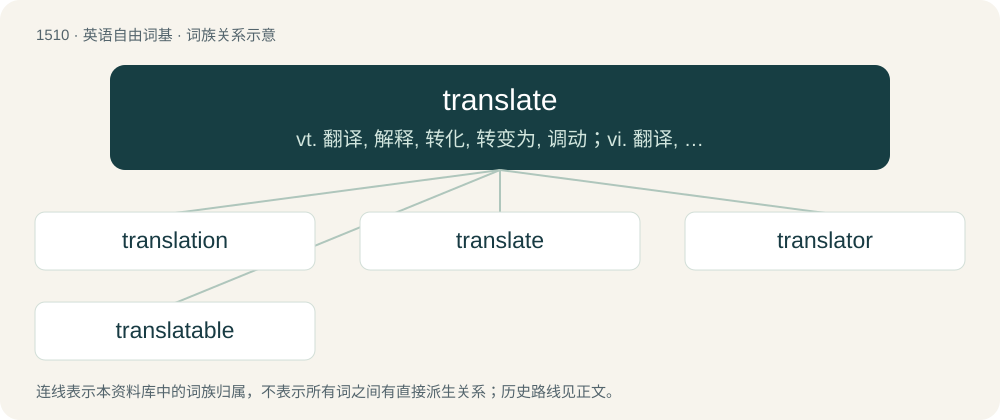

# 1598 · translate — vt. 翻译, 解释, 转化, 转变为, 调动；vi. 翻译, 被译；\[计\] 转换

[总目录](../00_总目录_按常用程度.md)

**类型**：英语自由词基　｜　**来源语言**：见词源记录

## 核心含义与来源

- 核心含义：vt. 翻译, 解释, 转化, 转变为, 调动；vi. 翻译, 被译；\[计\] 转换
- 英文含义：To change spoken words or written text (of a book, document, movie, etc.) from one language to another.
- 词形：translate

**来源记录 1**（动词；To change spoken words or written text (of a book, document, movie, etc.) from one language to another.）

From Middle English translaten (“to transport, translate, transform”), from Anglo-Norman translater, from Latin trānslātus, perfect passive participle of trānsferō (“to transport, carry across, translate”). See also -ate (verb-forming suffix). Distant doublet of transfer, see collate and confer, delate and defer, as well as prelate and prefer among others. In this sense, displaced Old English wendan (“to translate,” also the word for “to turn” and “to change”).

## 词族图

## 单词速览（常用到不常用）

| 单词 | 音标 | 释义 |
|---|---|---|
| [translation](#w-1) | 英 /tɹænzˈleɪʃən/；美 /tɹænzˈleɪʃən/ | n. 翻译, 译文, 转化, 调任, 平移, 转译；\[计\] 转换 |
| [translate](#w-2) | 英 /tɹɑːnzˈleɪt/；美 /tɹænzˈleɪt/ | vt. 翻译, 解释, 转化, 转变为, 调动；vi. 翻译, 被译；\[计\] 转换 |
| [translator](#w-3) | 英 /ˈtɹanzleɪtə/；美 /ˈtɹænzleɪtɚ/ | n. 翻译者；\[计\] 翻译程序; 翻译器 |
| [translatable](#w-4) | /tɹænzˈleɪtəbəl/ | a. 可译的, 可转变的 |

## 逐词详解

### 1. translation

**词性**：名词　｜　**音标**：英 /tɹænzˈleɪʃən/；美 /tɹænzˈleɪʃən/

**中文释义**：n. 翻译, 译文, 转化, 调任, 平移, 转译；\[计\] 转换

**英文义项**：The conversion of text from one language to another. / The discipline or study of translating written language (as opposed to interpretation, which concerns itself with spoken language).

**构词拆分**：translate + -ion

**词源与演化**：

From Middle English translacioun (“transfer, translation”), from Anglo-Norman translacioun, from Latin trānslātiō, from trānslāt-, the supine stem of trānsferō (“to transfer, transport, transform, translate”). Equivalent to translate + -ion. Displaced native Old English wending.

**例句**：

> This old text needs translation into modern English before it is published.

该用例对应义项：The conversion of text from one language to another.

### 2. translate

**词性**：动词　｜　**音标**：英 /tɹɑːnzˈleɪt/；美 /tɹænzˈleɪt/

**中文释义**：vt. 翻译, 解释, 转化, 转变为, 调动；vi. 翻译, 被译；\[计\] 转换

**英文义项**：To change spoken words or written text (of a book, document, movie, etc.) from one language to another. / To provide a translation of spoken words or written text in another language; to be, or be capable of being, rendered in another language.

**词源与演化**：

From Middle English translaten (“to transport, translate, transform”), from Anglo-Norman translater, from Latin trānslātus, perfect passive participle of trānsferō (“to transport, carry across, translate”). See also -ate (verb-forming suffix). Distant doublet of transfer, see collate and confer, delate and defer, as well as prelate and prefer among others. In this sense, displaced Old English wendan (“to translate,” also the word for “to turn” and “to change”).

**例句**：

> Excellent writing does not necessarily translate well into film.

该用例对应义项：To change, or be capable of being changed, from one form or medium to another.

### 3. translator

**词性**：名词　｜　**音标**：英 /ˈtɹanzleɪtə/；美 /ˈtɹænzleɪtɚ/

**中文释义**：n. 翻译者；\[计\] 翻译程序; 翻译器

**英文义项**：A person or thing that translates various forms of text. / Synonym of interpreter, a person or thing that immediately interprets direct speech.

**构词拆分**：translate + -or

**词源与演化**：

Directly from Latin trānslātor and French translator, and also from Middle English translatour, from Old French translatour, translateur, etc., from Latin trānslātor, from trānslātus (“carried across”) + -or (“-er: forming agent nouns”), from trānsferō (“carry across”), from trans (“across”) + ferō (“bear, carry”), q.v. Equivalent to translate + -or.

**例句**：

> Mark my words: I will become the greatest translator in the world!

### 4. translatable

**词性**：形容词　｜　**音标**：/tɹænzˈleɪtəbəl/

**中文释义**：a. 可译的, 可转变的

**英文义项**：Capable of being translated into another language. / Capable of being transferred from one context or environment to another.

**构词拆分**：translate + -able

**词源与演化**：

From translate + -able.

**例句**：

> Her political skills were easily translatable to the marketing sector.

该用例对应义项：Capable of being transferred from one context or environment to another.
