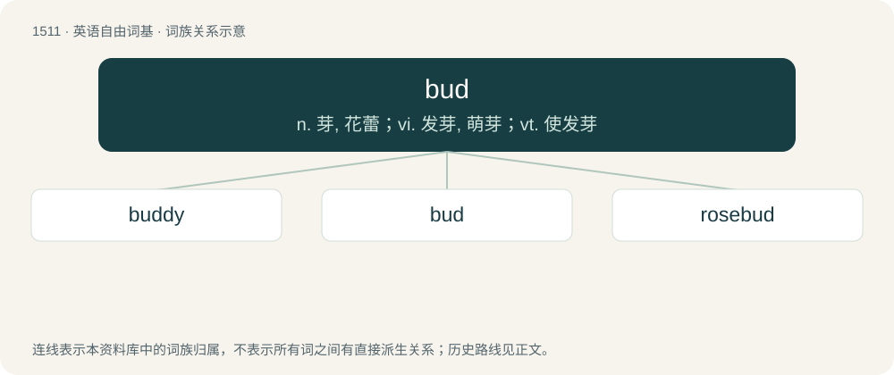

# 1599 · bud — n. 芽, 花蕾；vi. 发芽, 萌芽；vt. 使发芽

[总目录](../00_总目录_按常用程度.md)

**类型**：英语自由词基　｜　**来源语言**：见词源记录

## 核心含义与来源

- 核心含义：n. 芽, 花蕾；vi. 发芽, 萌芽；vt. 使发芽
- 英文含义：A newly sprouted leaf or blossom that has not yet unfolded.
- 词形：bud

**多个词源／构词路径**：同一拼写可能有不同来源；以下按词性和含义分别列出。

**来源记录 1**（名词；A newly sprouted leaf or blossom that has not yet unfolded.）

From Middle English budde, bodde (“bud, seed pod”), from Old English \*budde, from Proto-West Germanic \*buʀdā, from Proto-Germanic \*buzdǭ (compare archaic German Butte (“rosehip”), Swedish dialect bodd (“head”)), perhaps from Proto-Indo-European \*bʰew-, \*bu- (“to swell”). Compare also German Low German Butte, Butt (“bud”), Dutch bot (“bud”), regional German Butz, Butzen (“seed pod; apple core”), German Low German Haagbutt ("rosehip"; Haagbudden (“rosehips”, plural)).

**来源记录 2**（名词；Buddy, friend.）

Back-formation from buddy.

## 词族图

## 单词速览（常用到不常用）

| 单词 | 音标 | 释义 |
|---|---|---|
| [buddy](#w-1) | 英 /ˈbʌdi/；美 /ˈbʌdi/ | 【英文】Resembling a bud. |
| [bud](#w-2) | /bʌd/ | n. 芽, 花蕾；vi. 发芽, 萌芽；vt. 使发芽 |
| [rosebud](#w-3) | 英 /ˈɹəʊz.bʌd/；美 /ˈɹoʊz.bʌd/ | n. 蔷薇花蕾, 妙龄少女 |

## 逐词详解

### 1. buddy

**词性**：形容词　｜　**音标**：英 /ˈbʌdi/；美 /ˈbʌdi/

**英文义项**：Resembling a bud.

**构词拆分**：bud + -y

**词源与演化**：

From Middle English buddy, buddi, equivalent to bud + -y.

### 2. bud

**词性**：名词　｜　**音标**：/bʌd/

**中文释义**：n. 芽, 花蕾；vi. 发芽, 萌芽；vt. 使发芽

**英文义项**：A newly sprouted leaf or blossom that has not yet unfolded. / Something that has begun to develop.

**词源与演化**：

From Middle English budde, bodde (“bud, seed pod”), from Old English \*budde, from Proto-West Germanic \*buʀdā, from Proto-Germanic \*buzdǭ (compare archaic German Butte (“rosehip”), Swedish dialect bodd (“head”)), perhaps from Proto-Indo-European \*bʰew-, \*bu- (“to swell”). Compare also German Low German Butte, Butt (“bud”), Dutch bot (“bud”), regional German Butz, Butzen (“seed pod; apple core”), German Low German Haagbutt ("rosehip"; Haagbudden (“rosehips”, plural)).

**例句**：

> After a long, cold winter, the trees finally began to produce buds.

该用例对应义项：A newly sprouted leaf or blossom that has not yet unfolded.

### 3. rosebud

**词性**：名词　｜　**音标**：英 /ˈɹəʊz.bʌd/；美 /ˈɹoʊz.bʌd/

**中文释义**：n. 蔷薇花蕾, 妙龄少女

**英文义项**：The bud of a rose. / A pretty young woman.

**构词拆分**：rose + bud

**词源与演化**：

From rose + bud.

**例句**：

> He also pursed his lips to such an extent that they resembled a rosebud in a dirty bush.
