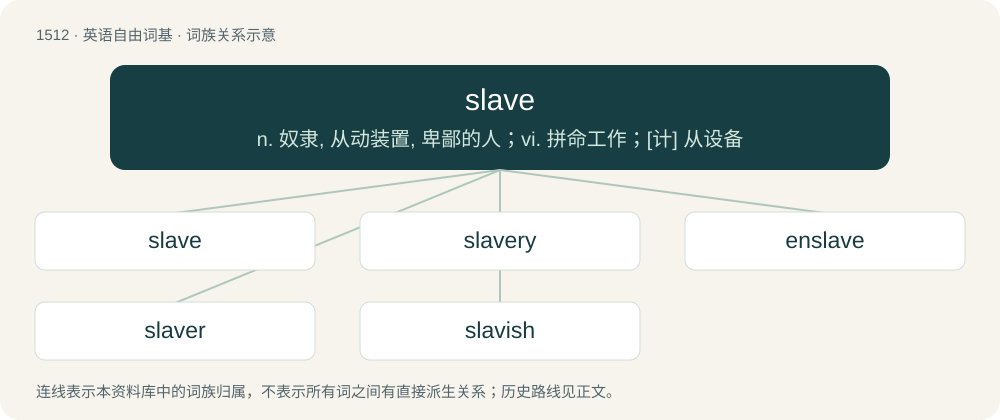

# 1600 · slave — n. 奴隶, 从动装置, 卑鄙的人；vi. 拼命工作；\[计\] 从设备

[总目录](../00_总目录_按常用程度.md)

**类型**：英语自由词基　｜　**来源语言**：见词源记录

## 核心含义与来源

- 核心含义：n. 奴隶, 从动装置, 卑鄙的人；vi. 拼命工作；\[计\] 从设备
- 英文含义：A person who is held in servitude as the property of another person, and whose labor (and often also whose body and life) is subject to the owner's volition and control.
- 词形：slave

**来源记录 1**（名词；A person who is held in servitude as the property of another person, and whose labor (and often also whose body and life) is subject to the owner's volition and control.）

Inherited from Middle English sclave, from Old French esclave, from Medieval Latin sclavus (“slave”), from Late Latin Sclavus (“Slav”), traditionally assumed to be because Slavs were often forced into slavery in the Middle Ages. The Latin word is from Byzantine Greek Σκλάβος (Sklábos); see that entry and Slav for more. Displaced native Old English þēow. Thrall and bondsman/bondswoman, however, remain common synonyms. Doublet of ciao and Slav. An alternative hypothesis derives sclavus from Ancient Greek σκῡλεύω (skūleúō), σκῡλάω (skūláō, “to strip or despoil a slain enemy”).

## 词族图

## 单词速览（常用到不常用）

| 单词 | 音标 | 释义 |
|---|---|---|
| [slave](#w-1) | /sleɪv/ | n. 奴隶, 从动装置, 卑鄙的人；vi. 拼命工作；\[计\] 从设备 |
| [slavery](#w-2) | /ˈsleɪvəɹi/ | n. 奴隶的身分, 奴隶状态, 奴隶制度；\[法\] 奴隶制度, 奴役, 苦役 |
| [enslave](#w-3) | /ɪnˈsleɪv/ | vt. 奴役, 束缚, 使受控制, 征服 |
| [slaver](#w-4) | 英 /ˈsleɪvə/；美 /ˈsleɪvɚ/ | 【英文】A person engaged in the slave trade; a person who buys, sells, transports, or owns slaves. |
| [slavish](#w-5) | /ˈsleɪvɪʃ/ | a. 奴隶的, 奴性的, 盲从的 |

## 逐词详解

### 1. slave

**词性**：名词　｜　**音标**：/sleɪv/

**中文释义**：n. 奴隶, 从动装置, 卑鄙的人；vi. 拼命工作；\[计\] 从设备

**英文义项**：A person who is held in servitude as the property of another person, and whose labor (and often also whose body and life) is subject to the owner's volition and control. / A drudge; one who labors or is obliged (e.g. by prior contract) to labor like a slave with limited rights, e.g. an indentured servant.

**词源与演化**：

Inherited from Middle English sclave, from Old French esclave, from Medieval Latin sclavus (“slave”), from Late Latin Sclavus (“Slav”), traditionally assumed to be because Slavs were often forced into slavery in the Middle Ages. The Latin word is from Byzantine Greek Σκλάβος (Sklábos); see that entry and Slav for more. Displaced native Old English þēow. Thrall and bondsman/bondswoman, however, remain common synonyms. Doublet of ciao and Slav. An alternative hypothesis derives sclavus from Ancient Greek σκῡλεύω (skūleúō), σκῡλάω (skūláō, “to strip or despoil a slain enemy”).

**用法示例／搭配（非完整句）**：

> a slave to passion, to strong drink, or to ambition

该用例对应义项：One who has no power of resistance to something, one who surrenders to or is under the domination of something.

### 2. slavery

**词性**：名词　｜　**音标**：/ˈsleɪvəɹi/

**中文释义**：n. 奴隶的身分, 奴隶状态, 奴隶制度；\[法\] 奴隶制度, 奴役, 苦役

**英文义项**：An institution or social practice of owning human beings as property, especially for use as forced laborers. / Forced labor in general, regardless of legality.

**构词拆分**：slave + -ery

**词源与演化**：

From slave + -ery.

**例句**：

> Slavery was abolished in the nineteenth century.

该用例对应义项：An institution or social practice of owning human beings as property, especially for use as forced laborers.

### 3. enslave

**词性**：动词　｜　**音标**：/ɪnˈsleɪv/

**中文释义**：vt. 奴役, 束缚, 使受控制, 征服

**英文义项**：To make subservient; to strip one of freedom; enthrall.

**构词拆分**：en- + slave

**词源与演化**：

From en- + slave.

**例句**：

> To give millions a knowledge of English is to enslave them.

### 4. slaver

**词性**：名词　｜　**音标**：英 /ˈsleɪvə/；美 /ˈsleɪvɚ/

**英文义项**：A person engaged in the slave trade; a person who buys, sells, transports, or owns slaves. / A white slaver; a person who sells prostitutes into sexual slavery.

**构词拆分**：slave + -er

**词源与演化**：

From slave (“enslave, traffic in slaves”) + -er.

### 5. slavish

**词性**：形容词　｜　**音标**：/ˈsleɪvɪʃ/

**中文释义**：a. 奴隶的, 奴性的, 盲从的

**英文义项**：In the manner of a slave; abject. / Utterly faithful; totally lacking originality, creativity, or reflection.

**构词拆分**：slave + -ish

**词源与演化**：

From slave + -ish.

**用法示例／搭配（非完整句）**：

> slavish observation of rules

该用例对应义项：Utterly faithful; totally lacking originality, creativity, or reflection.
