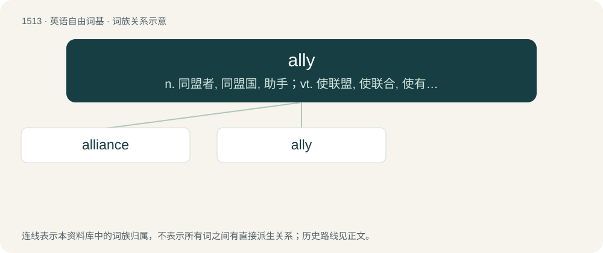

# 1601 · ally — n. 同盟者, 同盟国, 助手；vt. 使联盟, 使联合, 使有关系；vi. 结盟

[总目录](../00_总目录_按常用程度.md)

**类型**：英语自由词基　｜　**来源语言**：见词源记录

## 核心含义与来源

- 核心含义：n. 同盟者, 同盟国, 助手；vt. 使联盟, 使联合, 使有关系；vi. 结盟
- 英文含义：To unite or form a connection between (people or things), as between families by marriage, or between states by confederacy, league, or treaty.
- 词形：ally

**多个词源／构词路径**：同一拼写可能有不同来源；以下按词性和含义分别列出。

**来源记录 1**（动词；To unite or form a connection between (people or things), as between families by marriage, or between states by confederacy, league, or treaty.）

From Middle English allien, alien (“to form an alliance, associate, join; to become an ally; to introduce (someone) as an ally; to marry; to become related (to someone); to attack, engage in combat; to combine; (cooking) to combine ingredients, especially to bind them together”) \[and other forms\], from Anglo-Norman alier, allier, Middle French alier, allier \[and other forms\], and Old French alier (“to join together, unite; to alloy (metals); (cooking) to combine ingredients”) (modern French allier), from Latin alligāre, the present active infinitive of alligō, adligō (“to bind around, to, or up (something), bandage, fasten, fetter, tie; to hold fast; to detain, hinder”), from al-, ad- (intensifying prefix) + ligō (“to bind, tie; to bandage, wrap around; to unite”) (from Proto-Indo-European \*leyǵ- (“to bind, tie”)). Doublet of allay, alligate, alloy, and ligament.

**来源记录 2**（名词；A person who co-operates with or helps another; an associate; a friend.）

From Middle English allie, alie \[and other forms\], probably partly: \* from allien (verb): see etymology 1; and \* from Anglo-Norman allié, alié, alyé, allyé, Middle French allié, alié, allyé (“associate, supporter; friend; relative; person, state, etc., associated or united with another by alliance or treaty”), and Old French alliiet (“military or political ally”) (modern French allié), a noun use of the past participle of Anglo-Norman alier, allier, Middle French alier, allier, and Old French alier (verb): see etymology 1.

## 词族图

## 单词速览（常用到不常用）

| 单词 | 音标 | 释义 |
|---|---|---|
| [alliance](#w-1) | 英 /əˈlaɪ.əns/ | n. 联盟, 联合；\[法\] 同盟, 联盟, 联姻 |
| [ally](#w-2) | 英 /ˈæl.aɪ/；美 /ˈæl.aɪ/ | n. 同盟者, 同盟国, 助手；vt. 使联盟, 使联合, 使有关系；vi. 结盟 |

## 逐词详解

### 1. alliance

**词性**：名词　｜　**音标**：英 /əˈlaɪ.əns/

**中文释义**：n. 联盟, 联合；\[法\] 同盟, 联盟, 联姻

**英文义项**：The state of being allied. / The act of allying or uniting.

**构词拆分**：ally + -ance

**词源与演化**：

From Middle English alliaunce, from Old French aliance (French alliance). Equivalent to ally + -ance. Compare with Doric Greek ἁλία (halía, “assembly”). See also al-.

**用法示例／搭配（非完整句）**：

> an alliance between church and state, or welded by two countries

该用例对应义项：A union or connection of interests between families, states, parties, etc., especially between families by marriage and states by compact, treaty, or league.

### 2. ally

**词性**：动词　｜　**音标**：英 /ˈæl.aɪ/；美 /ˈæl.aɪ/

**中文释义**：n. 同盟者, 同盟国, 助手；vt. 使联盟, 使联合, 使有关系；vi. 结盟

**英文义项**：To unite or form a connection between (people or things), as between families by marriage, or between states by confederacy, league, or treaty. / Chiefly followed by to or with: to connect or form a relation to (someone or something) by similarity in features or nature.

**词源与演化**：

From Middle English allien, alien (“to form an alliance, associate, join; to become an ally; to introduce (someone) as an ally; to marry; to become related (to someone); to attack, engage in combat; to combine; (cooking) to combine ingredients, especially to bind them together”) \[and other forms\], from Anglo-Norman alier, allier, Middle French alier, allier \[and other forms\], and Old French alier (“to join together, unite; to alloy (metals); (cooking) to combine ingredients”) (modern French allier), from Latin alligāre, the present active infinitive of alligō, adligō (“to bind around, to, or up (something), bandage, fasten, fetter, tie; to hold fast; to detain, hinder”), from al-, ad- (intensifying prefix) + ligō (“to bind, tie; to bandage, wrap around; to unite”) (from Proto-Indo-European \*leyǵ- (“to bind, tie”)). Doublet of allay, alligate, alloy, and ligament.

**例句**：

> Fadil can either be your best ally or your worst enemy.
