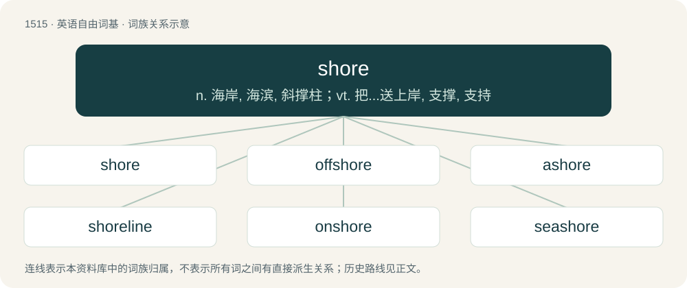

# 1602 · shore — n. 海岸, 海滨, 斜撑柱；vt. 把...送上岸, 支撑, 支持

[总目录](../00_总目录_按常用程度.md)

**类型**：英语自由词基　｜　**来源语言**：见词源记录

## 核心含义与来源

- 核心含义：n. 海岸, 海滨, 斜撑柱；vt. 把...送上岸, 支撑, 支持
- 英文含义：Land adjoining a non-flowing body of water, such as an ocean, lake or pond.
- 词形：shore

**多个词源／构词路径**：同一拼写可能有不同来源；以下按词性和含义分别列出。

**来源记录 1**（名词；Land adjoining a non-flowing body of water, such as an ocean, lake or pond.）

From Middle English schore, from Old English \*sċora (attested as sċor- in placenames), from Proto-Germanic \*skurô (“rugged rock, cliff, high rocky shore”). Possibly related to Old English sċieran (“to cut”), which survives today as English shear. Cognate with Middle Dutch scorre (“land washed by the sea”), Middle Low German schor (“shore, coast, headland”), Middle High German schorre ("rocky crag, high rocky shore"; &gt; German Schorre, Schorren (“towering rock, crag”)), and Limburgish sjaor (“riverbank”). Maybe connected with Norwegian Bokmål skjær.

**来源记录 2**（名词；A prop or strut supporting some structure or weight above it.）

From Late Middle English shore (“a prop, a support”) \[and other forms\], from Middle Dutch schore, schare (“a prop, a stay”) (modern Dutch schoor), and Middle Low German schōre, schāre (“a prop, a stay; barrier; stockade”) (compare Old Norse skorða (“a prop, a stay”) (Norwegian skor, skorda)); further etymology unknown.

**来源记录 3**（动词；Not followed by up: to provide (something) with support.）

From Late Middle English shoren (“to prop, to support”) \[and other forms\], from Middle English shore (“a prop, a support”) (see etymology 2) + -en (suffix forming the infinitive form of verbs); compare Middle Dutch schooren (“to prop up, support”) and Middle Low German schore (“to shovel; to sweep”).

**来源记录 4**（名词；A sewer.）

Originally common-shore.

## 词族图

## 单词速览（常用到不常用）

| 单词 | 音标 | 释义 |
|---|---|---|
| [shore](#w-1) | 英 /ʃɔː/；美 /ʃɔɹ/ | n. 海岸, 海滨, 斜撑柱；vt. 把...送上岸, 支撑, 支持 |
| [offshore](#w-2) | /ɒfˈʃɔː(ɹ)/ | a. 海面的, 吹向海面的, 近海的；adv. 向海面 |
| [ashore](#w-3) | 英 /əˈʃɔː/；美 /əˈʃɔɹ/ | adv. 向岸, 在岸上 |
| [shoreline](#w-4) | /ˈʃɒːlain/ | n. 海岸线 |
| [onshore](#w-5) | 英 /ˈɒnʃɔː/；/ˈɔnʃoɹ/ | a. 向陆的, 陆上的, 在国内的；adv. 向陆地, 在陆上, 在国内 |
| [seashore](#w-6) | 英 /ˈsiːʃɔː/；美 /ˈsiːʃoɹ/ | n. 海岸, 海滨 |
| [lakeshore](#w-7) | 英 /ˈleɪk.ʃɔː/；美 /ˈleɪk.ʃɔɹ/ | n. 湖岸 |
| [foreshore](#w-8) | /ˈfɒːʃɒː/ | n. 前滩, 海滩 |
| [shored](#w-9) |  | vt. 支撑（shore的过去式与过去分词形式） |

## 逐词详解

### 1. shore

**词性**：名词　｜　**音标**：英 /ʃɔː/；美 /ʃɔɹ/

**中文释义**：n. 海岸, 海滨, 斜撑柱；vt. 把...送上岸, 支撑, 支持

**英文义项**：Land adjoining a non-flowing body of water, such as an ocean, lake or pond. / Land, usually near a port.

**词源与演化**：

From Middle English schore, from Old English \*sċora (attested as sċor- in placenames), from Proto-Germanic \*skurô (“rugged rock, cliff, high rocky shore”). Possibly related to Old English sċieran (“to cut”), which survives today as English shear. Cognate with Middle Dutch scorre (“land washed by the sea”), Middle Low German schor (“shore, coast, headland”), Middle High German schorre ("rocky crag, high rocky shore"; &gt; German Schorre, Schorren (“towering rock, crag”)), and Limburgish sjaor (“riverbank”). Maybe connected with Norwegian Bokmål skjær.

**例句**：

> The seamen were serving on shore instead of on ships.

该用例对应义项：Land, usually near a port.

### 2. offshore

**词性**：形容词　｜　**音标**：/ɒfˈʃɔː(ɹ)/

**中文释义**：a. 海面的, 吹向海面的, 近海的；adv. 向海面

**英文义项**：Moving away from the shore. / Located in the sea away from the coast.

**构词拆分**：From off- + shore.

**词源与演化**：

From off- + shore.

**用法示例／搭配（非完整句）**：

> an offshore oil rig

该用例对应义项：Located in the sea away from the coast.

### 3. ashore

**词性**：副词　｜　**音标**：英 /əˈʃɔː/；美 /əˈʃɔɹ/

**中文释义**：adv. 向岸, 在岸上

**英文义项**：On the land as opposed to onboard. / On, or towards the shore.

**构词拆分**：a- + shore

**词源与演化**：

From a- + shore; see also onshore.

**例句**：

> The canoe sailed ashore.

该用例对应义项：On, or towards the shore.

### 4. shoreline

**词性**：名词　｜　**音标**：/ˈʃɒːlain/

**中文释义**：n. 海岸线

**英文义项**：The divide between land and a body of water. / The line on a map that illustrates this.

**构词拆分**：shore + line

**词源与演化**：

From shore + line.

**例句**：

> This road follows the shoreline for the next thirty kilometers.

### 5. onshore

**词性**：形容词　｜　**音标**：英 /ˈɒnʃɔː/；/ˈɔnʃoɹ/

**中文释义**：a. 向陆的, 陆上的, 在国内的；adv. 向陆地, 在陆上, 在国内

**英文义项**：Moving from the sea towards the land. / Positioned on or near the shore.

**构词拆分**：on + shore

**词源与演化**：

From on + shore.

**用法示例／搭配（非完整句）**：

> an onshore breeze

该用例对应义项：Moving from the sea towards the land.

### 6. seashore

**词性**：名词　｜　**音标**：英 /ˈsiːʃɔː/；美 /ˈsiːʃoɹ/

**中文释义**：n. 海岸, 海滨

**英文义项**：The coastal land bordering a sea or an ocean. / The foreshore, the strip of land between low water and high water.

**构词拆分**：sea + shore

**词源与演化**：

From sea + shore.

**例句**：

> We often took a walk along the seashore together in the morning.

### 7. lakeshore

**词性**：名词　｜　**音标**：英 /ˈleɪk.ʃɔː/；美 /ˈleɪk.ʃɔɹ/

**中文释义**：n. 湖岸

**英文义项**：The shore of a lake.

**构词拆分**：lake + shore

**词源与演化**：

From lake + shore.

### 8. foreshore

**词性**：名词　｜　**音标**：/ˈfɒːʃɒː/

**中文释义**：n. 前滩, 海滩

**英文义项**：The part of a shore between high water and low water.

**构词拆分**：fore- + shore

**词源与演化**：

From fore- + shore.

### 9. shored

**词性**：形容词

**中文释义**：vt. 支撑（shore的过去式与过去分词形式）

**英文义项**：Having a shore, often one of a specified type.

**构词拆分**：From shore (“coast”) + -ed.

**词源与演化**：

From shore (“coast”) + -ed.

**用法示例／搭配（非完整句）**：

> the rocky-shored straits, a sandy-shored cove

该用例对应义项：Having a shore, often one of a specified type.
