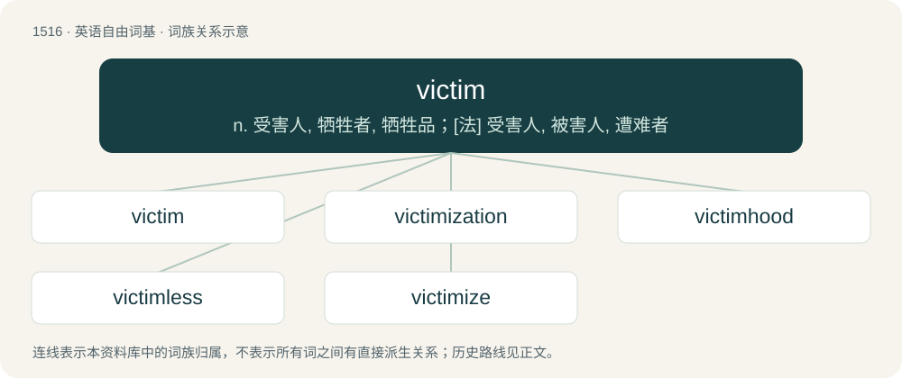

# 1603 · victim — n. 受害人, 牺牲者, 牺牲品；\[法\] 受害人, 被害人, 遭难者

[总目录](../00_总目录_按常用程度.md)

**类型**：英语自由词基　｜　**来源语言**：见词源记录

## 核心含义与来源

- 核心含义：n. 受害人, 牺牲者, 牺牲品；\[法\] 受害人, 被害人, 遭难者
- 英文含义：One that is harmed—killed, injured, subjected to oppression, deceit, or otherwise adversely affected—by someone or something, especially another person or event, force, or condition; in particular
- 词形：victim

**来源记录 1**（名词；One that is harmed—killed, injured, subjected to oppression, deceit, or otherwise adversely affected—by someone or something, especially another person or event, force, or condition; in particular）

From Middle French victime, from Latin victima (“sacrificial animal”). Although this root and victor drive from homophonous PIE roots, they are traditionally reconstructed as separate words and thus not cognates.

## 词族图

## 单词速览（常用到不常用）

| 单词 | 音标 | 释义 |
|---|---|---|
| [victim](#w-1) | /ˈvɪktɪm/ | n. 受害人, 牺牲者, 牺牲品；\[法\] 受害人, 被害人, 遭难者 |
| [victimization](#w-2) | /ˌvɪk.tɪ.maɪˈzeɪ.ʃən/ | n. 牺牲, 欺骗 |
| [victimhood](#w-3) |  | n. 受害人；牺牲品；牺牲者 (victim的变形) |
| [victimless](#w-4) | /ˈviktimlis/ | \[法\] 没有受害者的 |
| [victimize](#w-5) | /ˈvɪktɪmaɪz/ | vt. 使牺牲, 使受害；\[法\] 使受害, 使作牺牲, 欺骗 |

## 逐词详解

### 1. victim

**词性**：名词　｜　**音标**：/ˈvɪktɪm/

**中文释义**：n. 受害人, 牺牲者, 牺牲品；\[法\] 受害人, 被害人, 遭难者

**英文义项**：One that is harmed—killed, injured, subjected to oppression, deceit, or otherwise adversely affected—by someone or something, especially another person or event, force, or condition; in particular / One who is harmed or killed by a crime or scam.

**词源与演化**：

From Middle French victime, from Latin victima (“sacrificial animal”). Although this root and victor drive from homophonous PIE roots, they are traditionally reconstructed as separate words and thus not cognates.

**例句**：

> The victim of the robbery gave a detailed statement.

该用例对应义项：One that is harmed—killed, injured, subjected to oppression, deceit, or otherwise adversely affected—by someone or something, especially another person or event, force, or condition; in particular

### 2. victimization

**词性**：名词　｜　**音标**：/ˌvɪk.tɪ.maɪˈzeɪ.ʃən/

**中文释义**：n. 牺牲, 欺骗

**英文义项**：An act that victimizes or exploits someone. / Adversity as a result of being a victim.

**构词拆分**：victim + -ization；victimize + -ation

**词源与演化**：

From victim + -ization or victimize + -ation.

**例句**：

> Paying Blacks less and charging them more is a form of victimization.

该用例对应义项：an act that exploits or victimizes someone (treats them unfairly)

### 3. victimhood

**词性**：名词

**中文释义**：n. 受害人；牺牲品；牺牲者 (victim的变形)

**英文义项**：The state or perception of being a victim.

**构词拆分**：victim + -hood

**词源与演化**：

From victim + -hood.

**例句**：

> Victimhood might seem easier, but it doesn’t lead to personal growth.

### 4. victimless

**词性**：形容词　｜　**音标**：/ˈviktimlis/

**中文释义**：\[法\] 没有受害者的

**英文义项**：Without a victim.

**构词拆分**：victim + -less

**词源与演化**：

From victim + -less.

**例句**：

> He said that prostitution, drug trafficking, and gambling were victimless crimes.

该用例对应义项：Without a victim.

### 5. victimize

**词性**：动词　｜　**音标**：/ˈvɪktɪmaɪz/

**中文释义**：vt. 使牺牲, 使受害；\[法\] 使受害, 使作牺牲, 欺骗

**英文义项**：To make (someone) a victim or sacrifice. / To punish unjustly.

**构词拆分**：victim + -ize

**词源与演化**：

From victim + -ize.

**例句**：

> The police are known to victimize anyone who isn't local to that town.
