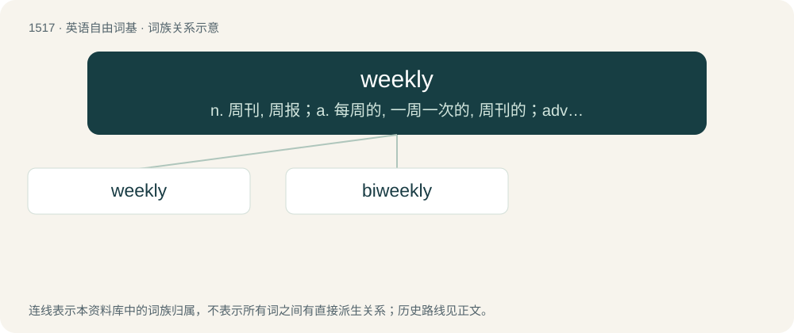

# 1605 · weekly — n. 周刊, 周报；a. 每周的, 一周一次的, 周刊的；adv. 每周, 一周一次

[总目录](../00_总目录_按常用程度.md)

**类型**：英语自由词基　｜　**来源语言**：见词源记录

## 核心含义与来源

- 核心含义：n. 周刊, 周报；a. 每周的, 一周一次的, 周刊的；adv. 每周, 一周一次
- 英文含义：Once every week.
- 词形：weekly

**来源记录 1**（副词；Once every week.）

From Middle English wykely (adverb), equivalent to week + -ly (adverbial suffix) or week + -ly (adjectival suffix). Compare Dutch wekelijks (“weekly”), German wöchentlich (“weekly”), Danish ugentlig (“weekly”), Norwegian ukentlig (“weekly”), Icelandic vikulega (“weekly”), Swedish veckovis (“weekly”).

## 词族图

## 单词速览（常用到不常用）

| 单词 | 音标 | 释义 |
|---|---|---|
| [weekly](#w-1) | /ˈwiːk.li/ | n. 周刊, 周报；a. 每周的, 一周一次的, 周刊的；adv. 每周, 一周一次 |
| [biweekly](#w-2) | /baɪˈwiːkli/ | n. 双周刊；a. 两周一次的, 每周二次的；adv. 每两周一次地, 每周二次地 |

## 逐词详解

### 1. weekly

**词性**：形容词　｜　**音标**：/ˈwiːk.li/

**中文释义**：n. 周刊, 周报；a. 每周的, 一周一次的, 周刊的；adv. 每周, 一周一次

**英文义项**：Of or relating to a week. / Happening once a week, or every week.

**构词拆分**：week + -ly (adverbial suffix)；week + -ly (adjectival suffix)

**词源与演化**：

From Middle English wykely (adverb), equivalent to week + -ly (adverbial suffix) or week + -ly (adjectival suffix). Compare Dutch wekelijks (“weekly”), German wöchentlich (“weekly”), Danish ugentlig (“weekly”), Norwegian ukentlig (“weekly”), Icelandic vikulega (“weekly”), Swedish veckovis (“weekly”).

**例句**：

> He's going for his weekly check-up at the hospital.

该用例对应义项：Happening once a week, or every week.

### 2. biweekly

**词性**：名词　｜　**音标**：/baɪˈwiːkli/

**中文释义**：n. 双周刊；a. 两周一次的, 每周二次的；adv. 每两周一次地, 每周二次地

**英文义项**：Something that is published or released once every two weeks.

**构词拆分**：bi- + week + -ly；bi- + weekly

**词源与演化**：

From bi- + week + -ly. The sense referring to twice a week can be analyzed as bi- + weekly.

**例句**：

> The local paper is a biweekly.

该用例对应义项：Something that is published or released once every two weeks.
