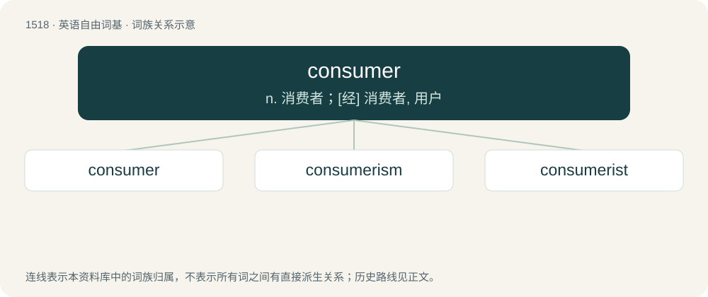

# 1606 · consumer — n. 消费者；\[经\] 消费者, 用户

[总目录](../00_总目录_按常用程度.md)

**类型**：英语自由词基　｜　**来源语言**：见词源记录

## 核心含义与来源

- 核心含义：n. 消费者；\[经\] 消费者, 用户
- 英文含义：One who, or that which, consumes.
- 词形：consumer

**来源记录 1**（名词；One who, or that which, consumes.）

From consume + -er.

## 词族图

## 单词速览（常用到不常用）

| 单词 | 音标 | 释义 |
|---|---|---|
| [consumer](#w-1) | 英 /kənˈsjuːmə/；美 /kənˈsumɚ/ | n. 消费者；\[经\] 消费者, 用户 |
| [consumerism](#w-2) | 英 /kənˈsjumərɪzm̩/；美 /kənˈsumərɪzm̩/ | n. 保护消费者利益运动 |
| [consumerist](#w-3) | /kənˈsuːmərɪst/ | 用户至上主义者, 主张消费主义的人 |

## 逐词详解

### 1. consumer

**词性**：名词　｜　**音标**：英 /kənˈsjuːmə/；美 /kənˈsumɚ/

**中文释义**：n. 消费者；\[经\] 消费者, 用户

**英文义项**：One who, or that which, consumes. / Someone who trades money for goods or services as an individual.

**构词拆分**：consume + -er

**词源与演化**：

From consume + -er.

**例句**：

> This new system favours the consumer over the producer.

该用例对应义项：Someone who trades money for goods or services as an individual.

### 2. consumerism

**词性**：名词　｜　**音标**：英 /kənˈsjumərɪzm̩/；美 /kənˈsumərɪzm̩/

**中文释义**：n. 保护消费者利益运动

**英文义项**：A materialistic attachment to possessions with a heavy use of consumables; a lifestyle based on such tendencies. / An economic theory that increased consumption is beneficial to a nation's economy in the long run.

**构词拆分**：consumer + -ism

**词源与演化**：

From consumer + -ism.

**例句**：

> Do the Germans have any other concerns in life apart from consumerism?

### 3. consumerist

**词性**：形容词　｜　**音标**：/kənˈsuːmərɪst/

**中文释义**：用户至上主义者, 主张消费主义的人

**英文义项**：Of or pertaining to consumerism; consumeristic.

**构词拆分**：consumer + -ist

**词源与演化**：

From consumer + -ist.

**用法示例／搭配（非完整句）**：

> consumerist society

该用例对应义项：Of or pertaining to consumerism; consumeristic.
