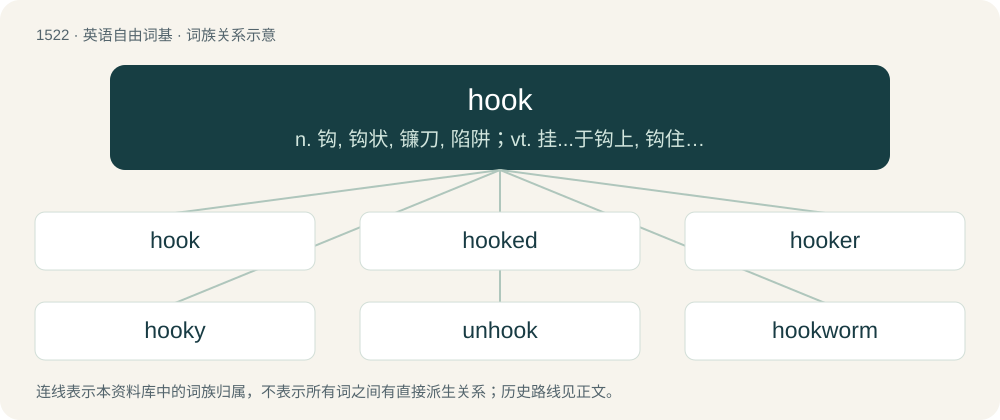

# 1608 · hook — n. 钩, 钩状, 镰刀, 陷阱；vt. 挂...于钩上, 钩住, 引上钩, 偷窃；vi. 弯成钩状, 钩紧

[总目录](../00_总目录_按常用程度.md)

**类型**：英语自由词基　｜　**来源语言**：见词源记录

## 核心含义与来源

- 核心含义：n. 钩, 钩状, 镰刀, 陷阱；vt. 挂...于钩上, 钩住, 引上钩, 偷窃；vi. 弯成钩状, 钩紧
- 英文含义：A rod bent into a curved shape, typically with one end free and the other end secured to a rope or other attachment.
- 词形：hook

**来源记录 1**（名词；A rod bent into a curved shape, typically with one end free and the other end secured to a rope or other attachment.）

From Middle English hoke, from Old English hōc (“angle, point, hook”), from Proto-West Germanic \*hōk, from Proto-Germanic \*hōkaz, variant of \*hakô (“hook”), probably ultimately from Proto-Indo-European \*kog-, \*keg-, \*keng- (“peg, hook, claw”). Cognates Cognate with Scots huke, huik (“hook”), West Frisian and Dutch hoek (“hook, angle, corner”), Low German Hook, Huuk, German Hook (“small cluster of farms”), Faroese høkja (“crutch”), Icelandic hækja (“crutch”), Norn hek (“crutch”), Finnish kuokka (“hoe, mattock”). Related to hake.

## 词族图

## 单词速览（常用到不常用）

| 单词 | 音标 | 释义 |
|---|---|---|
| [hook](#w-1) | 英 /hʊk/；/huːk/ | n. 钩, 钩状, 镰刀, 陷阱；vt. 挂...于钩上, 钩住, 引上钩, 偷窃；vi. 弯成钩状, 钩紧 |
| [hooked](#w-2) | /hʊkt/ | a. 钩状的, 有钩的, 用钩针编织的 |
| [hooker](#w-3) | 英 /ˈhʊkə/；美 /ˈhʊkɚ/ | n. 用钩子的人, 渔船 |
| [hooky](#w-4) | /ˈhʊki/ | 【英文】Full of hooks (in any sense). |
| [unhook](#w-5) | /.ʌnˈhuk/ | vt. 从...取下, 解开...的钩子 |
| [hookworm](#w-6) | 美 /ˈhʊkˌwɝm/ | n. 钩虫；\[医\] 钩虫 |

## 逐词详解

### 1. hook

**词性**：名词　｜　**音标**：英 /hʊk/；/huːk/

**中文释义**：n. 钩, 钩状, 镰刀, 陷阱；vt. 挂...于钩上, 钩住, 引上钩, 偷窃；vi. 弯成钩状, 钩紧

**英文义项**：A rod bent into a curved shape, typically with one end free and the other end secured to a rope or other attachment. / A barbed metal hook used for fishing; a fishhook.

**词源与演化**：

From Middle English hoke, from Old English hōc (“angle, point, hook”), from Proto-West Germanic \*hōk, from Proto-Germanic \*hōkaz, variant of \*hakô (“hook”), probably ultimately from Proto-Indo-European \*kog-, \*keg-, \*keng- (“peg, hook, claw”). Cognates Cognate with Scots huke, huik (“hook”), West Frisian and Dutch hoek (“hook, angle, corner”), Low German Hook, Huuk, German Hook (“small cluster of farms”), Faroese høkja (“crutch”), Icelandic hækja (“crutch”), Norn hek (“crutch”), Finnish kuokka (“hoe, mattock”). Related to hake.

**例句**：

> We've added hooks to allow undefined message types to be handled with custom code.

该用例对应义项：Part of a system's operation that can be intercepted to change or augment its behaviour.

### 2. hooked

**词性**：形容词　｜　**音标**：/hʊkt/

**中文释义**：a. 钩状的, 有钩的, 用钩针编织的

**英文义项**：Having a sharp curve at the end; resembling a hook. / Addicted; unable to resist or cease doing.

**构词拆分**：From hook + -ed.

**词源与演化**：

From hook + -ed.

**例句**：

> He will never leave her because he is hooked on her chocolate chip cookies.

该用例对应义项：Addicted; unable to resist or cease doing.

### 3. hooker

**词性**：名词　｜　**音标**：英 /ˈhʊkə/；美 /ˈhʊkɚ/

**中文释义**：n. 用钩子的人, 渔船

**英文义项**：One who, or that which, hooks. / A player who hooks the ball out of the scrum with his foot.

**构词拆分**：hook + -er

**词源与演化**：

From hook (verb) + -er.

**例句**：

> You can't find a job if you're dressed like a hooker.

### 4. hooky

**词性**：形容词　｜　**音标**：/ˈhʊki/

**英文义项**：Full of hooks (in any sense). / Shaped like or resembling a hook; hooked.

**构词拆分**：hook + -y

**词源与演化**：

From hook + -y.

**例句**：

> Sew the hooky half of the Velcro on the inner side so that it doesn't pick up fluff.

该用例对应义项：Full of hooks (in any sense).

### 5. unhook

**词性**：动词　｜　**音标**：/.ʌnˈhuk/

**中文释义**：vt. 从...取下, 解开...的钩子

**英文义项**：To remove from a hook. / To unfasten by means of hooks.

**构词拆分**：un- + hook

**词源与演化**：

From un- + hook.

**用法示例／搭配（非完整句）**：

> to unhook a bra

该用例对应义项：To unfasten by means of hooks.

### 6. hookworm

**词性**：名词　｜　**音标**：美 /ˈhʊkˌwɝm/

**中文释义**：n. 钩虫；\[医\] 钩虫

**英文义项**：Any of various parasitic bloodsucking roundworms which cause disease, especially the species Ancylostoma duodenale and Necator americanus, having hooked mouthparts and entering their hosts by boring through the skin. / Infection with one of these parasites.

**构词拆分**：hook + worm

**词源与演化**：

From hook + worm.

**用法示例／搭配（非完整句）**：

> a case of hookworm

该用例对应义项：Infection with one of these parasites.
