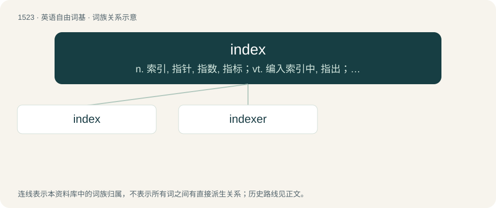

# 1609 · index — n. 索引, 指针, 指数, 指标；vt. 编入索引中, 指出；vi. 做索引

[总目录](../00_总目录_按常用程度.md)

**类型**：英语自由词基　｜　**来源语言**：见词源记录

## 核心含义与来源

- 核心含义：n. 索引, 指针, 指数, 指标；vt. 编入索引中, 指出；vi. 做索引
- 英文含义：An alphabetical listing of items and their location.
- 词形：index

**来源记录 1**（名词；An alphabetical listing of items and their location.）

From Latin index (“a discoverer, informer, spy; of things, an indicator, the forefinger, a title, superscription”), from indicō (“point out, show”); see indicate.

## 词族图

## 单词速览（常用到不常用）

| 单词 | 音标 | 释义 |
|---|---|---|
| [index](#w-1) | 英 /ˈɪndɛks/ | n. 索引, 指针, 指数, 指标；vt. 编入索引中, 指出；vi. 做索引 |
| [indexer](#w-2) | /inˈdeksə/ | n. 编索引的人；\[计\] 位标, 变址器, 编索引者 |

## 逐词详解

### 1. index

**词性**：名词　｜　**音标**：英 /ˈɪndɛks/

**中文释义**：n. 索引, 指针, 指数, 指标；vt. 编入索引中, 指出；vi. 做索引

**英文义项**：An alphabetical listing of items and their location. / The index finger; the forefinger.

**词源与演化**：

From Latin index (“a discoverer, informer, spy; of things, an indicator, the forefinger, a title, superscription”), from indicō (“point out, show”); see indicate.

**例句**：

> The index of a book lists words or expressions and the pages of the book upon which they are to be found.

该用例对应义项：An alphabetical listing of items and their location.

### 2. indexer

**词性**：名词　｜　**音标**：/inˈdeksə/

**中文释义**：n. 编索引的人；\[计\] 位标, 变址器, 编索引者

**英文义项**：A person or program which creates indexes. / A special property of a class allowing objects of the class to be accessed by index as though they were arrays or hash tables.

**构词拆分**：index + -er

**词源与演化**：

From index + -er.
