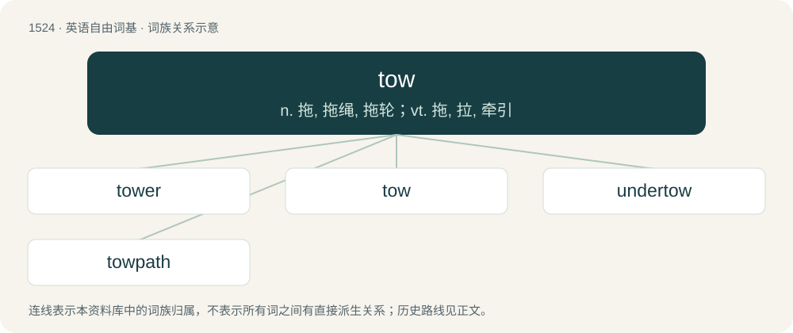

# 1611 · tow — n. 拖, 拖绳, 拖轮；vt. 拖, 拉, 牵引

[总目录](../00_总目录_按常用程度.md)

**类型**：英语自由词基　｜　**来源语言**：见词源记录

## 核心含义与来源

- 核心含义：n. 拖, 拖绳, 拖轮；vt. 拖, 拉, 牵引
- 英文含义：To pull something behind one, such as by using a line, chain, or tongue.
- 词形：tow

**多个词源／构词路径**：同一拼写可能有不同来源；以下按词性和含义分别列出。

**来源记录 1**（动词；To pull something behind one, such as by using a line, chain, or tongue.）

From Middle English towen, from Old English togian (“to tow”), from Proto-West Germanic \*togōn, from Proto-Germanic \*tugōną (“to draw, pull”), from Proto-Indo-European \*dewk- (“to draw, pull; to lead”). Cognates Cognate with German zögern (“to hesitate, pause”), Faroese and Icelandic toga (“to pull”), French touer (“to tow, tug a ship”); also Welsh dwyn (“to steal; to take; to bring to”), Latin dūcō (“to conduct, guide, lead; to take; to draw, pull; to consider, think; to prolong; to march; to forge”), Ancient Greek δαδύσσομαι (dadússomai, “to be distracted”), Albanian nduk (“to pluck out, pull out, tear”), Central Kurdish دۆشین (doşîn, “to milk”), Northern Kurdish dotin, doşîn, دۆشین (doşîn, “to milk”), Ossetian ду́цын (dúcyn, “to milk”), Pashto لوشل (lwašal, “to milk; to extort”), Persian دوشیدن (dōšīdan / dušidan), دوشتن (duštan), دوختن (dōxtan / duxtan, “to milk”). Related to tug.

**来源记录 2**（名词；An untwisted bundle of fibres such as cellulose acetate, flax, hemp or jute.）

From Middle English touw, from Old English tow- (“spinning”) (in compounds, e.g. towcræft, towhūs, towlic), from Proto-Germanic \*tawwą; compare Old Norse tó (“uncleansed wool”), Dutch touw (“rope”). Perhaps cognate with Old English tawian (“prepare for use”), Gothic 𐍄𐌰𐌿𐌾𐌰𐌽 (taujan, “do, make”).

## 词族图

## 单词速览（常用到不常用）

| 单词 | 音标 | 释义 |
|---|---|---|
| [tower](#w-1) | 英 /ˈtəʊ.ə(ɹ)/；美 /ˈtoʊ.əɹ/ | 【英文】One who tows. |
| [tow](#w-2) | 英 /təʊ/；美 /toʊ/ | n. 拖, 拖绳, 拖轮；vt. 拖, 拉, 牵引 |
| [undertow](#w-3) | /ˈʌndətəu/ | n. 回头浪 |
| [towpath](#w-4) | /ˈtəupæθ/ | n. 纤路 |

## 逐词详解

### 1. tower

**词性**：名词　｜　**音标**：英 /ˈtəʊ.ə(ɹ)/；美 /ˈtoʊ.əɹ/

**英文义项**：One who tows.

**构词拆分**：tow + -er

**词源与演化**：

From tow + -er.

### 2. tow

**词性**：名词　｜　**音标**：英 /təʊ/；美 /toʊ/

**中文释义**：n. 拖, 拖绳, 拖轮；vt. 拖, 拉, 牵引

**英文义项**：The act of towing and the condition of being towed. / Something, such as a tugboat, that tows.

**词源与演化**：

From Middle English towen, from Old English togian (“to tow”), from Proto-West Germanic \*togōn, from Proto-Germanic \*tugōną (“to draw, pull”), from Proto-Indo-European \*dewk- (“to draw, pull; to lead”). Cognates Cognate with German zögern (“to hesitate, pause”), Faroese and Icelandic toga (“to pull”), French touer (“to tow, tug a ship”); also Welsh dwyn (“to steal; to take; to bring to”), Latin dūcō (“to conduct, guide, lead; to take; to draw, pull; to consider, think; to prolong; to march; to forge”), Ancient Greek δαδύσσομαι (dadússomai, “to be distracted”), Albanian nduk (“to pluck out, pull out, tear”), Central Kurdish دۆشین (doşîn, “to milk”), Northern Kurdish dotin, doşîn, دۆشین (doşîn, “to milk”), Ossetian ду́цын (dúcyn, “to milk”), Pashto لوشل (lwašal, “to milk; to extort”), Persian دوشیدن (dōšīdan / dušidan), دوشتن (duštan), دوختن (dōxtan / duxtan, “to milk”). Related to tug.

**例句**：

> It isn't the car's battery; I think I need a tow.

该用例对应义项：The act of towing and the condition of being towed.

### 3. undertow

**词性**：名词　｜　**音标**：/ˈʌndətəu/

**中文释义**：n. 回头浪

**英文义项**：A short-range flow of water returning seaward from the waves breaking on the shore. / A feeling that runs contrary to one's normal one.

**构词拆分**：under- + tow

**词源与演化**：

From under- + tow.

**例句**：

> A strong undertow may sweep a returning swimmer off their feet but it does not carry them far from the shore.

该用例对应义项：A short-range flow of water returning seaward from the waves breaking on the shore.

### 4. towpath

**词性**：名词　｜　**音标**：/ˈtəupæθ/

**中文释义**：n. 纤路

**英文义项**：A path alongside a canal or river, originally for draft animals towing barges, now more often used as a footpath, nature trail, etc.

**构词拆分**：tow + path

**词源与演化**：

From tow + path.
