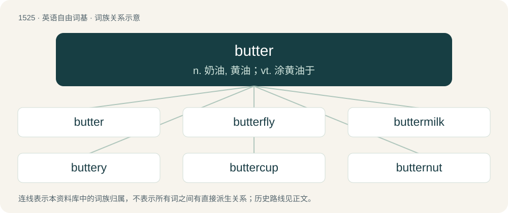

# 1612 · butter — n. 奶油, 黄油；vt. 涂黄油于

[总目录](../00_总目录_按常用程度.md)

**类型**：英语自由词基　｜　**来源语言**：见词源记录

## 核心含义与来源

- 核心含义：n. 奶油, 黄油；vt. 涂黄油于
- 英文含义：A soft, fatty foodstuff made by churning the cream of milk (generally cow's milk).
- 词形：butter

**多个词源／构词路径**：同一拼写可能有不同来源；以下按词性和含义分别列出。

**来源记录 1**（名词；A soft, fatty foodstuff made by churning the cream of milk (generally cow's milk).）

From Middle English buter, butter, from Old English butere, from Proto-West Germanic \*buterā, from Latin būtȳrum, from Ancient Greek βούτῡρον (boútūron, “cow cheese”), compound of βοῦς (boûs, “ox, cow”) and τῡρός (tūrós, “cheese”). Cognate with Dutch boter and German Butter.

**来源记录 2**（名词；Someone or something that butts.）

From butt + -er.

## 词族图

## 单词速览（常用到不常用）

| 单词 | 音标 | 释义 |
|---|---|---|
| [butter](#w-1) | 英 /ˈbʌtə/；美 /ˈbʌtɚ/ | n. 奶油, 黄油；vt. 涂黄油于 |
| [butterfly](#w-2) | /ˈbʌ.tə(ɹ).flaɪ/ | n. 蝴蝶；\[医\] 蝶式棉块, 翼形皮癣, 纸蝶 |
| [buttermilk](#w-3) | 英 /ˈbʌtəˌmɪlk/；美 /ˈbʌtɚˌmɪlk/ | n. 脱脂乳, 酪乳；\[医\] 酪乳 |
| [buttery](#w-4) | 英 /ˈbʌtəɹi/；美 /ˈbʌt(ə)ɹi/ | n. 配膳室；a. 涂用黄油的, 谄媚的 |
| [buttercup](#w-5) | 英 /ˈbʌt.ə.kʌp/；美 /ˈbʌt.ɚ.kʌp/ | n. 毛茛属植物 |
| [butternut](#w-6) | /ˈbʌtənʌt/ | n. 灰胡桃；\[化\] 灰胡桃(Juglans cenerea) |
| [butterscotch](#w-7) | 英 /ˈbʌtəˌskɒtʃ/；美 /ˈbʌtɚˌskɑt͡ʃ/ | n. 奶油糖果 |
| [buttercream](#w-8) | /ˈbʌtəkriːm/ | n. 甜奶油酱 |
| [butterball](#w-9) | /ˈbʌtəbɔːl/ | n. 小鸭的一种；胖子（口语） |

## 逐词详解

### 1. butter

**词性**：名词　｜　**音标**：英 /ˈbʌtə/；美 /ˈbʌtɚ/

**中文释义**：n. 奶油, 黄油；vt. 涂黄油于

**英文义项**：A soft, fatty foodstuff made by churning the cream of milk (generally cow's milk). / Any of various foodstuffs made from other foods or oils, similar in consistency to, eaten like or intended as a substitute for butter (preceded by the name of the food used to make it).

**词源与演化**：

From Middle English buter, butter, from Old English butere, from Proto-West Germanic \*buterā, from Latin būtȳrum, from Ancient Greek βούτῡρον (boútūron, “cow cheese”), compound of βοῦς (boûs, “ox, cow”) and τῡρός (tūrós, “cheese”). Cognate with Dutch boter and German Butter.

**例句**：

> That landing was total butter!

该用例对应义项：A smooth plane landing.

### 2. butterfly

**词性**：名词　｜　**音标**：/ˈbʌ.tə(ɹ).flaɪ/

**中文释义**：n. 蝴蝶；\[医\] 蝶式棉块, 翼形皮癣, 纸蝶

**英文义项**：A flying insect of the order Lepidoptera, distinguished from moths by their diurnal activity and generally brighter colouring. / The imago (final form) of such an insect, consisting usually of a long body with large flat wings, as opposed to earlier instars such as caterpillar or pupa.

**构词拆分**：butter + fly

**词源与演化**：

From Middle English buterflie, butturflye, boterflye, from Old English buterflēoge, equivalent to butter + fly. Cognate with Dutch botervlieg, German Butterfliege (“butterfly”). The name may have originally been applied to butterflies of a yellowish color, or reflected a belief that butterflies ate milk and butter (compare German Molkendieb (“butterfly”, literally “whey-thief”) and Low German Botterlicker (“butterfly”, literally “butter-licker”)), or that they excreted a butter-like substance (compare Dutch boterschijte (“butterfly”, literally “butter-excretor”)). Compare also German Schmetterling from Schmetten (“cream”), German Low German Bottervögel (“butterfly”, literally “butter-fowl”). More at butter, fly. An alternate theory suggests that the first element may have originally been Old English butor- (“beater”), a mutation of bēatan (“to beat”), but this would not explain the cognates in other languages or the other names formed with milk products. Superseded non-native Middle English papilion (“butterfly”) borrowed from Old French papillon (“butterfly”). Contrary to popularised belief, the form "butterfly" was not derived from an earlier flutterby.

**例句**：

> One potential butterfly could be JFK having another son the year after the POD instead of a daughter.

该用例对应义项：A random change in an aspect of the timeline seemingly unrelated to the primary point of divergence, resulting from the butterfly effect.

### 3. buttermilk

**词性**：名词　｜　**音标**：英 /ˈbʌtəˌmɪlk/；美 /ˈbʌtɚˌmɪlk/

**中文释义**：n. 脱脂乳, 酪乳；\[医\] 酪乳

**英文义项**：The liquid left over after producing butter from full cream milk by the churning process, also called traditional buttermilk. / Cultured buttermilk, a fermented dairy product produced from cow's milk, with a characteristically sour taste.

**构词拆分**：butter + milk

**词源与演化**：

Inherited from Middle English butter-melke, equivalent to butter + milk. Cognate with Dutch botermelk (“buttermilk”), German Buttermilch (“buttermilk”), Low German Bottermelk (“buttermilk”), Luxembourgish Bottermëllech (“buttermilk”), Plautdietsch Bottamalkj, Bottamaltj, Bottermalkj, Bottermaltj (“buttermilk”), and Yiddish פּוטערמילך (putermilkh), פּוטער־מילעך (puter-milekh, “buttermilk”).

**例句**：

> Buttermilk is no longer popular in the United States.

### 4. buttery

**词性**：形容词　｜　**音标**：英 /ˈbʌtəɹi/；美 /ˈbʌt(ə)ɹi/

**中文释义**：n. 配膳室；a. 涂用黄油的, 谄媚的

**英文义项**：Made with or tasting of butter. / Resembling butter in some way, such as yellow color or smooth texture.

**构词拆分**：butter + -y

**词源与演化**：

From Middle English buttry, equivalent to butter + -y. Piecewise doublet of butyric, butter ultimately being from Latin būtȳrum and -y being a doublet of -ic.

**例句**：

> The buttery-tasting cookie was actually made with margarine, but you couldn't tell by tasting it.

该用例对应义项：Made with or tasting of butter.

### 5. buttercup

**词性**：名词　｜　**音标**：英 /ˈbʌt.ə.kʌp/；美 /ˈbʌt.ɚ.kʌp/

**中文释义**：n. 毛茛属植物

**英文义项**：Any of many herbs, of the genus Ranunculus, having yellow flowers; the crowfoot. / Any flower of the genus Narcissus; a daffodil.

**构词拆分**：butter + cup

**词源与演化**：

From butter + cup. Both sense 1 and 2 are from the flowers' association with butter, from their yellow colour. Compare butterflower for a similar derivation; outside of English, compare Dutch boterbloem, German Butterblume.

**例句**：

> When Tom was in the first grade, he would pick buttercup flowers and give them to girls.

### 6. butternut

**词性**：名词　｜　**音标**：/ˈbʌtənʌt/

**中文释义**：n. 灰胡桃；\[化\] 灰胡桃(Juglans cenerea)

**英文义项**：A North American walnut tree, Juglans cinerea. / The wood or bark of this walnut tree.

**构词拆分**：butter + nut

**词源与演化**：

From butter + nut.

**例句**：

> He made a delicious butternut soup.

该用例对应义项：Butternut squash.

### 7. butterscotch

**词性**：名词　｜　**音标**：英 /ˈbʌtəˌskɒtʃ/；美 /ˈbʌtɚˌskɑt͡ʃ/

**中文释义**：n. 奶油糖果

**英文义项**：A hard candy made from butter, brown sugar, syrup and vanilla. / A sauce or syrup made of similar ingredients.

**构词拆分**：butter + scotch

**词源与演化**：

From butter + scotch, with the second element deriving (not from scotch whiskey or Scotland, but) from Middle English scocchen (“to score, nick, cut”), in reference to how the candy is boiled and hardened and then usually scored to make breaking it apart easier. The word is usually said to have originally been a trademark of Parkinson's, who is claimed to have invented it.

### 8. buttercream

**词性**：名词　｜　**音标**：/ˈbʌtəkriːm/

**中文释义**：n. 甜奶油酱

**英文义项**：A type of thick, sweet icing or cake-filling made by creaming butter (or sometimes another fat, such as margarine) with powdered sugar.

**构词拆分**：butter + cream

**词源与演化**：

From butter + cream.

**例句**：

> The pastry chef is decorating a cake with green owls made of buttercream frosting.

### 9. butterball

**词性**：名词　｜　**音标**：/ˈbʌtəbɔːl/

**中文释义**：n. 小鸭的一种；胖子（口语）

**英文义项**：A round lump of a coagulated fat used in cooking such as butter or margarine. / An overweight person.

**构词拆分**：butter + ball

**词源与演化**：

From butter + ball.

**例句**：

> Rigorous controls also exist for turkey production at Butterball Turkey LLC, which says the regulations are ingrained in how they produce food.
