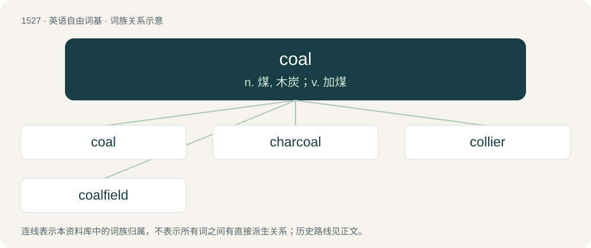

# 1613 · coal — n. 煤, 木炭；v. 加煤

[总目录](../00_总目录_按常用程度.md)

**类型**：英语自由词基　｜　**来源语言**：见词源记录

## 核心含义与来源

- 核心含义：n. 煤, 木炭；v. 加煤
- 英文含义：A black or brownish black rock formed from prehistoric plant remains, composed largely of carbon and burned as a fuel.
- 词形：coal

**来源记录 1**（名词；A black or brownish black rock formed from prehistoric plant remains, composed largely of carbon and burned as a fuel.）

From Middle English col, from Old English col, from Proto-West Germanic \*kol, from Proto-Germanic \*kulą (“coal”), from Proto-Indo-European \*ǵwelH- (“to burn, shine”). Cognates Cognate with North Frisian kööl (“coal”), Saterland Frisian Koole (“coal”), West Frisian koal (“coal”), Cimbrian kholl (“coal”), Dutch kool (“coal; carbon”), German Kohle (“coal”), Limburgish Kǫe̩l (“coal”), Luxembourgish Kuel (“coal”), Vilamovian köła (“coal”), Yiddish קויל (koyl, “coal”), Danish kul (“coal”), Faroese, Icelandic, Norwegian Nynorsk, and Swedish kol (“coal; carbon”), Jamtish kuł (“coal; carbon”), Norwegian Bokmål kol, kull (“coal”). Compare Irish and Scottish Gaelic gual (“coal”), Manx geayl (“coal”), Lithuanian žvi̇̀lti (“to glow, twinkle”), Persian زکال (zakâl), زکار (zekâr), زغال (zoġâl, “coal”), Tocharian B śoliye (“hearth”), Sanskrit ज्वल् (jval, “to burn, glow”), all from the same root.

## 词族图

## 单词速览（常用到不常用）

| 单词 | 音标 | 释义 |
|---|---|---|
| [coal](#w-1) | 英 /kəʊl/；美 /koʊl/ | n. 煤, 木炭；v. 加煤 |
| [charcoal](#w-2) | 英 /ˈtʃɑː.kəʊl/；美 /ˈt͡ʃɑɹ.koʊl/ | n. 木炭；\[化\] 木炭 |
| [collier](#w-3) | 英 /ˈkɒlɪə(ɹ)/；美 /ˈkɑliɚ/ | n. 煤矿工人, 运煤船, 运煤船员 |
| [coalfield](#w-4) | /ˈkəulfiːld/ | n. 煤田 |

## 逐词详解

### 1. coal

**词性**：名词　｜　**音标**：英 /kəʊl/；美 /koʊl/

**中文释义**：n. 煤, 木炭；v. 加煤

**英文义项**：A black or brownish black rock formed from prehistoric plant remains, composed largely of carbon and burned as a fuel. / A type of coal, such as bituminous, anthracite, or lignite, and grades and varieties thereof, as a fuel commodity ready to buy and burn.

**词源与演化**：

From Middle English col, from Old English col, from Proto-West Germanic \*kol, from Proto-Germanic \*kulą (“coal”), from Proto-Indo-European \*ǵwelH- (“to burn, shine”). Cognates Cognate with North Frisian kööl (“coal”), Saterland Frisian Koole (“coal”), West Frisian koal (“coal”), Cimbrian kholl (“coal”), Dutch kool (“coal; carbon”), German Kohle (“coal”), Limburgish Kǫe̩l (“coal”), Luxembourgish Kuel (“coal”), Vilamovian köła (“coal”), Yiddish קויל (koyl, “coal”), Danish kul (“coal”), Faroese, Icelandic, Norwegian Nynorsk, and Swedish kol (“coal; carbon”), Jamtish kuł (“coal; carbon”), Norwegian Bokmål kol, kull (“coal”). Compare Irish and Scottish Gaelic gual (“coal”), Manx geayl (“coal”), Lithuanian žvi̇̀lti (“to glow, twinkle”), Persian زکال (zakâl), زکار (zekâr), زغال (zoġâl, “coal”), Tocharian B śoliye (“hearth”), Sanskrit ज्वल् (jval, “to burn, glow”), all from the same root.

**例句**：

> I'm so sick of seeing this coal online.

该用例对应义项：Content of low quality.

### 2. charcoal

**词性**：名词　｜　**音标**：英 /ˈtʃɑː.kəʊl/；美 /ˈt͡ʃɑɹ.koʊl/

**中文释义**：n. 木炭；\[化\] 木炭

**英文义项**：impure carbon obtained by destructive distillation of wood or other organic matter, that is, heating it in the absence of oxygen. / A stick of black carbon material used for drawing.

**构词拆分**：By surface analysis, char (Etymology 3 \[verb\]) + coal

**词源与演化**：

From Middle English charcole, from charren (“to change, turn”) + cole (“coal”), from Old English cierran (“to change, turn”) + col (“coal”). By surface analysis, char (Etymology 3 \[verb\]) + coal.

**例句**：

> Do you think it impossible for the sky to turn charcoal black?

### 3. collier

**词性**：名词　｜　**音标**：英 /ˈkɒlɪə(ɹ)/；美 /ˈkɑliɚ/

**中文释义**：n. 煤矿工人, 运煤船, 运煤船员

**英文义项**：A vessel carrying a bulk cargo of coal. / A sailor on such a vessel.

**构词拆分**：coal + -ier

**词源与演化**：

From Middle English colier, colyer, alteration of earlier coler, collere (“one who makes or sells charcoal”), from Old English \*colere (“collier”), equivalent to coal + -ier.

**例句**：

> The collier spent his days deep underground, mining coal in dangerous conditions.

### 4. coalfield

**词性**：名词　｜　**音标**：/ˈkəulfiːld/

**中文释义**：n. 煤田

**英文义项**：Any region containing deposits of coal that may be mined.

**构词拆分**：coal + field

**词源与演化**：

From coal + field.
