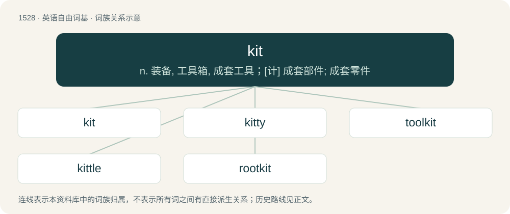

# 1614 · kit — n. 装备, 工具箱, 成套工具；\[计\] 成套部件; 成套零件

[总目录](../00_总目录_按常用程度.md)

**类型**：英语自由词基　｜　**来源语言**：见词源记录

## 核心含义与来源

- 核心含义：n. 装备, 工具箱, 成套工具；\[计\] 成套部件; 成套零件
- 英文含义：A circular wooden vessel, made of hooped staves.
- 词形：kit

**多个词源／构词路径**：同一拼写可能有不同来源；以下按词性和含义分别列出。

**来源记录 1**（名词；A circular wooden vessel, made of hooped staves.）

From Middle English kyt, kytt, kytte, from Middle Dutch kitte (“a wooden vessel made of hooped staves”). Related to Dutch kit (“tankard”) (see below). The further etymology is unknown. Perhaps from Proto-Germanic \*kitjō-, \*kut-, which would be related to the root of Dutch kot (“ramshackle house”), itself of non-Indo-European origin. The transfer of meaning to the contents of a soldier's knapsack dates to the late 18th century, extended use of any collection of necessaries used for travelling dates to the first half of the 19th century. The further widening of the sense to a collection of parts sold for the buyer to assemble emerges in American English in the mid 20th century.

**来源记录 2**（名词；A kitten (young cat).）

\[Alt: A young red fox emerging from a burrow, looking at the camera\] A short form of kitten or kitling. From the 16th century, spelled kytte, kitt. From the 19th century also extended to other young animals (beaver, fox, mink, muskrat, etc.), and to a species of small fox (kit fox). Later usage (for other animals) perhaps influenced by chit.

**来源记录 3**（名词；Synonym of kit violin.）

16th century, perhaps from cithara.

**来源记录 4**（名词；A flock of pigeons, especially domesticated, trained pigeons and especially when flying together.）

Borrowed from German kitte, Kütte (“flock of doves”) (circa 1880).

## 词族图

## 单词速览（常用到不常用）

| 单词 | 音标 | 释义 |
|---|---|---|
| [kit](#w-1) | /ˈkɪt/ | n. 装备, 工具箱, 成套工具；\[计\] 成套部件; 成套零件 |
| [kitty](#w-2) | 英 /ˈkɪti/；美 /ˈkɪti/ | 【英文】Synonym of jack (“a small, typically white, ball used as the target ball in bowls”). |
| [toolkit](#w-3) | 美 /ˈtulˌkɪt/ | \[计\] 工具包 |
| [kittle](#w-4) | /ˈkitl/ | 【英文】To bring forth young, as a cat; to kitten; to litter. |
| [rootkit](#w-5) | /rʊkɪt/ | n. 一种特殊类型的恶意软件 |

## 逐词详解

### 1. kit

**词性**：名词　｜　**音标**：/ˈkɪt/

**中文释义**：n. 装备, 工具箱, 成套工具；\[计\] 成套部件; 成套零件

**英文义项**：A circular wooden vessel, made of hooped staves. / A kind of basket made especially from straw of rushes, especially for holding fish; by extension, the contents of such a basket or similar container, used as a measure of weight.

**词源与演化**：

From Middle English kyt, kytt, kytte, from Middle Dutch kitte (“a wooden vessel made of hooped staves”). Related to Dutch kit (“tankard”) (see below). The further etymology is unknown. Perhaps from Proto-Germanic \*kitjō-, \*kut-, which would be related to the root of Dutch kot (“ramshackle house”), itself of non-Indo-European origin. The transfer of meaning to the contents of a soldier's knapsack dates to the late 18th century, extended use of any collection of necessaries used for travelling dates to the first half of the 19th century. The further widening of the sense to a collection of parts sold for the buyer to assemble emerges in American English in the mid 20th century.

**例句**：

> Always carry a good first-aid kit.

该用例对应义项：Any collection of items needed for a specific purpose, especially for use by a workman, or personal effects packed for travelling.

### 2. kitty

**词性**：名词　｜　**音标**：英 /ˈkɪti/；美 /ˈkɪti/

**英文义项**：Synonym of jack (“a small, typically white, ball used as the target ball in bowls”). / A pool of money to which card players contribute a portion of their winnings, which is used for paying shared expenses such as the cost of the premises or refreshments; (by extension) any pool of money to which people contribute for shared expenses or other joint purposes; also, any fund of liquid assets set aside for future use.

**构词拆分**：kit (“collection of items”) + -y (diminutive suffix)

**词源与演化**：

Origin uncertain; etymology 2 sense 2 (relating to card games) is possibly from kit (“collection of items”) + -y (diminutive suffix).

### 3. toolkit

**词性**：名词　｜　**音标**：美 /ˈtulˌkɪt/

**中文释义**：\[计\] 工具包

**英文义项**：A set of tools kept together, especially comprising all the tools suitable for some particular type of work. / A set of personal abilities, skills, or resources to draw on.

**构词拆分**：tool + kit

**词源与演化**：

From tool + kit.

**用法示例／搭配（非完整句）**：

> a financial planning toolkit for small businesses

该用例对应义项：A set of personal abilities, skills, or resources to draw on.

### 4. kittle

**词性**：动词　｜　**音标**：/ˈkitl/

**英文义项**：To bring forth young, as a cat; to kitten; to litter.

**构词拆分**：kit + -le

**词源与演化**：

From Middle English kitelen, from Old Norse kjetla (“to bring forth young”), equivalent to kit + -le.

### 5. rootkit

**词性**：名词　｜　**音标**：/rʊkɪt/

**中文释义**：n. 一种特殊类型的恶意软件

**英文义项**：A set of software tools used by a third party to gain unauthorized access to a computer system and control the system while concealing itself from the user.

**构词拆分**：root + kit

**词源与演化**：

From root + kit.
