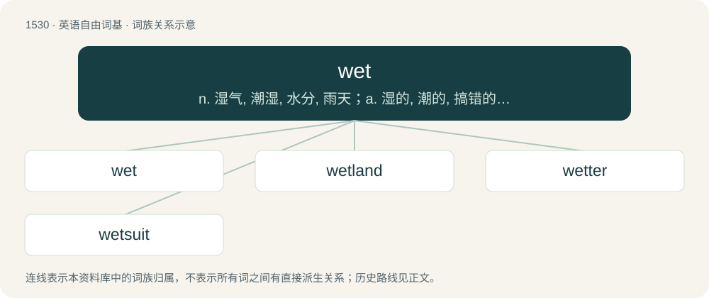

# 1617 · wet — n. 湿气, 潮湿, 水分, 雨天；a. 湿的, 潮的, 搞错的, 下雨的, 反对禁酒的；vi. 变湿

[总目录](../00_总目录_按常用程度.md)

**类型**：英语自由词基　｜　**来源语言**：见词源记录

## 核心含义与来源

- 核心含义：n. 湿气, 潮湿, 水分, 雨天；a. 湿的, 潮的, 搞错的, 下雨的, 反对禁酒的；vi. 变湿
- 英文含义：Made up of liquid or moisture, usually (but not always) water.
- 词形：wet

**来源记录 1**（形容词；Made up of liquid or moisture, usually (but not always) water.）

From Middle English wet (“wet, moistened”), wett, wette, past participle of Middle English weten (“to wet”), from Old English wǣtan (“to wet, moisten, water”), from Proto-West Germanic \*wātijan, from Proto-Germanic \*wētijaną (“to wet, make wet”), from Proto-Indo-European \*wed- (“water, wet”) (also the source of water). Cognate with Scots weit, wete (“to wet”), Saterland Frisian wäitje (“to wet; drench”), Icelandic væta (“to wet”). Compare also Middle English weet (“wet”), from Old English wǣt (“wet, moist, rainy”), from Proto-West Germanic \*wāt, from Proto-Germanic \*wētaz (“wet, moist”), related to Scots weit, weet, wat (“wet”), North Frisian wiat, weet, wäit (“wet”), Saterland Frisian wäit (“wet”), West Frisian wiet (“wet”), Middle Dutch wet (“wet, damp, watery”), Swedish and Norwegian våt (“wet”), Danish våd (“wet”), Faroese vátur (“wet”), Icelandic votur (“wet”).

## 词族图

## 单词速览（常用到不常用）

| 单词 | 音标 | 释义 |
|---|---|---|
| [wet](#w-1) | 英 /wɛt/ | n. 湿气, 潮湿, 水分, 雨天；a. 湿的, 潮的, 搞错的, 下雨的, 反对禁酒的；vi. 变湿 |
| [wetland](#w-2) | /ˈwetlænd/ | n. 湿地, 沼泽地；\[经\] 湿地 |
| [wetter](#w-3) | 英 /ˈwɛtə/；美 /ˈwɛtɚ/ | n. 湿润剂 |
| [wetsuit](#w-4) | /ˈwɛtˌs(j)ut/ | n. 潜水服；防寒泳衣；湿式保暖服 |

## 逐词详解

### 1. wet

**词性**：形容词　｜　**音标**：英 /wɛt/

**中文释义**：n. 湿气, 潮湿, 水分, 雨天；a. 湿的, 潮的, 搞错的, 下雨的, 反对禁酒的；vi. 变湿

**英文义项**：Made up of liquid or moisture, usually (but not always) water. / Of an object, etc.: covered or impregnated with liquid, usually (but not always) water.

**词源与演化**：

From Middle English wet (“wet, moistened”), wett, wette, past participle of Middle English weten (“to wet”), from Old English wǣtan (“to wet, moisten, water”), from Proto-West Germanic \*wātijan, from Proto-Germanic \*wētijaną (“to wet, make wet”), from Proto-Indo-European \*wed- (“water, wet”) (also the source of water). Cognate with Scots weit, wete (“to wet”), Saterland Frisian wäitje (“to wet; drench”), Icelandic væta (“to wet”). Compare also Middle English weet (“wet”), from Old English wǣt (“wet, moist, rainy”), from Proto-West Germanic \*wāt, from Proto-Germanic \*wētaz (“wet, moist”), related to Scots weit, weet, wat (“wet”), North Frisian wiat, weet, wäit (“wet”), Saterland Frisian wäit (“wet”), West Frisian wiet (“wet”), Middle Dutch wet (“wet, damp, watery”), Swedish and Norwegian våt (“wet”), Danish våd (“wet”), Faroese vátur (“wet”), Icelandic votur (“wet”).

**例句**：

> This pen’s a wet writer, so it’ll feather on this cheap paper.

该用例对应义项：Of calligraphy and fountain pens: depositing a large amount of ink from the nib or the feed.

### 2. wetland

**词性**：名词　｜　**音标**：/ˈwetlænd/

**中文释义**：n. 湿地, 沼泽地；\[经\] 湿地

**英文义项**：Land that is covered mostly with water, with occasional marshy and soggy areas.

**构词拆分**：wet + land

**词源与演化**：

From wet + land. Cognate with West Frisian wetlân.

**例句**：

> A wetland is an area of land that is saturated with water.

### 3. wetter

**词性**：名词　｜　**音标**：英 /ˈwɛtə/；美 /ˈwɛtɚ/

**中文释义**：n. 湿润剂

**英文义项**：A wetting agent or surfactant. / A bedwetter.

**构词拆分**：wet + -er

**词源与演化**：

From wet + -er.

**例句**：

> Wet and stormy areas will get wetter and stormier.

### 4. wetsuit

**词性**：名词　｜　**音标**：/ˈwɛtˌs(j)ut/

**中文释义**：n. 潜水服；防寒泳衣；湿式保暖服

**英文义项**：A close fitting, insulating garment usually made from neoprene or similar material designed to keep one warm during activities on or under water.

**构词拆分**：wet + suit

**词源与演化**：

From wet + suit.

**例句**：

> Tom usually wears a wetsuit when he goes surfing.
