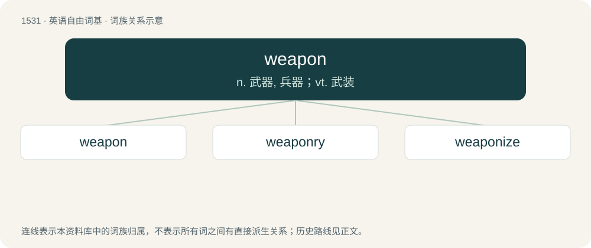

# 1618 · weapon — n. 武器, 兵器；vt. 武装

[总目录](../00_总目录_按常用程度.md)

**类型**：英语自由词基　｜　**来源语言**：见词源记录

## 核心含义与来源

- 核心含义：n. 武器, 兵器；vt. 武装
- 英文含义：An instrument of attack or defense in combat or hunting, e.g. most guns, missiles, or swords.
- 词形：weapon

**来源记录 1**（名词；An instrument of attack or defense in combat or hunting, e.g. most guns, missiles, or swords.）

From Middle English wepen, from Old English wǣpn, from Proto-West Germanic \*wāpn, from Proto-Germanic \*wēpną (“weapon”), of unknown origin, possibly from Proto-Indo-European \*wēbnom. Cognates Cognate with Scots weepon (“weapon”), North Frisian woopen (“weapon”), Saterland Frisian Woapen (“weapon”), West Frisian wapen (“weapon; coat of arms”), Alemannic German Waaffe (“tool”), Dutch wapen (“weapon”), German Waffe (“weapon”) and Wappen (“coat of arms”), Luxembourgish Waff (“weapon”), Yiddish וואָפֿן (vofn, “weapon”), Danish våben (“weapon; coat of arms”), Faroese vákn, vápn (“weapon; whaling lance”), Icelandic vopn (“weapon”), Norwegian Bokmål and Norwegian Nynorsk våpen (“weapon”), Swedish vapen (“weapon; coat of arms”), Gothic 𐍅𐌴𐍀𐌽 (wēpn, “weapon”).

## 词族图

## 单词速览（常用到不常用）

| 单词 | 音标 | 释义 |
|---|---|---|
| [weapon](#w-1) | 英 /ˈwɛp.ən/ | n. 武器, 兵器；vt. 武装 |
| [weaponry](#w-2) | 英 /ˈwɛp.ən.ɹi/ | n. 武器, 军备, 武器设计研制学 |
| [weaponize](#w-3) | /ˈwɛpənaɪz/ | vt. 把…改装成武器, 使武器化 |

## 逐词详解

### 1. weapon

**词性**：名词　｜　**音标**：英 /ˈwɛp.ən/

**中文释义**：n. 武器, 兵器；vt. 武装

**英文义项**：An instrument of attack or defense in combat or hunting, e.g. most guns, missiles, or swords. / An instrument or other means of harming or exerting control over another.

**词源与演化**：

From Middle English wepen, from Old English wǣpn, from Proto-West Germanic \*wāpn, from Proto-Germanic \*wēpną (“weapon”), of unknown origin, possibly from Proto-Indo-European \*wēbnom. Cognates Cognate with Scots weepon (“weapon”), North Frisian woopen (“weapon”), Saterland Frisian Woapen (“weapon”), West Frisian wapen (“weapon; coat of arms”), Alemannic German Waaffe (“tool”), Dutch wapen (“weapon”), German Waffe (“weapon”) and Wappen (“coat of arms”), Luxembourgish Waff (“weapon”), Yiddish וואָפֿן (vofn, “weapon”), Danish våben (“weapon; coat of arms”), Faroese vákn, vápn (“weapon; whaling lance”), Icelandic vopn (“weapon”), Norwegian Bokmål and Norwegian Nynorsk våpen (“weapon”), Swedish vapen (“weapon; coat of arms”), Gothic 𐍅𐌴𐍀𐌽 (wēpn, “weapon”).

**例句**：

> The club that is now mostly used for golf was once a common weapon.

该用例对应义项：An instrument of attack or defense in combat or hunting, e.g. most guns, missiles, or swords.

### 2. weaponry

**词性**：名词　｜　**音标**：英 /ˈwɛp.ən.ɹi/

**中文释义**：n. 武器, 军备, 武器设计研制学

**英文义项**：Weapons collectively

**构词拆分**：weapon + -ry

**词源与演化**：

From weapon + -ry.

**例句**：

> The army has a wide array of weaponry.

该用例对应义项：Weapons collectively

### 3. weaponize

**词性**：动词　｜　**音标**：/ˈwɛpənaɪz/

**中文释义**：vt. 把…改装成武器, 使武器化

**英文义项**：To make into a weapon. / To make more effective as a weapon.

**构词拆分**：weapon + -ize

**词源与演化**：

From weapon + -ize. First use appears c. 1938. See cite below.

**例句**：

> To weaponize anthrax it is made more distributable, not more virulent.

该用例对应义项：To make more effective as a weapon.
