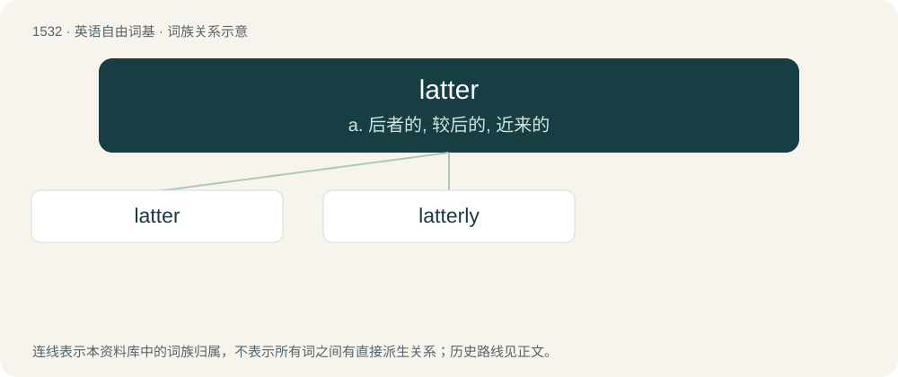

# 1620 · latter — a. 后者的, 较后的, 近来的

[总目录](../00_总目录_按常用程度.md)

**类型**：英语自由词基　｜　**来源语言**：见词源记录

## 核心含义与来源

- 核心含义：a. 后者的, 较后的, 近来的
- 英文含义：Near (or nearer) to the end.
- 词形：latter

**来源记录 1**（形容词；Near (or nearer) to the end.）

From Middle English latter, lattere, lattre, from Old English lætra, comparative form of læt (“late”). Equivalent to late + -er, thus a doublet of later; also, related to last, whose doublet is latest.

## 词族图

## 单词速览（常用到不常用）

| 单词 | 音标 | 释义 |
|---|---|---|
| [latter](#w-1) | 美 /ˈlæt.ɚ/；/ˈlæt.ə(ɹ)/ | a. 后者的, 较后的, 近来的 |
| [latterly](#w-2) | /ˈlætəli/ | adv. 近来, 最近 |

## 逐词详解

### 1. latter

**词性**：形容词　｜　**音标**：美 /ˈlæt.ɚ/；/ˈlæt.ə(ɹ)/

**中文释义**：a. 后者的, 较后的, 近来的

**英文义项**：Near (or nearer) to the end. / In the past, but close (or closer) to the present time.

**构词拆分**：late + -er

**词源与演化**：

From Middle English latter, lattere, lattre, from Old English lætra, comparative form of læt (“late”). Equivalent to late + -er, thus a doublet of later; also, related to last, whose doublet is latest.

**例句**：

> In his latter years my dad became very absent-minded.

该用例对应义项：In the past, but close (or closer) to the present time.

### 2. latterly

**词性**：副词　｜　**音标**：/ˈlætəli/

**中文释义**：adv. 近来, 最近

**英文义项**：In a latter manner

**构词拆分**：latter + -ly

**词源与演化**：

From latter + -ly.
