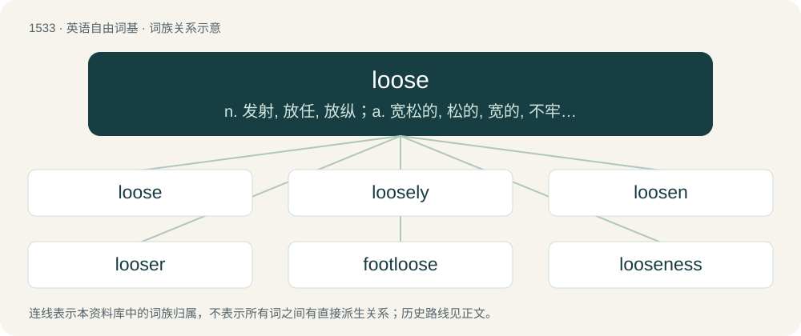

# 1622 · loose — n. 发射, 放任, 放纵；a. 宽松的, 松的, 宽的, 不牢固的, 散漫的, 自由的, 不精确的；vt. 释放, 放枪, 开船

[总目录](../00_总目录_按常用程度.md)

**类型**：英语自由词基　｜　**来源语言**：见词源记录

## 核心含义与来源

- 核心含义：n. 发射, 放任, 放纵；a. 宽松的, 松的, 宽的, 不牢固的, 散漫的, 自由的, 不精确的；vt. 释放, 放枪, 开船
- 英文含义：To let loose, to free from restraints.
- 词形：loose

**来源记录 1**（动词；To let loose, to free from restraints.）

From Middle English loos, los, lous, from Old Norse lauss, from Proto-Germanic \*lausaz, whence also -less, leasing; from Proto-Indo-European \*lewh₁- (“to untie, set free, separate”), whence also lyo-, -lysis, via Ancient Greek.

## 词族图

## 单词速览（常用到不常用）

| 单词 | 音标 | 释义 |
|---|---|---|
| [loose](#w-1) | 英 /luːs/；美 /lus/ | n. 发射, 放任, 放纵；a. 宽松的, 松的, 宽的, 不牢固的, 散漫的, 自由的, 不精确的；vt. 释放, 放枪, 开船 |
| [loosely](#w-2) | /ˈluːsli/ | adv. 松弛地, 宽松地, 不紧 |
| [loosen](#w-3) | 英 /ˈluːsən/；美 /ˈlusən/ | vt. 放松, 松开, 解除；vi. 变松, 松弛 |
| [looser](#w-4) | 英 /ˈluːsə/；美 /ˈlusɚ/ | \[经\] 放宽 |
| [footloose](#w-5) | /ˈfutluːs/ | a. 自由自在的, 能做所要做的, 不受束缚的 |
| [looseness](#w-6) | 英 /ˈluːsnəs/ | n. 松, 松弛, 漠然；\[医\] 松驰 |

## 逐词详解

### 1. loose

**词性**：形容词　｜　**音标**：英 /luːs/；美 /lus/

**中文释义**：n. 发射, 放任, 放纵；a. 宽松的, 松的, 宽的, 不牢固的, 散漫的, 自由的, 不精确的；vt. 释放, 放枪, 开船

**英文义项**：Not fixed in place tightly or firmly. / Not held or packaged together.

**词源与演化**：

From Middle English loos, los, lous, from Old Norse lauss, from Proto-Germanic \*lausaz, whence also -less, leasing; from Proto-Indo-European \*lewh₁- (“to untie, set free, separate”), whence also lyo-, -lysis, via Ancient Greek.

**例句**：

> You can buy apples in a pack, but they are cheaper loose.

该用例对应义项：Not held or packaged together.

### 2. loosely

**词性**：副词　｜　**音标**：/ˈluːsli/

**中文释义**：adv. 松弛地, 宽松地, 不紧

**英文义项**：In a loose manner. / Not tightly.

**构词拆分**：loose + -ly

**词源与演化**：

From Middle English lously; equivalent to loose + -ly.

**例句**：

> It's red, to use the term loosely, sort of brown and sort of orange, let's call it reddish.

该用例对应义项：Approximately.

### 3. loosen

**词性**：动词　｜　**音标**：英 /ˈluːsən/；美 /ˈlusən/

**中文释义**：vt. 放松, 松开, 解除；vi. 变松, 松弛

**英文义项**：To make loose. / To become loose.

**构词拆分**：loose + -en

**词源与演化**：

From loose + -en.

**例句**：

> I noticed that my seatbelt had gradually loosened during the journey.

该用例对应义项：To become loose.

### 4. looser

**词性**：名词　｜　**音标**：英 /ˈluːsə/；美 /ˈlusɚ/

**中文释义**：\[经\] 放宽

**英文义项**：One who looses, who sets loose or frees.

**构词拆分**：loose + -er

**词源与演化**：

From loose + -er.

**例句**：

> Biden supports Democratic Party policies such as stricter gun control, looser immigration laws and higher minimum wages.

### 5. footloose

**词性**：形容词　｜　**音标**：/ˈfutluːs/

**中文释义**：a. 自由自在的, 能做所要做的, 不受束缚的

**英文义项**：Tending to travel or do as one pleases; readily without many commitments or responsibility. / Of a sail: not properly secured at the bottom.

**构词拆分**：foot + loose

**词源与演化**：

From foot + loose.

**例句**：

> He was footloose in his youth.

该用例对应义项：Tending to travel or do as one pleases; readily without many commitments or responsibility.

### 6. looseness

**词性**：名词　｜　**音标**：英 /ˈluːsnəs/

**中文释义**：n. 松, 松弛, 漠然；\[医\] 松驰

**英文义项**：The quality or fact of being free from rigidity, attachment or restraint; not tight, not firmly attached or taut. / A relaxed state regarding principles or accuracy.

**构词拆分**：loose + -ness

**词源与演化**：

From loose + -ness.

**例句**：

> See if that nut has too much looseness and tighten it if it does.

该用例对应义项：The quality or fact of being free from rigidity, attachment or restraint; not tight, not firmly attached or taut.
