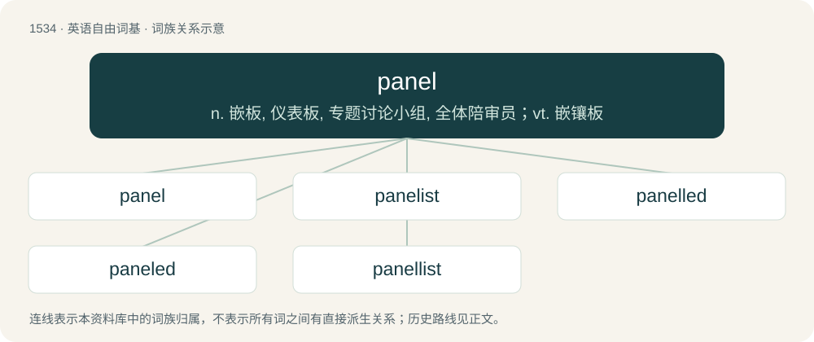

# 1623 · panel — n. 嵌板, 仪表板, 专题讨论小组, 全体陪审员；vt. 嵌镶板

[总目录](../00_总目录_按常用程度.md)

**类型**：英语自由词基　｜　**来源语言**：见词源记录

## 核心含义与来源

- 核心含义：n. 嵌板, 仪表板, 专题讨论小组, 全体陪审员；vt. 嵌镶板
- 英文含义：A (usually) rectangular section of a surface, or of a covering or of a wall, fence etc.
- 词形：panel

**来源记录 1**（名词；A (usually) rectangular section of a surface, or of a covering or of a wall, fence etc.）

From Middle English panel (“piece of cloth, saddle pad, pane of glass, piece of ice, part, division, jury list, jury members”), from Anglo-Norman panel, panelle (“piece of cloth, saddle cushion”), from Vulgar Latin \*pannellus, diminutive of Latin pannus (“cloth, rag, garment”), from Proto-Indo-European \*peh₂n- (“fabric”). Cognate with Old English fana (“a piece of cloth, patch, banner, flag, vane”). Doublet of vane.

## 词族图

## 单词速览（常用到不常用）

| 单词 | 音标 | 释义 |
|---|---|---|
| [panel](#w-1) | 英 /ˈpænəl/；美 /ˈpænəl/ | n. 嵌板, 仪表板, 专题讨论小组, 全体陪审员；vt. 嵌镶板 |
| [panelist](#w-2) | /ˈpænəlist/ | n. 专门小组成员, 演出小组成员, 参加电视公开讨论会的成员, 答问小组的成员 |
| [panelled](#w-3) | /ˈpænəld/ | a. （房间）有护墙板的; （墙、门或窗）镶有嵌板的 |
| [paneled](#w-4) |  | vt. 选定（panel的过去式与过去分词形式） |
| [panellist](#w-5) | /ˈpænəlist/ | n. 小组辩论, 猜谜参加者 |

## 逐词详解

### 1. panel

**词性**：名词　｜　**音标**：英 /ˈpænəl/；美 /ˈpænəl/

**中文释义**：n. 嵌板, 仪表板, 专题讨论小组, 全体陪审员；vt. 嵌镶板

**英文义项**：A (usually) rectangular section of a surface, or of a covering or of a wall, fence etc. / A sunken compartment with raised margins, moulded or otherwise, as in ceilings, wainscotings, etc.

**词源与演化**：

From Middle English panel (“piece of cloth, saddle pad, pane of glass, piece of ice, part, division, jury list, jury members”), from Anglo-Norman panel, panelle (“piece of cloth, saddle cushion”), from Vulgar Latin \*pannellus, diminutive of Latin pannus (“cloth, rag, garment”), from Proto-Indo-European \*peh₂n- (“fabric”). Cognate with Old English fana (“a piece of cloth, patch, banner, flag, vane”). Doublet of vane.

**例句**：

> The last panel of a comic strip usually contains a punchline.

该用例对应义项：An individual frame or drawing in a comic.

### 2. panelist

**词性**：名词　｜　**音标**：/ˈpænəlist/

**中文释义**：n. 专门小组成员, 演出小组成员, 参加电视公开讨论会的成员, 答问小组的成员

**英文义项**：A person who is a member of a panel.

**构词拆分**：panel + -ist

**词源与演化**：

From panel + -ist.

**例句**：

> The panelist talked about their experience as a researcher.

### 3. panelled

**词性**：形容词　｜　**音标**：/ˈpænəld/

**中文释义**：a. （房间）有护墙板的; （墙、门或窗）镶有嵌板的

**英文义项**：Having panels.

**构词拆分**：panel + -ed

**词源与演化**：

From panel + -ed.

### 4. paneled

**词性**：形容词

**中文释义**：vt. 选定（panel的过去式与过去分词形式）

**英文义项**：Having panels.

**构词拆分**：From panel + -ed.

**词源与演化**：

From panel + -ed.

### 5. panellist

**词性**：名词　｜　**音标**：/ˈpænəlist/

**中文释义**：n. 小组辩论, 猜谜参加者

**英文义项**：A person who appears on a panel, either as a member of a committee or jury, or as part of a panel game.

**构词拆分**：panel + -ist

**词源与演化**：

From panel + -ist.

**例句**：

> Each panellist spoke for five minutes.
