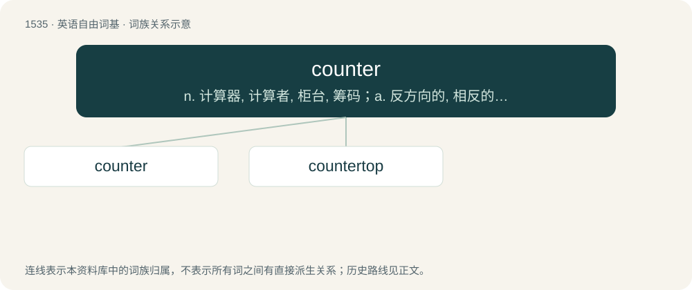

# 1624 · counter — n. 计算器, 计算者, 柜台, 筹码；a. 反方向的, 相反的；adv. 反方向地, 相反地

[总目录](../00_总目录_按常用程度.md)

**类型**：英语自由词基　｜　**来源语言**：见词源记录

## 核心含义与来源

- 核心含义：n. 计算器, 计算者, 柜台, 筹码；a. 反方向的, 相反的；adv. 反方向地, 相反地
- 英文含义：One who counts.
- 词形：counter

**多个词源／构词路径**：同一拼写可能有不同来源；以下按词性和含义分别列出。

**来源记录 1**（名词；One who counts.）

Inherited from Middle English countour, from Old French conteor (French comptoir), from Medieval Latin computātōrium, from Latin computō, equivalent to count + -er. Doublet of cantore, computer, and kontor.

**来源记录 2**（副词；Contrary, in opposition; in an opposite direction.）

From Old French contre, Anglo-Norman cuntre, both from Latin contra.

## 词族图

## 单词速览（常用到不常用）

| 单词 | 音标 | 释义 |
|---|---|---|
| [counter](#w-1) | 英 /ˈkaʊn.tə/；美 /ˈkaʊn.tɚ/ | n. 计算器, 计算者, 柜台, 筹码；a. 反方向的, 相反的；adv. 反方向地, 相反地 |
| [countertop](#w-2) | /ˈkajntətɔp/ | n. (厨房的)工作台面 |

## 逐词详解

### 1. counter

**词性**：名词　｜　**音标**：英 /ˈkaʊn.tə/；美 /ˈkaʊn.tɚ/

**中文释义**：n. 计算器, 计算者, 柜台, 筹码；a. 反方向的, 相反的；adv. 反方向地, 相反地

**英文义项**：One who counts. / A reckoner; someone who collects data by counting; an enumerator.

**构词拆分**：count + -er

**词源与演化**：

Inherited from Middle English countour, from Old French conteor (French comptoir), from Medieval Latin computātōrium, from Latin computō, equivalent to count + -er. Doublet of cantore, computer, and kontor.

**例句**：

> He's only 16 months, but is already a good counter – he can count to 100.

该用例对应义项：One who counts.

### 2. countertop

**词性**：名词　｜　**音标**：/ˈkajntətɔp/

**中文释义**：n. (厨房的)工作台面

**英文义项**：The top surface of a counter, for preparation of food, etc.

**构词拆分**：counter + top

**词源与演化**：

From counter + top.

**例句**：

> The sink was full, so I left the plate on the countertop.
