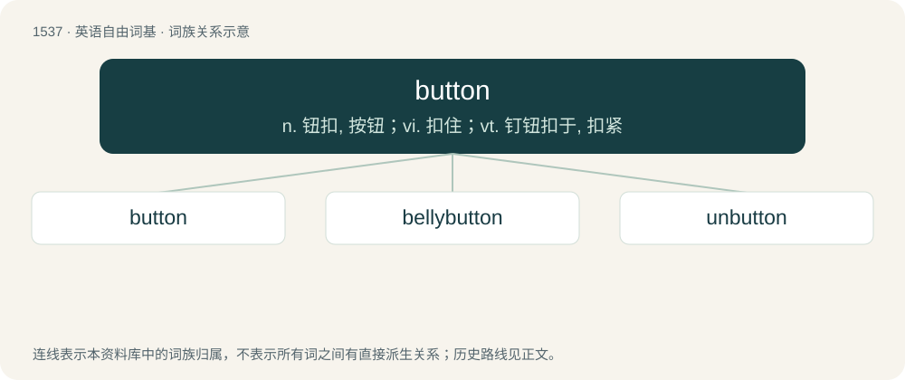

# 1625 · button — n. 钮扣, 按钮；vi. 扣住；vt. 钉钮扣于, 扣紧

[总目录](../00_总目录_按常用程度.md)

**类型**：英语自由词基　｜　**来源语言**：见词源记录

## 核心含义与来源

- 核心含义：n. 钮扣, 按钮；vi. 扣住；vt. 钉钮扣于, 扣紧
- 英文含义：A knob or disc that is passed through a loop or (buttonhole), serving as a fastener.
- 词形：button

**多个词源／构词路径**：同一拼写可能有不同来源；以下按词性和含义分别列出。

**来源记录 1**（名词；A knob or disc that is passed through a loop or (buttonhole), serving as a fastener.）

From Middle English boton, botoun, from Old French boton (Modern French bouton), from Old French bouter, boter (“to push; thrust”), ultimately from a Germanic language. Doublet of bouton, Biden, and beat. More at butt.

**来源记录 2**（动词；To fasten with a button.）

From Middle English butonen, botonen, from the noun (see above).

## 词族图

## 单词速览（常用到不常用）

| 单词 | 音标 | 释义 |
|---|---|---|
| [button](#w-1) | 英 /ˈbʌtən/；/ˈbʌʔən/ | n. 钮扣, 按钮；vi. 扣住；vt. 钉钮扣于, 扣紧 |
| [bellybutton](#w-2) | /ˈbelɪ,bʌtn/ | n. 肚脐 |
| [unbutton](#w-3) | /ʌnˈbʌtən/ | vt. 解开...的钮扣；vi. 解开钮扣 |

## 逐词详解

### 1. button

**词性**：名词　｜　**音标**：英 /ˈbʌtən/；/ˈbʌʔən/

**中文释义**：n. 钮扣, 按钮；vi. 扣住；vt. 钉钮扣于, 扣紧

**英文义项**：A knob or disc that is passed through a loop or (buttonhole), serving as a fastener. / A mechanical device designed to be pressed with a finger in order to open or close an electric circuit or to activate a mechanism.

**词源与演化**：

From Middle English boton, botoun, from Old French boton (Modern French bouton), from Old French bouter, boter (“to push; thrust”), ultimately from a Germanic language. Doublet of bouton, Biden, and beat. More at butt.

**例句**：

> The politician wore a bright yellow button with the slogan "Vote Smart" emblazoned on it.

该用例对应义项：A badge worn on clothes, fixed with a pin through the fabric.

### 2. bellybutton

**词性**：名词　｜　**音标**：/ˈbelɪ,bʌtn/

**中文释义**：n. 肚脐

**英文义项**：The navel or umbilicus.

**构词拆分**：belly + button

**词源与演化**：

From belly + button.

### 3. unbutton

**词性**：动词　｜　**音标**：/ʌnˈbʌtən/

**中文释义**：vt. 解开...的钮扣；vi. 解开钮扣

**英文义项**：To open (something) by undoing its buttons. / To come open by having its buttons unfastened.

**构词拆分**：un- + button

**词源与演化**：

From Middle English onbottonen, unbotonen; equivalent to un- + button.

**例句**：

> Do you want me to unbutton your shirt?
