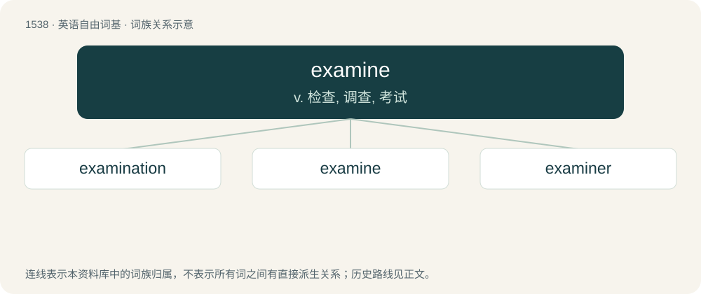

# 1626 · examine — v. 检查, 调查, 考试

[总目录](../00_总目录_按常用程度.md)

**类型**：英语自由词基　｜　**来源语言**：见词源记录

## 核心含义与来源

- 核心含义：v. 检查, 调查, 考试
- 英文含义：To observe carefully or critically to learn about someone or something.
- 词形：examine

**来源记录 1**（动词；To observe carefully or critically to learn about someone or something.）

From Middle English examinen, examenen, from Old French examiner, from Latin exāmināre.

## 词族图

## 单词速览（常用到不常用）

| 单词 | 音标 | 释义 |
|---|---|---|
| [examination](#w-1) | 英 /ɪɡˌzæm.ɪˈneɪ.ʃən/；美 /ɪɡˌzæm.əˈneɪ.ʃən/ | n. 考试, 测验, 审查；\[医\] 检查, 诊察 |
| [examine](#w-2) | /ɪɡˈzæmɪn/ | v. 检查, 调查, 考试 |
| [examiner](#w-3) | /əɡˈzæmɪnɚ/ | n. 检查人, 审查人, 主考者；\[化\] 检验人; 验收员 |

## 逐词详解

### 1. examination

**词性**：名词　｜　**音标**：英 /ɪɡˌzæm.ɪˈneɪ.ʃən/；美 /ɪɡˌzæm.əˈneɪ.ʃən/

**中文释义**：n. 考试, 测验, 审查；\[医\] 检查, 诊察

**英文义项**：The act of examining. / Particularly, an inspection by a medical professional to establish the extent and nature of any sickness or injury.

**构词拆分**：examine + -ation

**词源与演化**：

From Middle English examinacioun, from Old French examinacion, from Latin exāminātiō. Morphologically examine + -ation.

**例句**：

> Your success depends on whether you pass the STEP examination or not.

### 2. examine

**词性**：动词　｜　**音标**：/ɪɡˈzæmɪn/

**中文释义**：v. 检查, 调查, 考试

**英文义项**：To observe carefully or critically to learn about someone or something. / To check the health or condition of something or someone.

**词源与演化**：

From Middle English examinen, examenen, from Old French examiner, from Latin exāmināre.

**例句**：

> How long does it take for a veterinarian to examine a horse?

### 3. examiner

**词性**：名词　｜　**音标**：/əɡˈzæmɪnɚ/

**中文释义**：n. 检查人, 审查人, 主考者；\[化\] 检验人; 验收员

**英文义项**：A person who investigates someone or something. / A person who sets an examination.

**构词拆分**：examine + -er

**词源与演化**：

From examine + -er.

**例句**：

> The examiner searched for clues.

该用例对应义项：an investigator who observes carefully
