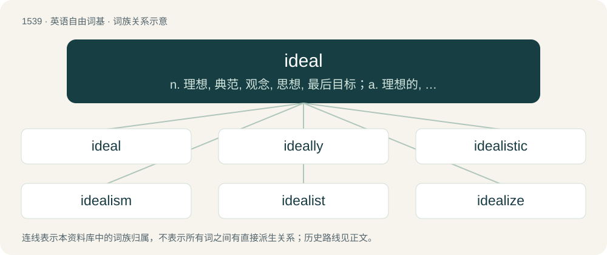

# 1627 · ideal — n. 理想, 典范, 观念, 思想, 最后目标；a. 理想的, 完美的, 空想的, 观念的, 唯心论的

[总目录](../00_总目录_按常用程度.md)

**类型**：英语自由词基　｜　**来源语言**：见词源记录

## 核心含义与来源

- 核心含义：n. 理想, 典范, 观念, 思想, 最后目标；a. 理想的, 完美的, 空想的, 观念的, 唯心论的
- 英文含义：Pertaining to ideas, or to a given idea.
- 词形：ideal

**来源记录 1**（形容词；Pertaining to ideas, or to a given idea.）

From French idéal, from Late Latin ideālis (“existing in idea”), by surface analysis, idea + -al, from Latin idea (“idea”); see idea. In mathematics, the noun ring theory sense was first introduced by German mathematician Richard Dedekind in his 1871 edition of a text on number theory. The concept was quickly expanded to ring theory and later generalised to order theory. The set theory and Lie theory senses can be regarded as applications of the order theory sense.

## 词族图

## 单词速览（常用到不常用）

| 单词 | 音标 | 释义 |
|---|---|---|
| [ideal](#w-1) | 英 /aɪˈdɪəl/；美 /aɪˈdi(ə)l/ | n. 理想, 典范, 观念, 思想, 最后目标；a. 理想的, 完美的, 空想的, 观念的, 唯心论的 |
| [ideally](#w-2) | 英 /aɪˈdɪə.li/；美 /aɪˈdi.ə.li/ | adv. 完美地, 理想地 |
| [idealistic](#w-3) | /ˌaɪ.di.əˈlɪ.stɪk/ | a. 理想主义的, 唯心论的, 唯心主义的, 唯心主义者的 |
| [idealism](#w-4) | /ʌɪˈdɪəlɪz(ə)m/ | n. 唯心主义, 观念论, 唯心论, 理想主义 |
| [idealist](#w-5) | /aiˈdiəlist/ | n. 理想主义者, 唯心主义者；a. 唯心论的, 理想主义的 |
| [idealize](#w-6) | 英 /aɪˈdɪəlaɪz/；美 /aɪˈdiəˌlaɪz/ | vt. 使理想化；vi. 理想化, 形成思想, 描述理想 |

## 逐词详解

### 1. ideal

**词性**：形容词　｜　**音标**：英 /aɪˈdɪəl/；美 /aɪˈdi(ə)l/

**中文释义**：n. 理想, 典范, 观念, 思想, 最后目标；a. 理想的, 完美的, 空想的, 观念的, 唯心论的

**英文义项**：Pertaining to ideas, or to a given idea. / Existing only in the mind; conceptual, imaginary.

**词源与演化**：

From French idéal, from Late Latin ideālis (“existing in idea”), by surface analysis, idea + -al, from Latin idea (“idea”); see idea. In mathematics, the noun ring theory sense was first introduced by German mathematician Richard Dedekind in his 1871 edition of a text on number theory. The concept was quickly expanded to ring theory and later generalised to order theory. The set theory and Lie theory senses can be regarded as applications of the order theory sense.

**例句**：

> An ideal triangle in the hyperbolic disk is one bounded by three geodesics that meet precisely on the circle.

该用例对应义项：Not actually present, but considered as present when limits at infinity are included.

### 2. ideally

**词性**：副词　｜　**音标**：英 /aɪˈdɪə.li/；美 /aɪˈdi.ə.li/

**中文释义**：adv. 完美地, 理想地

**英文义项**：In an ideal way; perfectly. / Given ideal circumstances; preferably.

**构词拆分**：ideal + -ly

**词源与演化**：

From ideal + -ly.

**例句**：

> Ideally, we would have one textbook per student, but unfortunately some of you will have to share.

该用例对应义项：Given ideal circumstances; preferably.

### 3. idealistic

**词性**：形容词　｜　**音标**：/ˌaɪ.di.əˈlɪ.stɪk/

**中文释义**：a. 理想主义的, 唯心论的, 唯心主义的, 唯心主义者的

**英文义项**：Of or pertaining to an idealist or to idealism.

**构词拆分**：idealist + -ic；ideal + -istic

**词源与演化**：

From idealist + -ic or ideal + -istic.

**例句**：

> Outsiders tend to scoff at Esperanto as an idealistic waste of time.

### 4. idealism

**词性**：名词　｜　**音标**：/ʌɪˈdɪəlɪz(ə)m/

**中文释义**：n. 唯心主义, 观念论, 唯心论, 理想主义

**英文义项**：The property of a person of having high ideals that are usually unrealizable or at odds with practical life. / The practice or habit of giving or attributing ideal form or character to things; treatment of things in art or literature according to ideal standards or patterns;—opposed to realism.

**构词拆分**：ideal + -ism

**词源与演化**：

First attested 1796, from ideal + -ism.

**例句**：

> His wide-eyed idealism is really starting to get on my nerves.

### 5. idealist

**词性**：名词　｜　**音标**：/aiˈdiəlist/

**中文释义**：n. 理想主义者, 唯心主义者；a. 唯心论的, 理想主义的

**英文义项**：One who adheres to idealism. / Someone whose conduct stems from idealism rather than from practicality.

**构词拆分**：ideal + -ist

**词源与演化**：

From French idéaliste, from Late Latin idealis (“ideal”), from Latin idea (“idea”), equivalent to ideal + -ist.

**例句**：

> Hooray! We have another dreamy, starry-eyed idealist to disenfranchise and oppress!

### 6. idealize

**词性**：动词　｜　**音标**：英 /aɪˈdɪəlaɪz/；美 /aɪˈdiəˌlaɪz/

**中文释义**：vt. 使理想化；vi. 理想化, 形成思想, 描述理想

**英文义项**：To regard something as ideal. / To conceive or form an ideal.

**构词拆分**：ideal + -ize

**词源与演化**：

From ideal + -ize. Compare French idéaliser.

**例句**：

> A sociopath would idealize you one minute and demonize you the next minute.
