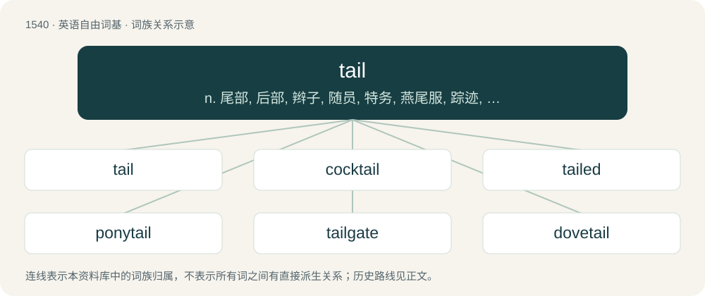

# 1629 · tail — n. 尾部, 后部, 辫子, 随员, 特务, 燕尾服, 踪迹, 限定继承(权)；a. 在后面的, 从后面而来的, 限定继承的, 尾部的, 后部的；vt. 为...装尾, 附于其后, 尾随, 使搭牢, 跟踪, 监视

[总目录](../00_总目录_按常用程度.md)

**类型**：英语自由词基　｜　**来源语言**：见词源记录

## 核心含义与来源

- 核心含义：n. 尾部, 后部, 辫子, 随员, 特务, 燕尾服, 踪迹, 限定继承(权)；a. 在后面的, 从后面而来的, 限定继承的, 尾部的, 后部的；vt. 为...装尾, 附于其后, 尾随, 使搭牢, 跟踪, 监视
- 英文含义：The caudal appendage of an animal that is attached to their posterior and near the anus or cloaca.
- 词形：tail

**多个词源／构词路径**：同一拼写可能有不同来源；以下按词性和含义分别列出。

**来源记录 1**（名词；The caudal appendage of an animal that is attached to their posterior and near the anus or cloaca.）

From Middle English tail, taile, taille, tayil, tayl, tayle, tayll, teil, tæȝel, from Old English tæġel, tæġl (“tail”), from Proto-West Germanic \*tagl, from Proto-Germanic \*taglą (“hair, fiber; hair of a tail”), from Proto-Indo-European \*doḱ- (“hair of the tail”), from Proto-Indo-European \*deḱ- (“to tear, fray, shred”). Cognates Cognate with German Zagel (“tail”), Danish, Faroese, and Icelandic tagl (“tail”), Swedish tagel (“horsehair”), Gothic 𐍄𐌰𐌲𐌻 (tagl, “hair”); also Serbo-Croatian дла̏ка, dlȁka (“single hair”), Slovene dlaka (“single hair”), Northern Kurdish dezî (“cotton, thread”), Sanskrit दशा (daśā, “border, fringe, hem”). In some senses, apparently by a generalization of the usual opposition between head and tail.

**来源记录 2**（形容词；Limited; abridged; reduced; curtailed.）

From Anglo-Norman, probably from a shortened form of entail.

## 词族图

## 单词速览（常用到不常用）

| 单词 | 音标 | 释义 |
|---|---|---|
| [tail](#w-1) | 英 /ˈteɪ̯l/；/ˈteːl/ | n. 尾部, 后部, 辫子, 随员, 特务, 燕尾服, 踪迹, 限定继承(权)；a. 在后面的, 从后面而来的, 限定继承的, 尾部的, 后部的；vt. 为...装尾, 附于其后, 尾随, 使搭牢, 跟踪, 监视 |
| [cocktail](#w-2) | 英 /ˈkɒk.teɪl/；美 /ˈkɑk.teɪl/ | n. 鸡尾酒, 开味品；a. 鸡尾酒会的 |
| [tailed](#w-3) | /teɪld/ | a. 有...尾的, 去掉尾的, 有...状尾的；\[计\] 尾部, 尾标, 结束符 |
| [ponytail](#w-4) | 美 /ˈpoʊniˌteɪl/ | n. 马尾辫 |
| [tailgate](#w-5) | 英 /ˈteɪlˌɡeɪt/ | n. 后挡板 |
| [dovetail](#w-6) | 英 /ˈdʌvteɪl/；美 /ˈdʌvˌteɪl/ | n. 楔形榫头；vt. 与...吻合, 用鸠尾榫接合；vi. 吻合 |
| [tailspin](#w-7) | /ˈteilspin/ | n. 旋尾降落 |
| [tailback](#w-8) | 美 /ˈteɪlˌbæk/ | n. &lt;英&gt;交通堵塞 |
| [tailwind](#w-9) | /ˈteɪlwɪnd/ | n. （从后面吹来的）顺风 |
| [tailpipe](#w-10) | /ˈteɪlpaɪp/ | n. \[汽\]排气管 |
| [taillight](#w-11) | /ˈteillait/ | n. 尾灯 |
| [fishtail](#w-12) | /ˈfɪʃteɪl/ | a. 鱼尾状的；vi. 摆尾飞行 |
| [yellowtail](#w-13) | /jeləʊˈteɪl/ | n. 黄鳍短须石首鱼 |
| [pigtail](#w-14) | 英 /ˈpɪɡ.teɪl/ | n. 猪尾, 发辫, 辫形导线；\[化\] 盘管 |
| [cottontail](#w-15) | 英 /ˈkɒt.n̩teɪl/；美 /ˈkɑt.n̩teɪl/ | n. 美洲产白尾棕色免 |
| [oxtail](#w-16) | /ˈɒksteil/ | n. (食用的)牛尾 |
| [whitetail](#w-17) | /ˈwaitteil/ | n. 白尾鹿 |
| [tailbone](#w-18) | 英 /ˈteɪlˌbəʊn/；美 /ˈteɪlˌboʊn/ | 尾骨 |
| [swallowtail](#w-19) | 英 /ˈswɒl.əʊˌteɪl/ | n. 燕尾, 燕尾服, 燕尾叉形旗子的末端 |
| [wagtail](#w-20) | /ˈwægteil/ | n. 鹩凫 |

## 逐词详解

### 1. tail

**词性**：名词　｜　**音标**：英 /ˈteɪ̯l/；/ˈteːl/

**中文释义**：n. 尾部, 后部, 辫子, 随员, 特务, 燕尾服, 踪迹, 限定继承(权)；a. 在后面的, 从后面而来的, 限定继承的, 尾部的, 后部的；vt. 为...装尾, 附于其后, 尾随, 使搭牢, 跟踪, 监视

**英文义项**：The caudal appendage of an animal that is attached to their posterior and near the anus or cloaca. / An object or part of an object resembling a tail in shape, such as the thongs on a cat-o'-nine-tails; a strand of material hanging from something.

**词源与演化**：

From Middle English tail, taile, taille, tayil, tayl, tayle, tayll, teil, tæȝel, from Old English tæġel, tæġl (“tail”), from Proto-West Germanic \*tagl, from Proto-Germanic \*taglą (“hair, fiber; hair of a tail”), from Proto-Indo-European \*doḱ- (“hair of the tail”), from Proto-Indo-European \*deḱ- (“to tear, fray, shred”). Cognates Cognate with German Zagel (“tail”), Danish, Faroese, and Icelandic tagl (“tail”), Swedish tagel (“horsehair”), Gothic 𐍄𐌰𐌲𐌻 (tagl, “hair”); also Serbo-Croatian дла̏ка, dlȁka (“single hair”), Slovene dlaka (“single hair”), Northern Kurdish dezî (“cotton, thread”), Sanskrit दशा (daśā, “border, fringe, hem”). In some senses, apparently by a generalization of the usual opposition between head and tail.

**例句**：

> A sequence (a#95;n) is said to be frequently 0 if every tail of the sequence contains 0.

该用例对应义项：All the last terms of a sequence, from some term on.

### 2. cocktail

**词性**：名词　｜　**音标**：英 /ˈkɒk.teɪl/；美 /ˈkɑk.teɪl/

**中文释义**：n. 鸡尾酒, 开味品；a. 鸡尾酒会的

**英文义项**：A mixed alcoholic beverage. / A mixture of other substances or things.

**构词拆分**：cock + tail

**词源与演化**：

Early 17th century, from cock (“male bird”) + tail, in the sense “(a horse with its) tail standing up, like a cock’s”. The origin of the extension to “an alcoholic mixed drink” is unknown. One theory is that it refers to a stimulant (gingering), hence a stimulating drink; compare pick-me-up. Another attested use is for non-thoroughbred racehorses: these were considered "cock-tailed" due to their docked tails. This may have led to the term "cocktail" (sense 1) being used for an adulterated spirit.

**例句**：

> Scientists found a cocktail of pollutants in the river downstream from the chemical factory.

该用例对应义项：A mixture of other substances or things.

### 3. tailed

**词性**：形容词　｜　**音标**：/teɪld/

**中文释义**：a. 有...尾的, 去掉尾的, 有...状尾的；\[计\] 尾部, 尾标, 结束符

**英文义项**：Having a tail. / Of certain butterflies, having one or more filamentous projections on the tornal section of each hind wing.

**构词拆分**：tail + -ed

**词源与演化**：

From Middle English tayled; equivalent to tail + -ed.

**例句**：

> A one-tailed hypothesis will make predictions in one particular direction.

该用例对应义项：Having a tail.

### 4. ponytail

**词性**：名词　｜　**音标**：美 /ˈpoʊniˌteɪl/

**中文释义**：n. 马尾辫

**英文义项**：A hairstyle where the hair is pulled back and tied into a single "tail" which hangs down behind the head.

**构词拆分**：pony + tail

**词源与演化**：

From pony + tail.

**例句**：

> I used a ribbon to tie my hair into a ponytail.

### 5. tailgate

**词性**：名词　｜　**音标**：英 /ˈteɪlˌɡeɪt/

**中文释义**：n. 后挡板

**英文义项**：A hinged board or hatch at the rear of a vehicle that can be lowered for loading and unloading. / The hinged rear door of a hatchback.

**构词拆分**：tail + gate

**词源与演化**：

From tail + gate. Compare liftgate.

**例句**：

> The locktender closed the tailgate and the chamber started to fill.

该用例对应义项：The downstream gate in the lock on a canal or river, or in an irrigation system.

### 6. dovetail

**词性**：动词　｜　**音标**：英 /ˈdʌvteɪl/；美 /ˈdʌvˌteɪl/

**中文释义**：n. 楔形榫头；vt. 与...吻合, 用鸠尾榫接合；vi. 吻合

**英文义项**：To unite (components) with a dovetail (noun sense 2.1) or similar joint. / To combine or fit (things) together well.

**构词拆分**：dove + tail

**词源与演化**：

The noun is derived from dove + tail. The verb is derived from the noun.

**例句**：

> The executive board dovetailed its decision neatly with the prior projects the company had taken up.

该用例对应义项：To combine or fit (things) together well.

### 7. tailspin

**词性**：名词　｜　**音标**：/ˈteilspin/

**中文释义**：n. 旋尾降落

**英文义项**：The rapid, uncontrollable descent of an aircraft in a steep spiral. / A severe mental or emotional collapse; emotional breakdown.

**构词拆分**：tail + spin

**词源与演化**：

From tail + spin.

**例句**：

> Just hours after leaving the institution, she suffered another tailspin.

该用例对应义项：A severe mental or emotional collapse; emotional breakdown.

### 8. tailback

**词性**：名词　｜　**音标**：美 /ˈteɪlˌbæk/

**中文释义**：n. &lt;英&gt;交通堵塞

**英文义项**：A line of motor vehicles causing or the result of traffic congestion or a traffic jam. / A running back or halfback who lines up furthest to the rear in an I formation.

**构词拆分**：tail + back

**词源与演化**：

From tail + back.

**例句**：

> Tom seems to have been late because of a tailback on the A19.

### 9. tailwind

**词性**：名词　｜　**音标**：/ˈteɪlwɪnd/

**中文释义**：n. （从后面吹来的）顺风

**英文义项**：A wind that blows in the same direction as the course taken by an aircraft, sailing ship, bird, etc.; a following wind. / A force that accelerates progress.

**构词拆分**：tail + wind

**词源与演化**：

From tail + wind.

**例句**：

> One of his election promises was more tailwind on bicycle paths.

### 10. tailpipe

**词性**：名词　｜　**音标**：/ˈteɪlpaɪp/

**中文释义**：n. \[汽\]排气管

**英文义项**：An exhaust pipe exhausting to the aft of the vehicle. / An exhaust pipe (on a vehicle) (in any configuration).

**构词拆分**：tail + pipe

**词源与演化**：

From tail + pipe.

**例句**：

> This car doesn't have a tailpipe because it has sidepipes instead.

该用例对应义项：An exhaust pipe exhausting to the aft of the vehicle.

### 11. taillight

**词性**：名词　｜　**音标**：/ˈteillait/

**中文释义**：n. 尾灯

**英文义项**：One of a pair of red lights mounted on the rear of a vehicle, so it can be seen from the rear at night.

**构词拆分**：tail + light

**词源与演化**：

From tail + light.

**例句**：

> Your car has a broken taillight.

### 12. fishtail

**词性**：动词　｜　**音标**：/ˈfɪʃteɪl/

**中文释义**：a. 鱼尾状的；vi. 摆尾飞行

**英文义项**：To swing the back of a vehicle (originally an aircraft) from side to side. / To cause the back of (a vehicle) to swing from side to side.

**构词拆分**：fish + tail

**词源与演化**：

From Middle English fisch tayle, equivalent to fish + tail.

**例句**：

> As we approached the runway, the pilot fishtailed slightly to reduce landing speed.

该用例对应义项：To swing the back of a vehicle (originally an aircraft) from side to side.

### 13. yellowtail

**词性**：形容词　｜　**音标**：/jeləʊˈteɪl/

**中文释义**：n. 黄鳍短须石首鱼

**英文义项**：Having a yellow tail.

**构词拆分**：yellow + tail

**词源与演化**：

Bahuvrihi compound of yellow + tail

### 14. pigtail

**词性**：名词　｜　**音标**：英 /ˈpɪɡ.teɪl/

**中文释义**：n. 猪尾, 发辫, 辫形导线；\[化\] 盘管

**英文义项**：The tail of a pig. / Tobacco twisted into a string or roll.

**构词拆分**：pig + tail

**词源与演化**：

From pig + tail.

**例句**：

> The junction box allows you to store the camera's pigtail inside of it.

### 15. cottontail

**词性**：名词　｜　**音标**：英 /ˈkɒt.n̩teɪl/；美 /ˈkɑt.n̩teɪl/

**中文释义**：n. 美洲产白尾棕色免

**英文义项**：A rabbit of any of various species in genus Sylvilagus. / A person with a tanned body and untanned buttocks, resembling a cottontail rabbit's dark fur and light tail.

**构词拆分**：cotton + tail

**词源与演化**：

From cotton + tail.

### 16. oxtail

**词性**：名词　｜　**音标**：/ˈɒksteil/

**中文释义**：n. (食用的)牛尾

**英文义项**：The tail of an ox or cow. / A cut of meat taken from the tail of a cow or calf; it requires long, slow braising, and is used to prepare oxtail soup.

**构词拆分**：ox + tail

**词源与演化**：

From Middle English ox tayll, from Old English oxan tæġl (literally “ox's tail”), equivalent to ox + tail.

### 17. whitetail

**词性**：名词　｜　**音标**：/ˈwaitteil/

**中文释义**：n. 白尾鹿

**英文义项**：A deer, Odocoileus virginianus, family Cervidae, perhaps the most popular game animal in North America. / Any of the white-tailed spiders of genus Lampona (Lampona cylindrata and Lampona murina) native to eastern and southern Australia.

**构词拆分**：white + tail

**词源与演化**：

From white + tail.

### 18. tailbone

**词性**：名词　｜　**音标**：英 /ˈteɪlˌbəʊn/；美 /ˈteɪlˌboʊn/

**中文释义**：尾骨

**英文义项**：The final fused vertebrae at the base of the spine; the coccyx.

**构词拆分**：tail + bone

**词源与演化**：

From tail + bone.

**例句**：

> He broke his tailbone when he fell down the stairs.

### 19. swallowtail

**词性**：名词　｜　**音标**：英 /ˈswɒl.əʊˌteɪl/

**中文释义**：n. 燕尾, 燕尾服, 燕尾叉形旗子的末端

**英文义项**：The forked tail of a swallow. / Anything, such as a burgee, of a similar forked shape.

**构词拆分**：swallow + tail

**词源与演化**：

From swallow + tail.

**例句**：

> Kotaro found a large swallowtail butterfly and chased him about 20 meters inside the grass field.

### 20. wagtail

**词性**：名词　｜　**音标**：/ˈwægteil/

**中文释义**：n. 鹩凫

**英文义项**：Any of various small passerine birds, principally of genus Motacilla, of the Old World, notable for their long tails.

**构词拆分**：wag + tail

**词源与演化**：

From a partial suppletion of Middle English wagstert (literally “wag-tail”), equivalent to wag + tail.

**例句**：

> That bird is called a wagtail.
