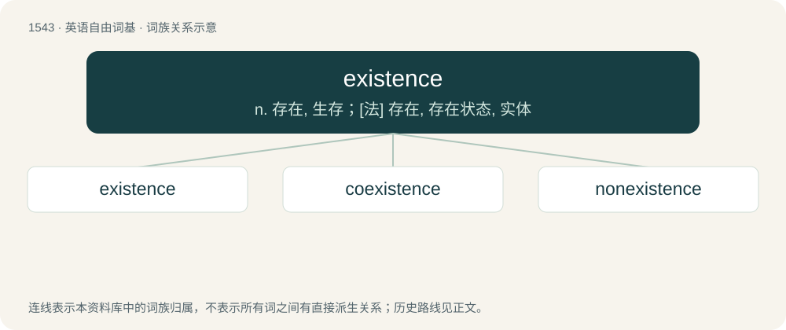

# 1630 · existence — n. 存在, 生存；\[法\] 存在, 存在状态, 实体

[总目录](../00_总目录_按常用程度.md)

**类型**：英语自由词基　｜　**来源语言**：见词源记录

## 核心含义与来源

- 核心含义：n. 存在, 生存；\[法\] 存在, 存在状态, 实体
- 英文含义：The state of being, existing, or occurring; beinghood.
- 词形：existence

**来源记录 1**（名词；The state of being, existing, or occurring; beinghood.）

From Middle English existence, from Old French existence, from Late Latin existentia (“existence”), from existēns, from existō, exsistō (“I am, I exist”), from ex (“out”) + sistere (“to set, place”) (related to stare (“to stand, to be stood”)), ultimately from Proto-Indo-European \*stísteh₂ti, from the root \*steh₂- (“stand”). Cognate with Spanish existencia, French existence, German Existenz. Displaced native Old English understandennes (literally, "understanden-ness"). Morphologically exist + -ence.

## 词族图

## 单词速览（常用到不常用）

| 单词 | 音标 | 释义 |
|---|---|---|
| [existence](#w-1) | 美 /ɛɡˈzɪs.təns/ | n. 存在, 生存；\[法\] 存在, 存在状态, 实体 |
| [coexistence](#w-2) | /ˌkəʊ.ɪɡˈzɪs.təns/ | n. 共存, 和平共处, 并立 |
| [nonexistence](#w-3) | /.nɒnigˈzistəns/ | n. 不存在的事, 无, 不存在的东西 |

## 逐词详解

### 1. existence

**词性**：名词　｜　**音标**：美 /ɛɡˈzɪs.təns/

**中文释义**：n. 存在, 生存；\[法\] 存在, 存在状态, 实体

**英文义项**：The state of being, existing, or occurring; beinghood. / Empirical reality; the substance of the physical universe. (Dictionary of Philosophy; 1968)

**构词拆分**：exist + -ence

**词源与演化**：

From Middle English existence, from Old French existence, from Late Latin existentia (“existence”), from existēns, from existō, exsistō (“I am, I exist”), from ex (“out”) + sistere (“to set, place”) (related to stare (“to stand, to be stood”)), ultimately from Proto-Indo-European \*stísteh₂ti, from the root \*steh₂- (“stand”). Cognate with Spanish existencia, French existence, German Existenz. Displaced native Old English understandennes (literally, "understanden-ness"). Morphologically exist + -ence.

**例句**：

> In order to destroy evil, we must first acknowledge its existence.

该用例对应义项：The state of being, existing, or occurring; beinghood.

### 2. coexistence

**词性**：名词　｜　**音标**：/ˌkəʊ.ɪɡˈzɪs.təns/

**中文释义**：n. 共存, 和平共处, 并立

**英文义项**：The state of two or more things existing together, usually in a temporal or spatial sense, with or without mutual interaction.

**构词拆分**：co- + existence

**词源与演化**：

From co- + existence.

**例句**：

> We aren't born with the capacity to carry out a happy coexistence.

### 3. nonexistence

**词性**：名词　｜　**音标**：/.nɒnigˈzistəns/

**中文释义**：n. 不存在的事, 无, 不存在的东西

**英文义项**：The state of not existing.

**构词拆分**：From non- + existence.

**词源与演化**：

From non- + existence.

**例句**：

> The nonexistence of Father Christmas and the Tooth Fairy came as something of a shock.

该用例对应义项：The state of not existing.
