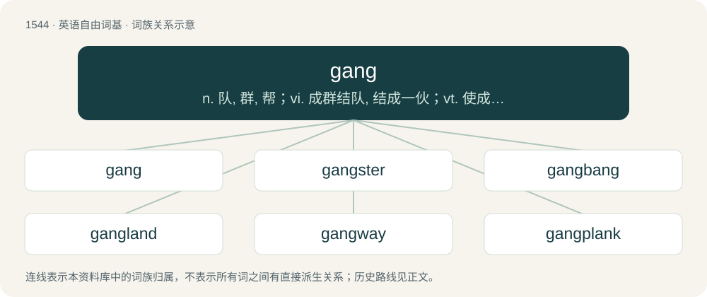

# 1631 · gang — n. 队, 群, 帮；vi. 成群结队, 结成一伙；vt. 使成群结队

[总目录](../00_总目录_按常用程度.md)

**类型**：英语自由词基　｜　**来源语言**：见词源记录

## 核心含义与来源

- 核心含义：n. 队, 群, 帮；vi. 成群结队, 结成一伙；vt. 使成群结队
- 英文含义：To go; walk; proceed.
- 词形：gang

**多个词源／构词路径**：同一拼写可能有不同来源；以下按词性和含义分别列出。

**来源记录 1**（动词；To go; walk; proceed.）

From Middle English gangen, from Old English gangan (“to go, walk, turn out”), from Proto-West Germanic \*gangan, from Proto-Germanic \*ganganą (“to go, walk”), from Proto-Indo-European \*ǵʰengʰ- (“to step, walk”). Cognate with Scots gang (“to go on foot, walk”), Swedish gånga (“to walk, go”), Faroese ganga (“to walk”), Icelandic ganga (“to walk, go”), Norwegian Nynorsk ganga (“to walk, go”), Vedic Sanskrit जंहस् (jáṃhas). Ultimately related to etymology 2, which see below.

**来源记录 2**（名词；A number going in company; a number of friends or persons associated for a particular purpose.）

From Middle English gang, from Old English gang (“a journey; way; passage”), from Proto-West Germanic \*gang, from Proto-Germanic \*gangaz, from Proto-Indo-European \*ǵʰongʰ-o-s, from \*ǵʰengʰ- (“to step; stride”). Cognate with Saterland Frisian Gong, Dutch gang, German Gang, Norwegian gang, Swedish gång, Icelandic gangur, Vedic Sanskrit जंहस् (jáṃhas).

**来源记录 3**（动词；Synonym of gangbang.）

Shortening of gangbang.

## 词族图

## 单词速览（常用到不常用）

| 单词 | 音标 | 释义 |
|---|---|---|
| [gang](#w-1) | 美 /ˈɡeɪ̯ŋ/；/ˈɡæŋ/ | n. 队, 群, 帮；vi. 成群结队, 结成一伙；vt. 使成群结队 |
| [gangster](#w-2) | 英 /ˈɡæŋ.stəː/；/ˈɡæŋ.stɚ/ | n. 流氓, 歹徒；\[法\] 暴徒, 恶棍, 打手 |
| [gangbang](#w-3) | 美 /ˈɡeɪ̯ŋˌbeɪ̯ŋ/；/ˈɡæŋˌbæŋ/ | n. \[美俚\]一群男子（流氓团伙）与一女子的淫乱活动；轮奸 |
| [gangland](#w-4) | /ˈ^æŋlænd/ | n. 黑社会, 强盗世界；\[法\] 黑社会, 强盗世界 |
| [gangway](#w-5) | 英 /ˈɡæŋweɪ/ | n. 通道, 通路, 跳板；interj. 让路 |
| [gangplank](#w-6) | /ˈɡæŋˌplæŋk/ | n. 跳板, 踏板 |

## 逐词详解

### 1. gang

**词性**：动词　｜　**音标**：美 /ˈɡeɪ̯ŋ/；/ˈɡæŋ/

**中文释义**：n. 队, 群, 帮；vi. 成群结队, 结成一伙；vt. 使成群结队

**英文义项**：To go; walk; proceed.

**词源与演化**：

From Middle English gangen, from Old English gangan (“to go, walk, turn out”), from Proto-West Germanic \*gangan, from Proto-Germanic \*ganganą (“to go, walk”), from Proto-Indo-European \*ǵʰengʰ- (“to step, walk”). Cognate with Scots gang (“to go on foot, walk”), Swedish gånga (“to walk, go”), Faroese ganga (“to walk”), Icelandic ganga (“to walk, go”), Norwegian Nynorsk ganga (“to walk, go”), Vedic Sanskrit जंहस् (jáṃhas). Ultimately related to etymology 2, which see below.

**例句**：

> After his brother was killed by a rival gang, Tom planned revenge.

### 2. gangster

**词性**：形容词　｜　**音标**：英 /ˈɡæŋ.stəː/；/ˈɡæŋ.stɚ/

**中文释义**：n. 流氓, 歹徒；\[法\] 暴徒, 恶棍, 打手

**英文义项**：Characteristic of a gangster; (especially) admirable and audacious. / On friendly terms; cool.

**构词拆分**：gang + -ster

**词源与演化**：

From gang + -ster. First attested in 1884.

**例句**：

> We put an end to our beef. We're all gangster now.

该用例对应义项：On friendly terms; cool.

### 3. gangbang

**词性**：动词　｜　**音标**：美 /ˈɡeɪ̯ŋˌbeɪ̯ŋ/；/ˈɡæŋˌbæŋ/

**中文释义**：n. \[美俚\]一群男子（流氓团伙）与一女子的淫乱活动；轮奸

**英文义项**：To participate in a gangbang. / To belong to a gang; to commit criminal acts as part of a gang.

**构词拆分**：gang + bang

**词源与演化**：

From gang + bang.

**例句**：

> It broke my heart to see him out there gangbanging.

该用例对应义项：To belong to a gang; to commit criminal acts as part of a gang.

### 4. gangland

**词性**：名词　｜　**音标**：/ˈ^æŋlænd/

**中文释义**：n. 黑社会, 强盗世界；\[法\] 黑社会, 强盗世界

**英文义项**：The underworld of organized crime.

**构词拆分**：gang + land

**词源与演化**：

From gang + land.

### 5. gangway

**词性**：名词　｜　**音标**：英 /ˈɡæŋweɪ/

**中文释义**：n. 通道, 通路, 跳板；interj. 让路

**英文义项**：An aisle between rows of seating (especially in a train, aircraft or auditorium). / The dividing aisle between the rows of seats on either side of the House of Commons. Used chiefly with reference to terms such as below the gangway.

**构词拆分**：gang + way

**词源与演化**：

From Middle English gangway, from Old English gangweġ (“passageway; thoroughfare”), equivalent to gang + way. Related to Dutch gang (“hallway”) and Norwegian gang (“hallway”).

**例句**：

> The new fleet of trains comes with widened gangways and improved seating.

该用例对应义项：An aisle between rows of seating (especially in a train, aircraft or auditorium).

### 6. gangplank

**词性**：名词　｜　**音标**：/ˈɡæŋˌplæŋk/

**中文释义**：n. 跳板, 踏板

**英文义项**：A board used as a temporary footbridge between a ship and a dockside.

**构词拆分**：gang (“way, path, course of travel”) + plank (“board”)

**词源与演化**：

From gang (“way, path, course of travel”) + plank (“board”).
